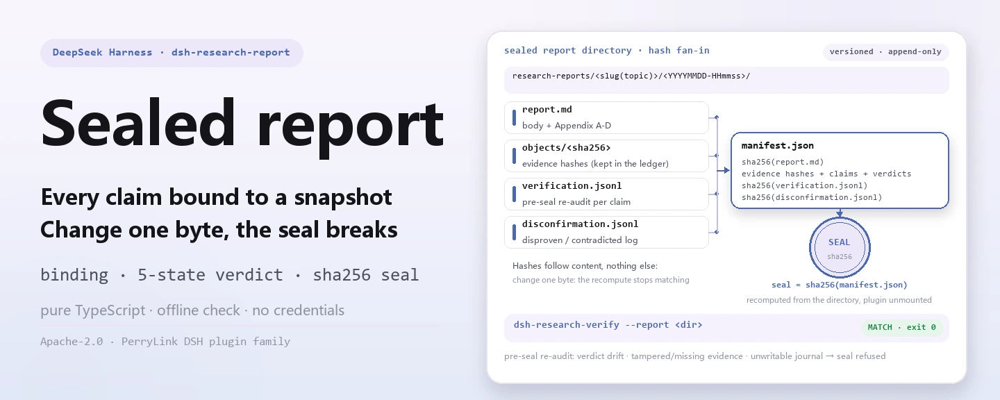
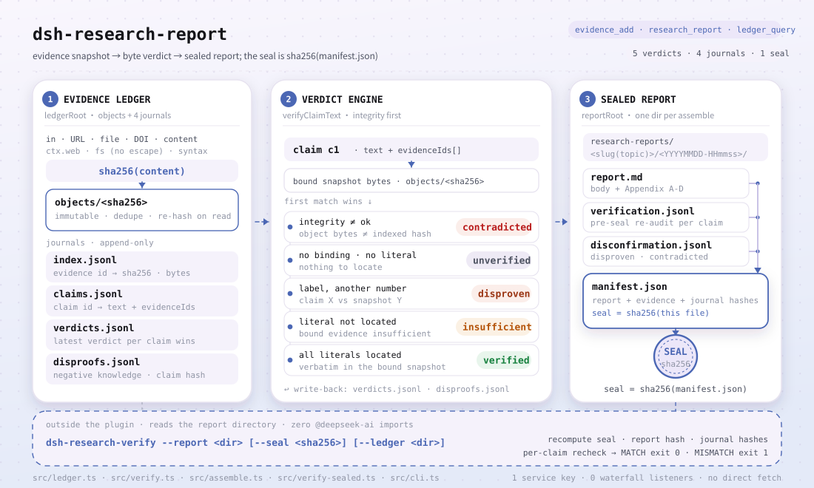

<div align="center">

<picture>
  <source media="(prefers-color-scheme: dark)" srcset="docs/assets/dsh-research-report-hero-en-dark.webp">
  
</picture>

# dsh-research-report

**Ship a report whose every claim anyone can re-check offline on their own machine — change one byte and the seal hash stops matching.**

A verifiable research-report engine for DeepSeek Harness: claims bind to immutable evidence snapshots, numbers and quotes are checked byte-for-byte, and the result is sealed into a versioned report directory whose seal is the SHA-256 of `manifest.json`.

[Install](#three-step-setup) · [Configuration](#configuration) · [FAQ](#faq) · [简体中文](README.md) · [English](README.en.md) · [Español](README.es.md) · [Português](README.pt.md) · [हिन्दी](README.hi.md)

[](LICENSE)
[](#compatibility)
[](https://www.npmjs.com/package/dsh-research-report)
[](https://github.com/PerryLink/dsh-research-report/actions/workflows/ci.yml)
[](#compatibility)

[](https://github.com/PerryLink/dsh-research-report/stargazers)
[](https://www.npmjs.com/package/dsh-research-report)
[](https://dshfind.com/plugins/PerryLink/dsh-research-report?ref=badge)
[](https://securityscorecards.dev/viewer/?uri=github.com/PerryLink/dsh-research-report)
[](https://dsh.market/)
[](https://gitee.com/perrylink/dsh-research-report)

```sh
dsh plugin --profile <name> add dsh-research-report
```

</div>

<sub>Community plugin, not affiliated with DeepSeek. Canonical repository: <https://github.com/PerryLink/dsh-research-report> (Gitee is a mirror).</sub>

## What it is

Give the model a topic and a set of sources, and `dsh-research-report` binds every claim to immutable evidence snapshots, checks the numbers and quotes byte-for-byte, then seals the result into a versioned report directory anyone can re-check independently. The directory holds `report.md`, `manifest.json`, and the audit journals; the seal is the SHA-256 of `manifest.json`, and `dsh-research-verify` recomputes it offline without mounting the plugin. It deliberately ships no deep-research loop: retrieval runs over `ctx.web`, long runs over `ctx.jobs`, and planning and synthesis stay with the model or an upstream plugin.

<picture>
  <source media="(prefers-color-scheme: dark)" srcset="docs/assets/dsh-research-report-flow-v5-dark.svg">
  
</picture>

## Three-step setup

1. **Install** (pick one channel):

   ```sh
   # npm channel (published releases)
   dsh plugin --profile web add dsh-research-report
   # git channel (latest main; equivalent to git+https://github.com/PerryLink/dsh-research-report.git)
   dsh plugin --profile web add github:PerryLink/dsh-research-report
   # tarball channel: pnpm pack in this repo, then
   dsh plugin --profile web add ./dsh-research-report-<version>.tgz
   ```

   Both online channels install the bundle row (see [`cordis.patch.yml`](cordis.patch.yml)) into the profile's `dsh.profile.bundles` stack; **restart to take effect**.

2. **Minimal config** (defaults are usable; relative roots resolve against the harness working directory):

   ```yaml
   - insert:
       - id: dsh-research-report
         name: dsh-research-report
         config:
           ledgerRoot: .research-ledger
           reportRoot: research-reports
   ```

3. **Verify it mounts**:

   ```sh
   dsh --profile web --dump-config | grep dsh-research-report
   ```

   Then run the minimal loop in a session and re-check the seal with the CLI:

   ```text
   evidence_add({ origin: "docs/market.md", title: "Market snapshot" })   # → ev-1a2b3c4d5e6f
   research_report({ topic: "...", sections: [...], claims: [...], evidenceRefs: ["ev-1a2b…"] })
   ledger_query({ claimId: "c1" })                                        # bindings + verdict
   ```

   ```sh
   dsh-research-verify --report research-reports/<topic>/<YYYYMMDD-HHmmss>
   ```

**Uninstall**: `dsh plugin --profile web remove dsh-research-report` (or remove the row from the profile patch).

<details>
<summary>Install from the DSH Desktop market</summary>

Every PerryLink plugin is listed in the built-in DSH Desktop market: **Market → Sources → Add source → paste** `https://perrylink-dsh-catalog.perrylink.workers.dev/catalog-source.json` **→ select**. Installation still requires the market's npm identity check and your confirmation.

</details>

## Core capabilities

Three things carry the trust: evidence is immutable, checks are recomputable, and gaps are never hidden.

- **Evidence ledger** — a content-addressed snapshot store (`<ledgerRoot>/objects/<sha256>` + JSONL journals). The same content is stored exactly once; snapshots are immutable; every read recomputes the hash, so tampering or deletion is detected instead of trusted.
- **Claim ↔ evidence binding** — claims register with the evidence ids they rely on; the ledger keeps the binding and every verification verdict (latest wins).
- **Byte-level verification** — every number and quoted span in a claim must be locatable verbatim in the bound snapshots. No bound evidence, or no checkable literal, marks the claim `unverified`; bound evidence that cannot confirm or deny the claimed literals marks it `insufficient`; a label whose snapshot value differs (the claimed value absent) marks it `disproven`; tampered/missing snapshots mark it `contradicted`. No semantics, no embeddings — auditable byte checks.
- **Optional numeric bridge** — when a claim cites a structured workspace dataset (CSV/JSON) and `dsh-data-quality` is mounted, citations are cross-checked with tolerances through its frozen `verifyCitations` contract; a dataset mismatch disproves the claim.
- **DOI evidence (zero network)** — DOI origins are validated deterministically (`10.xxxx/xxxx` structure, a prefix whitelist, and a DOI character set); invalid DOIs fail loud. Optional journal/year metadata is accepted, and `requireJournalMetadata` gates academic DOI evidence only when enabled.
- **Versioned sealed reports** — `<reportRoot>/<slug(topic)>/<YYYYMMDD-HHmmss>/report.md` + `manifest.json` + `verification.jsonl` + `disconfirmation.jsonl`; the seal hash is the SHA-256 of the manifest, which itself carries the report hash, every evidence hash, and the hash of each audit journal.
- **Pre-delivery re-audit & seal interception** — before sealing, every bound claim is re-verified offline and journaled to `verification.jsonl`; verdict drift, tampered/missing bound evidence, or a journal serialization failure blocks the seal (fail loud, no tunable).
- **Falsification ledger** — every contradicted or disproven claim is recorded in `disconfirmation.jsonl` (claim + evidence references + reason) and listed in the report's falsification-log appendix.
- **Negative knowledge** — a disproven claim is remembered by its content hash (`disproofs.jsonl`); the same text re-reported against unchanged evidence is forced back to `disproven` and only re-verifies once the evidence changes.
- **Read-only verifier loop** — after sealing, a deterministic `verifySealedReport` fallback (zero network, zero model) recomputes the seal and audit hashes and re-checks every claim, writing the machine check to `verifier-note.md`; when `ctx.jobs` is mounted a read-only verifier job is also spawned (the model review is an enhancement, never a replacement).
- **Session-anchored evidence** — `evidence_add` accepts an optional `sessionRef` (`sessionId` + `eventRange`, validated loud); the anchor is stored, rendered in Appendix B, and registered in the manifest and `verification.jsonl`. Session-anchored evidence verifies honestly as `unverified` (`session-anchored evidence requires a manual check against the session log`).
- **Honest gaps** — unverified, insufficient, contradicted, and disproven claims keep a visible marker in the report body and are listed in Appendix A. Nothing is silently passed.
- **No deep-research loop** — retrieval orchestration is deliberately reused: `ctx.web` for search/fetch, `ctx.jobs` for long runs. Planning and synthesis stay with the model (or an upstream plugin).

### Tool surface

- **`evidence_add({ origin, content?, title? })`** — register one evidence snapshot. With `content` the text is stored verbatim; without it a URL origin is fetched through `ctx.web` and a workspace-relative path is read from disk (reads never escape the workspace). Returns the evidence id and SHA-256 hash.
- **`research_report({ topic, title?, sections, claims, evidenceRefs, gather?, depth?, background? })`** — assemble and seal a report: validate (unregistered claim references are rejected loudly), verify every claim, render `report.md` with visible markers, write `manifest.json`, and return the seal hash. `gather: true` runs ONE search round over `ctx.web` and returns captured candidate evidence plus an explicit gap list — it never auto-assembles. `background: true` returns `{ kind: 'background', jobId }` over `ctx.jobs`.
- **`ledger_query({ claimId? | evidenceId? })`** — read-only binding/verdict queries; evidence is re-hashed on read so a tampered or missing snapshot is reported explicitly. With no id, returns a ledger summary.
- **`ctx.researchReport.assemble(request)`** — the frozen service surface for sibling plugins (see `src/service.ts`; gated byte-for-byte by [`scripts/verify-frozen-contract.mjs`](scripts/verify-frozen-contract.mjs)).

### Examples

These are the plugin's real entry points; install once, then call one.

**Detailed example**

**Command**

~~~sh
research_report({
  topic: "示例行业概览",
  sections: [{ heading: "市场规模", paragraphs: [{ text: "2025 年全球示例行业市场规模为 1,280 亿元。", claimIds: ["c1"] }] }],
  claims: [{ id: "c1", text: "市场规模为 1,280 亿元", evidenceIds: ["ev-5dc0a84d0e48"] }],
  evidenceRefs: ["ev-5dc0a84d0e48", "ev-c6cf024e0916", "ev-61f8f4533cb7"]
})
~~~

**Output**

~~~text
report sealed: /tmp/rr-test-4U2mlF/reports/示例行业概览/20261019-124904
seal (sha256 of manifest.json): 5c85c97597096ced281ca191d7abaaf7434f18b397d35ac81c31aa364a3b12f9
claims: 1 verified / 0 unverified / 0 contradicted / 0 insufficient / 0 disproven (of 1); evidence bound: 3
~~~

*Observed from `README.md:112-118,150; test/index.spec.ts:166-177; src/tools/research-report.ts:170-175`*

**Failure branch**

**Input**

~~~text
{"topic":"probe","sections":[{"heading":"Growth","paragraphs":[{"text":"Growth was 42%.","claimIds":["c1"]}]}],"claims":[{"id":"c1","text":"Growth was 42%.","evidenceIds":[]}]}
~~~

**Output**

~~~text
edge-case (no throw): isError=false; kind=sealed; verdicts[0]={"claimId":"c1","status":"unverified","note":"claim binds no evidence snapshot"}; counts={"verified":0,"unverified":1,"contradicted":0,"insufficient":0,"disproven":0}; evidenceCount=0; report.md marker=Growth was 42%. [未核实]
~~~

*Observed from `plugins/dsh-research-report/src/verify.ts:173-175 (unverified verdict); plugins/dsh-research-report/src/assemble.ts:209-220 (visible mark); plugins/dsh-research-report/README.md:87 (honest gaps); exercised through plugins/dsh-research-report/test/harness.ts`*

**Brief examples**: `research_report` · `ledger_query`

### dsh-research-verify CLI

The standalone binary (bundled as `lib/cli.js`, zero `@deepseek-ai` imports) audits any sealed report directory without mounting the plugin:

```sh
dsh-research-verify --report <dir> [--seal <sha256>] [--ledger <dir>] [--format json|sarif]
```

- `--report <dir>` — the sealed report directory (`manifest.json` + `report.md` + the audit journals).
- `--seal <sha256>` — the expected seal hash to compare the recomputed manifest hash against. Omitted = the recomputed hash is reported without comparison.
- `--ledger <dir>` — the evidence ledger root (`objects/<sha256>` + `index.jsonl`) enabling per-claim byte-level re-checks. Omitted = claim re-checks are skipped honestly.
- `--format` — `json` (default) or `sarif` (SARIF 2.1.0).

It recomputes the seal hash (SHA-256 of `manifest.json`), the `report.md` hash, and the audit-journal hashes, re-runs the byte-level + integrity check for every claim, and exits non-zero when any performed check fails. The same `verifySealedReport` / `buildVerificationReport` / `renderSarif` / `renderVerificationJson` functions are exported from the package for library use.

## Configuration

All tunables are Schemastery `Config` fields; invalid values fail the profile load loudly. Relative roots resolve against the harness working directory (the workspace). `cordis.patch.yml` documents each key inline.

Most-used keys:

| Key | Default | Meaning |
| --- | --- | --- |
| `enabled` | `true` | Master switch; `false` mounts nothing. |
| `ledgerRoot` | `.research-ledger` | Evidence-ledger directory (objects + JSONL journals). |
| `reportRoot` | `research-reports` | Sealed-report root (versioned per topic and timestamp). |
| `workspaceRoot` | *(host session working directory)* | Root for workspace-path evidence; defaults to the session working directory, then the harness cwd. |
| `maxEvidenceBytes` | `2097152` | Hard cap on one evidence snapshot's UTF-8 bytes. |
| `maxEvidencePerReport` | `200` | Hard cap on evidence items bound into one report. |

<details>
<summary>Full configuration table (8 keys)</summary>

| Key | Default | Meaning |
| --- | --- | --- |
| `enabled` | `true` | Master switch; `false` mounts nothing. |
| `ledgerRoot` | `.research-ledger` | Evidence-ledger directory (objects + JSONL journals). |
| `reportRoot` | `research-reports` | Sealed-report root (versioned per topic and timestamp). |
| `workspaceRoot` | *(host session working directory)* | Root for workspace-path evidence; defaults to the session working directory, then the harness cwd. |
| `maxEvidenceBytes` | `2097152` | Hard cap on one evidence snapshot's UTF-8 bytes. |
| `maxEvidencePerReport` | `200` | Hard cap on evidence items bound into one report. |
| `fetchTimeoutMs` | `20000` | Deadline (ms) for one `ctx.web` fetch during capture. |
| `requireJournalMetadata` | `false` | When true, DOI-typed evidence must carry a journal name and publication year at registration (fails loud otherwise). |

</details>

Example override in your profile patch:

```yaml
- insert:
    - id: dsh-research-report
      name: dsh-research-report
      config:
        reportRoot: research-reports/acme
        maxEvidencePerReport: 100
        requireJournalMetadata: true
```

## FAQ

<details>
<summary>Where do the ledger and reports actually live? What happens if I delete them?</summary>

Both sit under the configured roots: `ledgerRoot` (default `.research-ledger`) and `reportRoot` (default `research-reports`), resolved against the harness working directory when relative. Snapshots are content-addressed and immutable, and the same content is stored only once; delete or rewrite an object and the next read's hash check fails, the claims bound to it verify as `contradicted`, and `ledger_query` reports `integrity: missing`/`tampered` — nothing is quietly treated as fine.

</details>

<details>
<summary>What happens without a fetch provider? Does it degrade silently?</summary>

Never silently. The shipped `dsh-base` mounts search only, so URL capture fails loud (`WEB_UNAVAILABLE`/`WEB_PROVIDER_UNAVAILABLE`) until a fetch provider is configured; search-based `gather` lists the uncaptured sources in the gap list and never fabricates evidence or auto-assembles a report.

</details>

<details>
<summary>Does it conflict with dsh-data-quality?</summary>

No. `ctx.dataQuality` is optional and is looked up with `ctx.get` at call time — never injected. When present it cross-checks dataset citations through its frozen `verifyCitations` contract; when absent that path is skipped honestly. This plugin registers no waterfall listeners at all.

</details>

<details>
<summary>How big is the performance overhead?</summary>

Verification is pure byte work: no network, no model calls, linear in the number and quote literals of a claim and the size of the bound snapshots. The pre-seal re-audit is the same deterministic work repeated. The only external wait is evidence capture, bounded by `fetchTimeoutMs` (default 20000 ms); long reports can run with `background: true` over `ctx.jobs`.

</details>

<details>
<summary>Why does my paraphrased claim verify as unverified?</summary>

That is the byte-level design at work: the built-in check locates number and quote literals, and cannot judge semantic equivalence across a rewrite. See the first entry under Known limitations — auditable beats clever.

</details>

## Security boundaries

- **Tamper-evidence by construction** — every snapshot read recomputes SHA-256 against the index; a mismatch verifies the bound claims `contradicted` and `ledger_query` reports `integrity: tampered`/`missing`.
- **Workspace confinement** — local evidence reads resolve against the workspace root and refuse escapes (both sides are `path.resolve`d before comparison).
- **Fail-loud configuration** — invalid bounds throw at mount; unregistered claim references, unknown evidence ids, and id/content conflicts throw at assemble.
- **No credential handling, no hidden network** — URL capture rides `ctx.web` (provider selection, error taxonomy, and any SSRF policy stay with the deployment's web providers).
- **Reversible registrations** — every contribution goes through `ctx.effect()` / `register()`, so uninstall and hot reload are clean.

## Permissions & data

`dsh-research-report` consumes only public seams: `ctx.tools`, `ctx.systemPrompt`, and optionally `ctx.web` / `ctx.jobs` / `ctx.dataQuality` (looked up with `ctx.get` at call time, never injected). It writes only inside the configured ledger and report roots (both default to workspace-local directories), reads workspace files only inside the workspace, and reaches the network exclusively through the harness web seam — never a direct `fetch`. Evidence snapshots are immutable and content-addressed; claim registrations are immutable; verdicts are append-only.

- **Permissions declared in the manifest**: `fs:workspace-write`, `network:ctx-web-only`, `session:read`, `session:write`, `native-code:none` (see the `dshWorkshop` block in `package.json`).
- **Session events**: `research-report/evidence`, `research-report/verify`, and `research-report/seal` are an adaptive mirror; they land in the session log only when the host knows the vocabulary, otherwise the ledger journals alone carry the durable truth (see Known limitations).

## Known limitations

- **Byte-level, not semantic** — the built-in check locates number/quote literals verbatim; paraphrased claims without a checkable literal verify as `unverified`, and a true claim whose number is absent while its label appears with a different value reads `contradicted`. This is a deliberate v1 choice (auditable beats clever).
- **Session events are adaptive** — the plugin declares typed `research-report/evidence`, `research-report/verify`, and `research-report/seal` session events, but the 0.1.5-alpha.1 `Session.append` still exposes no `ignorable` option and no plugin event-registration surface, so appends activate only when the host build knows the types (otherwise the persistence layer would refuse the log on restore). The ledger journals are always the durable source of truth.
- **Default profiles mount no fetch provider** — the shipped `dsh-base` mounts search only, so URL capture fails loud (`WEB_UNAVAILABLE`/`WEB_PROVIDER_UNAVAILABLE`) until a fetch provider is configured; search-based `gather` lists uncaptured sources in the gap list.
- **Single-workspace scope** — ledger and report roots resolve against the harness working directory at mount; multi-workspace deployments should configure absolute roots per profile.

## Interoperability with other DSH plugins

This plugin does not contend structurally for another plugin's resources:

- **One service key, `ctx.researchReport`** — provided by the Service Definition in `src/service.ts`; no second service key is registered.
- **No waterfall listeners** — the plugin registers no `ctx.on()` listener, so it takes part in no ordering-sensitive event chain; if one is ever added, the allow/passthrough branch MUST call `next()`.
- **No HTTP routes, no client surface** — no `webServer` prefix and no client slot; it is a pure host plugin (the repo has no `client/`).
- **The patch layer only inserts its own row** — the bundle patch inserts `dsh-research-report` and never overrides a built-in row's `config`.
- **Optional siblings are looked up on demand** — `ctx.web` / `ctx.jobs` / `ctx.dataQuality` are resolved with `ctx.get` at call time; when missing, the affected path fails loud with an explicit reason instead of silently taking another route.
- **Frozen contracts are gated** — `ctx.researchReport.assemble` (`src/service.ts`) and `CitationCheck*` (`src/verify.ts`) are byte-frozen blocks shared with sibling plugins, and `scripts/verify-frozen-contract.mjs` guards drift in CI.

## Compatibility

| Surface | Status |
| --- | --- |
| Harness | DeepSeek Harness `dsh-v0.2.1-alpha.1` (verified 2026-09-25). npm dev/test line `0.1.7-rc.2`; the compat matrix pins all four declared peer lines. On 0.1.5-alpha.1 (adapted 2026-09-09) the session envelope keeps its ignorable field for stored-log read compatibility only — `Session.append` still cannot stamp it, so audit-gate behavior is unchanged. |
| Node | `^22.19.0 \|\| >=24.9.0`, ESM only (`"type": "module"`) |
| Platforms | Anywhere DSH runs (pure host; the network is reached through `ctx.web` only) |
| Model | Text models fully supported; verification is byte comparison, no extra model capability required |

Peer dependencies: `@deepseek-ai/cordis ^4.0.5-alpha.1`, `@deepseek-ai/schemastery ^3.18.5-alpha.1`, plus `@deepseek-ai/dsh-session`, `@deepseek-ai/dsh-tools`, `@deepseek-ai/dsh-system-prompt`, `@deepseek-ai/dsh-web`, `@deepseek-ai/dsh-jobs` (ranges in `package.json`). Optional siblings (never required): `ctx.web` for capture, `ctx.jobs` for background assembly, `ctx.dataQuality` for dataset citation cross-checks.

## Ecosystem & quality

- [Gitee mirror](https://gitee.com/perrylink/dsh-research-report) (sync mirror; GitHub is canonical)
- [dshfind plugin page](https://dshfind.com/plugins/PerryLink/dsh-research-report) (installs and ranking)
- [OpenSSF Scorecard report](https://securityscorecards.dev/viewer/?uri=github.com/PerryLink/dsh-research-report) (driven by [.github/workflows/scorecard.yml](.github/workflows/scorecard.yml))
- [dsh-plugin-doctor verification report](https://github.com/PerryLink/dsh-plugin-doctor#verified-徽章)
- [DSH Market](https://dsh.market/) (listed)
- **1024 store channel**: `npm i -g dsh1024` once, then `dsh1024 plugin --profile web add dsh-research-report` (counts toward the [deepseek1024.com](https://deepseek1024.com) install ranking)
- [Ecosystem knowledge base](https://perrylink.github.io/dsh-plugin-guide/) — measured data, not marketing: plugin development guide · plugin-selection data · maintenance criteria

## Development

```sh
pnpm install
pnpm run typecheck && pnpm run typecheck:ci
pnpm test
pnpm run build
pnpm run verify:self-contained && pnpm run verify:artifacts
pnpm run verify:frozen-contract
node scripts/check-readme-sync.mjs
pnpm run check:lockfile
pnpm pack
```

- `typecheck` resolves `@deepseek-ai/*` through the installed 0.1.7-rc.2 peers; `typecheck:ci` clears `skipLibCheck` and enables `verbatimModuleSyntax` against the published types. Both must stay green.
- Tests use the real `Context`/`Session`/`ToolRuntime`/`LocalJobRegistry`/`WebRuntime` from the 0.1.7-rc.2 peers; only network backends are scripted providers registered through the real `ctx.web` registries.
- Release: `node scripts/release.mjs <x.y.z>` (bumps, stamps CHANGELOG, re-runs the gate, commits + tags; never pushes).
- README images are generated programmatically by [`scripts/gen-readme-assets.py`](scripts/gen-readme-assets.py) (Python + Pillow): the raster banner is `docs/assets/dsh-research-report-hero-{zh,en}-{light,dark}.webp` (1440×576) and the hand-written structure diagram is `docs/assets/dsh-research-report-flow-v5-{light,dark}.svg` (1100×660), safe to re-run, shared by all five languages.

Directory layout:

| Path | Contents |
| --- | --- |
| `src/index.ts` | Function-plugin contract (`name`/`inject`/`Config`/`apply`, no default export) |
| `src/service.ts` | `ctx.researchReport` Service Definition + the byte-frozen `assemble` contract block |
| `src/ledger.ts` | The content-addressed evidence ledger (objects + JSONL journals, re-hash on read) |
| `src/verify.ts` | The byte-level checker + the frozen `CitationCheck*` bridge types |
| `src/assemble.ts` | Pure assembly: request validation, `report.md` rendering, deterministic `manifest.json`, seal |
| `src/gather.ts` | Capture (`ctx.web` / workspace files) and the `gather` candidate round |
| `src/tools/` | The three consumers: `evidence_add`, `research_report`, `ledger_query` |
| `test/` | vitest over the real host runtime; only network backends are scripted providers |
| `fixtures/` | Three local documents covering the evidence → seal → tamper → contradicted flow |

Topics: `dsh`, `dsh-plugin`, `deepseek-harness`, `cordis`, `research`, `evidence-ledger`, `verifiable-report`, `audit`, `citation-verification`

## Family & thanks

This project is part of the DeepSeek Harness plugin family from [PerryLink](https://github.com/PerryLink) (all Apache-2.0). If it is useful, **a star helps the next person find it** — nothing is gated behind it.

- [@PerryLink](https://github.com/PerryLink) — original author and maintainer: plugin architecture, evidence ledger, byte-level verification, sealed reports, five-language documentation, CI and release automation.

<details>
<summary>Expand all plugins</summary>

| Plugin | Status |
|---|---|
| **[dsh-aqua-input-check](https://github.com/PerryLink/dsh-aqua-input-check)** |  |
| **[dsh-archive-check](https://github.com/PerryLink/dsh-archive-check)** |  |
| **[dsh-auto-review](https://github.com/PerryLink/dsh-auto-review)** |  |
| **[dsh-autotier](https://github.com/PerryLink/dsh-autotier)** | 🧊 FROZEN — see the repo README |
| **[dsh-bid-ca-precheck](https://github.com/PerryLink/dsh-bid-ca-precheck)** |  |
| **[dsh-bid-qual-check](https://github.com/PerryLink/dsh-bid-qual-check)** |  |
| **[dsh-cert-mcp](https://github.com/PerryLink/dsh-cert-mcp)** | 🧊 FROZEN — see the repo README |
| **[dsh-checkpoint-rewind](https://github.com/PerryLink/dsh-checkpoint-rewind)** |  |
| **[dsh-click](https://github.com/PerryLink/dsh-click)** |  |
| **[dsh-composer-history](https://github.com/PerryLink/dsh-composer-history)** |  |
| **[dsh-contract-stance](https://github.com/PerryLink/dsh-contract-stance)** |  |
| **[dsh-customs-doc-check](https://github.com/PerryLink/dsh-customs-doc-check)** |  |
| **[dsh-data-quality](https://github.com/PerryLink/dsh-data-quality)** |  |
| **[dsh-demurrage-ledger](https://github.com/PerryLink/dsh-demurrage-ledger)** |  |
| **[dsh-doublecheck](https://github.com/PerryLink/dsh-doublecheck)** |  |
| **[dsh-drill-script-check](https://github.com/PerryLink/dsh-drill-script-check)** |  |
| **[dsh-eia-guide-check](https://github.com/PerryLink/dsh-eia-guide-check)** |  |
| **[dsh-emergency-plan](https://github.com/PerryLink/dsh-emergency-plan)** |  |
| **[dsh-essay-rubric-check](https://github.com/PerryLink/dsh-essay-rubric-check)** |  |
| **[dsh-evidence-check](https://github.com/PerryLink/dsh-evidence-check)** |  |
| **[dsh-export-ctl-check](https://github.com/PerryLink/dsh-export-ctl-check)** |  |
| **[dsh-fast](https://github.com/PerryLink/dsh-fast)** |  |
| **[dsh-fmea-table-check](https://github.com/PerryLink/dsh-fmea-table-check)** |  |
| **[dsh-forecast-penalty](https://github.com/PerryLink/dsh-forecast-penalty)** |  |
| **[dsh-fund-research](https://github.com/PerryLink/dsh-fund-research)** |  |
| **[dsh-github](https://github.com/PerryLink/dsh-github)** |  |
| **[dsh-gongwen-flow-check](https://github.com/PerryLink/dsh-gongwen-flow-check)** |  |
| **[dsh-gongwen-word-check](https://github.com/PerryLink/dsh-gongwen-word-check)** |  |
| **[dsh-guard-plan-qc](https://github.com/PerryLink/dsh-guard-plan-qc)** |  |
| **[dsh-hazchem-check](https://github.com/PerryLink/dsh-hazchem-check)** |  |
| **[dsh-hazplan-check](https://github.com/PerryLink/dsh-hazplan-check)** |  |
| **[dsh-hidden-risk-map](https://github.com/PerryLink/dsh-hidden-risk-map)** |  |
| **[dsh-hs-classify](https://github.com/PerryLink/dsh-hs-classify)** |  |
| **[dsh-icd-rule-check](https://github.com/PerryLink/dsh-icd-rule-check)** |  |
| **[dsh-industry-research](https://github.com/PerryLink/dsh-industry-research)** |  |
| **[dsh-lawcite-adapter](https://github.com/PerryLink/dsh-lawcite-adapter)** |  |
| **[dsh-laya](https://github.com/PerryLink/dsh-laya)** |  |
| **[dsh-lc-doc-check](https://github.com/PerryLink/dsh-lc-doc-check)** |  |
| **[dsh-learning-gap-check](https://github.com/PerryLink/dsh-learning-gap-check)** |  |
| **[dsh-library](https://github.com/PerryLink/dsh-library)** |  |
| **[dsh-local-ai](https://github.com/PerryLink/dsh-local-ai)** |  |
| **[dsh-lsp-actions](https://github.com/PerryLink/dsh-lsp-actions)** |  |
| **[dsh-mask](https://github.com/PerryLink/dsh-mask)** |  |
| **[dsh-mcp-panel](https://github.com/PerryLink/dsh-mcp-panel)** |  |
| **[dsh-medrec-qc](https://github.com/PerryLink/dsh-medrec-qc)** |  |
| **[dsh-memento](https://github.com/PerryLink/dsh-memento)** |  |
| **[dsh-nsfc-form-check](https://github.com/PerryLink/dsh-nsfc-form-check)** |  |
| **[dsh-nurse-record-check](https://github.com/PerryLink/dsh-nurse-record-check)** |  |
| **[dsh-observe](https://github.com/PerryLink/dsh-observe)** |  |
| **[dsh-origin-rvc-check](https://github.com/PerryLink/dsh-origin-rvc-check)** |  |
| **[dsh-ota-review-check](https://github.com/PerryLink/dsh-ota-review-check)** |  |
| **[dsh-output-styles](https://github.com/PerryLink/dsh-output-styles)** |  |
| **[dsh-paper-doc-adapter](https://github.com/PerryLink/dsh-paper-doc-adapter)** |  |
| **[dsh-permission-rules](https://github.com/PerryLink/dsh-permission-rules)** |  |
| **[dsh-permit-report-check](https://github.com/PerryLink/dsh-permit-report-check)** |  |
| **[dsh-pipeline-check](https://github.com/PerryLink/dsh-pipeline-check)** |  |
| **[dsh-pleading-draft](https://github.com/PerryLink/dsh-pleading-draft)** |  |
| **[dsh-plugin-doctor](https://github.com/PerryLink/dsh-plugin-doctor)** | 🚫 RETIRED (repo archived) |
| **[dsh-plugin-guide](https://github.com/PerryLink/dsh-plugin-guide)** |  |
| **[dsh-plugin-kit](https://github.com/PerryLink/dsh-plugin-kit)** | 🚫 RETIRED (repo archived) |
| **[dsh-plugin-upgrade](https://github.com/PerryLink/dsh-plugin-upgrade)** | 🚫 RETIRED (repo archived) |
| **[dsh-policy-brief-draft](https://github.com/PerryLink/dsh-policy-brief-draft)** |  |
| **[dsh-power-loss-split](https://github.com/PerryLink/dsh-power-loss-split)** |  |
| **[dsh-power-ticket-check](https://github.com/PerryLink/dsh-power-ticket-check)** |  |
| **[dsh-ppap-check](https://github.com/PerryLink/dsh-ppap-check)** |  |
| **[dsh-protest-deadline](https://github.com/PerryLink/dsh-protest-deadline)** |  |
| **[dsh-railway-window](https://github.com/PerryLink/dsh-railway-window)** |  |
| **[dsh-repair-order-qc](https://github.com/PerryLink/dsh-repair-order-qc)** |  |
| **[dsh-research-report](https://github.com/PerryLink/dsh-research-report)** |  |
| **[dsh-review-reply-check](https://github.com/PerryLink/dsh-review-reply-check)** |  |
| **[dsh-rulefile-check](https://github.com/PerryLink/dsh-rulefile-check)** |  |
| **[dsh-safety-brief-check](https://github.com/PerryLink/dsh-safety-brief-check)** |  |
| **[dsh-score](https://github.com/PerryLink/dsh-score)** |  |
| **[dsh-session-sync](https://github.com/PerryLink/dsh-session-sync)** |  |
| **[dsh-site-log-check](https://github.com/PerryLink/dsh-site-log-check)** |  |
| **[dsh-skill-pack-security](https://github.com/PerryLink/dsh-skill-pack-security)** |  |
| **[dsh-soe-decision-check](https://github.com/PerryLink/dsh-soe-decision-check)** |  |
| **[dsh-soilwater-check](https://github.com/PerryLink/dsh-soilwater-check)** |  |
| **[dsh-sop-sync-check](https://github.com/PerryLink/dsh-sop-sync-check)** |  |
| **[dsh-spc-gbt-adapter](https://github.com/PerryLink/dsh-spc-gbt-adapter)** |  |
| **[dsh-talk](https://github.com/PerryLink/dsh-talk)** |  |
| **[dsh-tender-extract](https://github.com/PerryLink/dsh-tender-extract)** |  |
| **[dsh-tender-matrix](https://github.com/PerryLink/dsh-tender-matrix)** |  |
| **[dsh-test-drive](https://github.com/PerryLink/dsh-test-drive)** |  |
| **[dsh-ticktick](https://github.com/PerryLink/dsh-ticktick)** | 🚫 RETIRED (repo archived) |
| **[dsh-translate](https://github.com/PerryLink/dsh-translate)** |  |
| **[dsh-warranty-calc](https://github.com/PerryLink/dsh-warranty-calc)** |  |
| **[dsh-budget](https://github.com/PerryLink/dsh-budget)** | 🧊 FROZEN — see the repo README |
| **[dsh-claude-move](https://github.com/PerryLink/dsh-claude-move)** | 🧊 FROZEN — see the repo README |
| **[dsh-defend](https://github.com/PerryLink/dsh-defend)** | 🧊 FROZEN — see the repo README |
| **[dsh-draw](https://github.com/PerryLink/dsh-draw)** | 🧊 FROZEN — see the repo README |
| **[dsh-reach](https://github.com/PerryLink/dsh-reach)** | 🧊 FROZEN — see the repo README |
| **[dsh-background-agents](https://github.com/PerryLink/dsh-background-agents)** | 🚫 RETIRED (repo archived) |
| **[dsh-session-pin](https://github.com/PerryLink/dsh-session-pin)** | 🚫 RETIRED (repo archived) |
| **[dsh-team-rooms](https://github.com/PerryLink/dsh-team-rooms)** | 🚫 RETIRED (repo archived) |

</details>

## License

[LICENSE](LICENSE) (Apache License 2.0) © 2026 dsh-research-report contributors

<p align="center"><sub>Apache-2.0 · Community plugin, not affiliated with DeepSeek.</sub></p>
