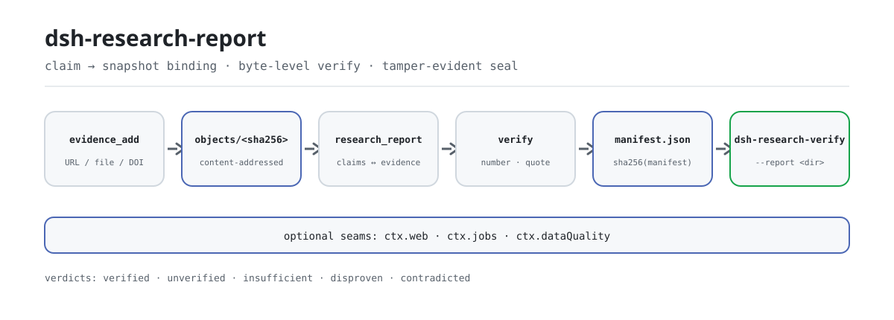

<div align="center">

<picture>
  <source media="(prefers-color-scheme: dark)" srcset="docs/assets/dsh-research-report-flow-dark.svg">
  
</picture>

# dsh-research-report

**Entrega un informe cuyas conclusiones cualquiera puede reverificar sin conexión en su propia máquina: cambia un byte y el hash del sello deja de coincidir.**

Motor de informes de investigación verificables para DeepSeek Harness: cada claim se vincula a instantáneas de evidencia inmutables, los números y las citas se comprueban byte a byte, y el resultado se sella en un directorio de informe versionado cuyo sello es el SHA-256 de `manifest.json`.

[Instalar](#instalación-en-tres-pasos) · [Configuración](#configuración) · [FAQ](#faq) · [简体中文](README.md) · [English](README.en.md) · [Español](README.es.md) · [Português](README.pt.md) · [हिन्दी](README.hi.md)

[](LICENSE)
[](#compatibilidad)
[](https://www.npmjs.com/package/dsh-research-report)
[](https://github.com/PerryLink/dsh-research-report/actions/workflows/ci.yml)
[](#compatibilidad)

[](https://github.com/PerryLink/dsh-research-report/stargazers)
[](https://www.npmjs.com/package/dsh-research-report)
[](https://dshfind.com/plugins/PerryLink/dsh-research-report?ref=badge)
[](https://securityscorecards.dev/viewer/?uri=github.com/PerryLink/dsh-research-report)
[](https://dsh.market/)
[](https://gitee.com/perrylink/dsh-research-report)

```sh
dsh plugin --profile <name> add dsh-research-report
```

</div>

<sub>Plugin de la comunidad, no afiliado a DeepSeek. Repositorio canónico: <https://github.com/PerryLink/dsh-research-report> (Gitee es un espejo).</sub>

## Qué es

Dale al modelo un tema y un conjunto de fuentes, y `dsh-research-report` vincula cada claim a instantáneas de evidencia inmutables, comprueba números y citas byte a byte y sella el resultado en un directorio de informe versionado que cualquiera puede reverificar de forma independiente. El directorio contiene `report.md`, `manifest.json` y los diarios de auditoría; el sello es el SHA-256 de `manifest.json`, y `dsh-research-verify` lo recalcula sin conexión sin montar el plugin. No incluye un bucle de deep-research: la recuperación pasa por `ctx.web`, las ejecuciones largas por `ctx.jobs`, y la planificación y la síntesis quedan en el modelo o en un plugin upstream.

## Instalación en tres pasos

1. **Instalar** (elige un canal):

   ```sh
   # canal npm (versiones publicadas)
   dsh plugin --profile web add dsh-research-report
   # canal git (último main; equivale a git+https://github.com/PerryLink/dsh-research-report.git)
   dsh plugin --profile web add github:PerryLink/dsh-research-report
   # canal tarball: pnpm pack en este repositorio y luego
   dsh plugin --profile web add ./dsh-research-report-<version>.tgz
   ```

   Ambos canales en línea instalan la fila del bundle (ver [`cordis.patch.yml`](cordis.patch.yml)) en la pila `dsh.profile.bundles` del perfil; **reinicia para que surta efecto**.

2. **Configuración mínima** (los valores por defecto ya sirven; las raíces relativas se resuelven contra el directorio de trabajo del harness):

   ```yaml
   - insert:
       - id: dsh-research-report
         name: dsh-research-report
         config:
           ledgerRoot: .research-ledger
           reportRoot: research-reports
   ```

3. **Verificar que está montado**:

   ```sh
   dsh --profile web --dump-config | grep dsh-research-report
   ```

   Después ejecuta el circuito mínimo en una sesión y revisa el sello con la CLI:

   ```text
   evidence_add({ origin: "docs/market.md", title: "Market snapshot" })   # → ev-1a2b3c4d5e6f
   research_report({ topic: "...", sections: [...], claims: [...], evidenceRefs: ["ev-1a2b…"] })
   ledger_query({ claimId: "c1" })                                        # vínculos + veredicto
   ```

   ```sh
   dsh-research-verify --report research-reports/<topic>/<YYYYMMDD-HHmmss>
   ```

**Desinstalar**: `dsh plugin --profile web remove dsh-research-report` (o elimina la fila del patch del perfil).

<details>
<summary>Instalar desde el mercado de DSH Desktop</summary>

Todos los plugins de PerryLink aparecen en el mercado integrado de DSH Desktop: **Mercado → Fuentes → Añadir fuente → pegar** `https://perrylink-dsh-catalog.perrylink.workers.dev/catalog-source.json` **→ seleccionar**. La instalación sigue requiriendo la verificación de identidad npm del mercado y tu confirmación.

</details>

## Capacidades clave

Tres cosas sostienen la confianza: la evidencia es inmutable, las comprobaciones son recalculables y las brechas nunca se ocultan.

- **Libro de evidencia (evidence ledger)** — almacén de instantáneas direccionado por contenido (`<ledgerRoot>/objects/<sha256>` + diarios JSONL). El mismo contenido se guarda una sola vez; las instantáneas son inmutables; cada lectura recomputa el hash, de modo que la manipulación o el borrado se detectan en lugar de confiarse.
- **Vínculo claim ↔ evidencia** — los claims se registran con los ids de evidencia en que se apoyan; el libro conserva el vínculo y cada veredicto de verificación (gana el más reciente).
- **Verificación a nivel de byte** — cada número y cada fragmento entrecomillado de un claim debe poder localizarse literalmente en las instantáneas vinculadas. Sin evidencia vinculada, o sin literal comprobable, el claim se marca `unverified`; evidencia vinculada que no puede confirmar ni desmentir los literales citados lo marca `insufficient`; una etiqueta cuyo valor difiere en la instantánea (y el valor citado está ausente) lo marca `disproven`; instantáneas manipuladas o ausentes lo marcan `contradicted`. Sin semántica, sin embeddings: solo comprobaciones de bytes auditables.
- **Puente numérico opcional** — cuando un claim cita un dataset estructurado del workspace (CSV/JSON) y `dsh-data-quality` está montado, las citas se verifican con tolerancias mediante su contrato congelado `verifyCitations`; una discrepancia del dataset desmiente el claim.
- **Evidencia DOI (sin red)** — los orígenes DOI se validan determinísticamente (estructura `10.xxxx/xxxx`, lista blanca de prefijos y juego de caracteres DOI); los DOI inválidos fallan ruidosamente. Se acepta metadato opcional de revista/año, y `requireJournalMetadata` solo restringe la evidencia DOI académica cuando está habilitado.
- **Informes sellados versionados** — `<reportRoot>/<slug(topic)>/<YYYYMMDD-HHmmss>/report.md` + `manifest.json` + `verification.jsonl` + `disconfirmation.jsonl`; el hash de sellado es el SHA-256 del manifiesto, que a su vez lleva el hash del informe, los hashes de toda la evidencia y el hash de cada diario de auditoría.
- **Reauditoría previa a la entrega e interceptación del sellado** — antes de sellar, cada claim vinculado se re-verifica sin conexión y se registra en `verification.jsonl`; el drift de veredicto, la evidencia vinculada manipulada o ausente, o un fallo de serialización del diario bloquean el sellado (falla ruidosamente, sin tunable).
- **Libro de falsificación** — cada claim contradicho o desmentido se registra en `disconfirmation.jsonl` (claim + referencias de evidencia + motivo) y se lista en el apéndice del registro de falsificación del informe.
- **Conocimiento negativo** — un claim desmentido se recuerda por su hash de contenido (`disproofs.jsonl`); el mismo texto re-reportado contra evidencia sin cambios se fuerza de nuevo a `disproven` y solo se re-verifica cuando la evidencia cambia.
- **Bucle de verificación de solo lectura** — tras sellar, el respaldo determinista `verifySealedReport` (sin red, sin modelo) recalcula el sello y los hashes de auditoría y re-comprueba cada claim, escribiendo la sección de comprobación de máquina en `verifier-note.md`; con `ctx.jobs` montado también se lanza un trabajo de verificación de solo lectura (la revisión del modelo es una mejora, nunca un reemplazo).
- **Evidencia anclada a sesión** — `evidence_add` acepta un `sessionRef` opcional (`sessionId` + `eventRange`, validado ruidosamente); el ancla se guarda y se registra en el Apéndice B, el manifiesto y `verification.jsonl`. La evidencia anclada a sesión se verifica honestamente como `unverified` (`la evidencia anclada a la sesión requiere una verificación manual en el registro de la sesión`).
- **Brechas honestas** — los claims no verificados, insuficientes, contradichos o desmentidos conservan una marca visible en el cuerpo del informe y se listan en el Apéndice A. Nada se aprueba en silencio.
- **Sin bucle de deep-research** — la orquestación de recuperación se reutiliza deliberadamente: `ctx.web` para buscar/descargar, `ctx.jobs` para trabajos largos. La planificación y la síntesis quedan en el modelo (o en un plugin upstream).

### Superficie de herramientas

- **`evidence_add({ origin, content?, title? })`** — registra una instantánea de evidencia. Con `content` el texto se guarda tal cual; sin él, un origen URL se descarga mediante `ctx.web` y una ruta relativa del workspace se lee del disco (las lecturas nunca escapan del workspace). Devuelve el id de evidencia y el hash SHA-256.
- **`research_report({ topic, title?, sections, claims, evidenceRefs, gather?, depth?, background? })`** — ensambla y sella un informe: valida (las referencias a claims no registrados se rechazan ruidosamente), verifica cada claim, renderiza `report.md` con marcas visibles, escribe `manifest.json` y devuelve el hash del sello. `gather: true` ejecuta UNA ronda de búsqueda sobre `ctx.web` y devuelve evidencia candidata capturada más una lista explícita de brechas; nunca ensambla automáticamente. `background: true` devuelve `{ kind: 'background', jobId }` mediante `ctx.jobs`.
- **`ledger_query({ claimId? | evidenceId? })`** — consultas de solo lectura de vínculos y veredictos; la evidencia se re-hashea al leer, de modo que una instantánea manipulada o ausente se reporta explícitamente. Sin id, devuelve un resumen del libro.
- **`ctx.researchReport.assemble(request)`** — la superficie de servicio congelada para plugins hermanos (ver `src/service.ts`; protegida byte a byte por [`scripts/verify-frozen-contract.mjs`](scripts/verify-frozen-contract.mjs)).

### Ejemplos

Son los puntos de entrada reales del plugin; instala una vez y llama a uno.

**Ejemplo detallado**

**Comando**

~~~sh
research_report({
  topic: "示例行业概览",
  sections: [{ heading: "市场规模", paragraphs: [{ text: "2025 年全球示例行业市场规模为 1,280 亿元。", claimIds: ["c1"] }] }],
  claims: [{ id: "c1", text: "市场规模为 1,280 亿元", evidenceIds: ["ev-5dc0a84d0e48"] }],
  evidenceRefs: ["ev-5dc0a84d0e48", "ev-c6cf024e0916", "ev-61f8f4533cb7"]
})
~~~

**Salida**

~~~text
report sealed: /tmp/rr-test-4U2mlF/reports/示例行业概览/20261019-124904
seal (sha256 of manifest.json): 5c85c97597096ced281ca191d7abaaf7434f18b397d35ac81c31aa364a3b12f9
claims: 1 verified / 0 unverified / 0 contradicted / 0 insufficient / 0 disproven (of 1); evidence bound: 3
~~~

*Observed from `README.md:112-118,150; test/index.spec.ts:166-177; src/tools/research-report.ts:170-175`*

**Rama de fallo**

**Entrada**

~~~text
{"topic":"probe","sections":[{"heading":"Growth","paragraphs":[{"text":"Growth was 42%.","claimIds":["c1"]}]}],"claims":[{"id":"c1","text":"Growth was 42%.","evidenceIds":[]}]}
~~~

**Salida**

~~~text
edge-case (no throw): isError=false; kind=sealed; verdicts[0]={"claimId":"c1","status":"unverified","note":"claim binds no evidence snapshot"}; counts={"verified":0,"unverified":1,"contradicted":0,"insufficient":0,"disproven":0}; evidenceCount=0; report.md marker=Growth was 42%. [未核实]
~~~

*Observed from `plugins/dsh-research-report/src/verify.ts:173-175 (unverified verdict); plugins/dsh-research-report/src/assemble.ts:209-220 (visible mark); plugins/dsh-research-report/README.md:87 (honest gaps); exercised through plugins/dsh-research-report/test/harness.ts`*

**Ejemplos breves**: `research_report` · `ledger_query`

### CLI dsh-research-verify

El binario independiente (empaquetado como `lib/cli.js`, con cero importaciones de `@deepseek-ai`) audita cualquier directorio de informe sellado sin montar el plugin:

```sh
dsh-research-verify --report <dir> [--seal <sha256>] [--ledger <dir>] [--format json|sarif]
```

- `--report <dir>` — el directorio del informe sellado (`manifest.json` + `report.md` + los diarios de auditoría).
- `--seal <sha256>` — el hash de sello esperado contra el que comparar el hash del manifiesto recalculado. Omitido = se informa el hash recalculado sin comparación.
- `--ledger <dir>` — la raíz del libro de evidencia (`objects/<sha256>` + `index.jsonl`), que habilita las re-comprobaciones byte a byte por claim. Omitido = las re-comprobaciones se saltan honestamente.
- `--format` — `json` (por defecto) o `sarif` (SARIF 2.1.0).

Recalcula el hash del sello (SHA-256 de `manifest.json`), el hash de `report.md` y los hashes de los diarios de auditoría, vuelve a ejecutar la comprobación byte a byte y de integridad de cada claim, y sale con código distinto de cero cuando falla cualquier comprobación ejecutada. Las mismas funciones `verifySealedReport` / `buildVerificationReport` / `renderSarif` / `renderVerificationJson` se exportan desde el paquete para uso como biblioteca.

## Configuración

Todos los ajustes son campos `Config` de Schemastery; los valores inválidos fallan ruidosamente al cargar el perfil. Las raíces relativas se resuelven contra el directorio de trabajo del harness (el workspace). `cordis.patch.yml` documenta cada clave en línea.

Claves más usadas:

| Clave | Predeterminado | Significado |
| --- | --- | --- |
| `enabled` | `true` | Interruptor maestro; `false` no monta nada. |
| `ledgerRoot` | `.research-ledger` | Directorio del libro de evidencia (objetos + diarios JSONL). |
| `reportRoot` | `research-reports` | Raíz de informes sellados (versionados por tema y marca de tiempo). |
| `workspaceRoot` | *(directorio de trabajo de la sesión del host)* | Raíz para la evidencia por ruta; por defecto el directorio de la sesión y luego el cwd del harness. |
| `maxEvidenceBytes` | `2097152` | Tope duro de bytes UTF-8 por instantánea de evidencia. |
| `maxEvidencePerReport` | `200` | Tope duro de evidencias vinculadas a un informe. |

<details>
<summary>Tabla de configuración completa (8 claves)</summary>

| Clave | Predeterminado | Significado |
| --- | --- | --- |
| `enabled` | `true` | Interruptor maestro; `false` no monta nada. |
| `ledgerRoot` | `.research-ledger` | Directorio del libro de evidencia (objetos + diarios JSONL). |
| `reportRoot` | `research-reports` | Raíz de informes sellados (versionados por tema y marca de tiempo). |
| `workspaceRoot` | *(directorio de trabajo de la sesión del host)* | Raíz para la evidencia por ruta; por defecto el directorio de la sesión y luego el cwd del harness. |
| `maxEvidenceBytes` | `2097152` | Tope duro de bytes UTF-8 por instantánea de evidencia. |
| `maxEvidencePerReport` | `200` | Tope duro de evidencias vinculadas a un informe. |
| `fetchTimeoutMs` | `20000` | Plazo (ms) de cada `ctx.web` fetch durante la captura. |
| `requireJournalMetadata` | `false` | Cuando es true, la evidencia de tipo DOI debe llevar nombre de revista y año de publicación al registrarse (si no, falla ruidosamente). |

</details>

Ejemplo de override en el patch del perfil:

```yaml
- insert:
    - id: dsh-research-report
      name: dsh-research-report
      config:
        reportRoot: research-reports/acme
        maxEvidencePerReport: 100
        requireJournalMetadata: true
```

## FAQ

<details>
<summary>¿Dónde viven realmente el libro y los informes? ¿Qué pasa si los borro?</summary>

Ambos están bajo las raíces configuradas: `ledgerRoot` (por defecto `.research-ledger`) y `reportRoot` (por defecto `research-reports`), resueltas contra el directorio de trabajo del harness cuando son relativas. Las instantáneas están direccionadas por contenido y son inmutables, y el mismo contenido se guarda una sola vez; si borras o reescribes un objeto, la comprobación de hash de la siguiente lectura falla, los claims vinculados se verifican como `contradicted` y `ledger_query` informa `integrity: missing`/`tampered`; nada se da por bueno en silencio.

</details>

<details>
<summary>¿Qué pasa sin un proveedor de fetch? ¿Degrada en silencio?</summary>

Nunca en silencio. El `dsh-base` distribuido solo monta búsqueda, así que la captura por URL falla ruidosamente (`WEB_UNAVAILABLE`/`WEB_PROVIDER_UNAVAILABLE`) hasta que se configure un proveedor de fetch; el `gather` basado en búsqueda lista las fuentes no capturadas en la lista de brechas y nunca fabrica evidencia ni ensambla un informe automáticamente.

</details>

<details>
<summary>¿Entra en conflicto con dsh-data-quality?</summary>

No. `ctx.dataQuality` es opcional y se consulta con `ctx.get` en tiempo de llamada; nunca se inyecta. Cuando está presente cruza las citas de datasets mediante su contrato congelado `verifyCitations`; cuando falta, esa ruta se omite honestamente. Este plugin no registra ningún listener waterfall.

</details>

<details>
<summary>¿Cuánto cuesta en rendimiento?</summary>

La verificación es puro trabajo de bytes: sin red, sin llamadas al modelo, lineal en el número de literales numéricos y entrecomillados de un claim y en el tamaño de las instantáneas vinculadas. La reauditoría previa al sellado es el mismo trabajo determinista repetido. La única espera externa es la captura de evidencia, acotada por `fetchTimeoutMs` (20000 ms por defecto); los informes largos pueden ejecutarse con `background: true` sobre `ctx.jobs`.

</details>

<details>
<summary>¿Por qué mi claim parafraseado se verifica como unverified?</summary>

Es el diseño a nivel de byte: la comprobación integrada localiza literales numéricos y entrecomillados, y no puede juzgar la equivalencia semántica de una reescritura. Ver la primera entrada de Limitaciones conocidas: auditable antes que ingenioso.

</details>

## Límites de seguridad

- **Anti-manipulación por construcción** — cada lectura de instantánea recalcula SHA-256 contra el índice; una discrepancia hace que los claims vinculados se verifiquen como `contradicted` y `ledger_query` informe `integrity: tampered`/`missing`.
- **Confinamiento al workspace** — las lecturas locales de evidencia se resuelven contra la raíz del workspace y rechazan escapes (ambos lados pasan por `path.resolve` antes de comparar).
- **Configuración que falla ruidosamente** — los límites inválidos lanzan al montar; las referencias a claims no registrados, los ids de evidencia desconocidos y los conflictos id/contenido lanzan al ensamblar.
- **Sin manejo de credenciales, sin red oculta** — la captura por URL pasa por `ctx.web` (la selección de proveedor, la taxonomía de errores y cualquier política SSRF quedan en los proveedores web del despliegue).
- **Registros reversibles** — cada contribución pasa por `ctx.effect()` / `register()`, de modo que la desinstalación y la recarga en caliente quedan limpias.

## Permisos y datos

`dsh-research-report` solo consume seams públicos: `ctx.tools`, `ctx.systemPrompt` y, opcionalmente, `ctx.web` / `ctx.jobs` / `ctx.dataQuality` (consultados con `ctx.get` en tiempo de llamada, nunca inyectados). Solo escribe dentro de las raíces configuradas del libro y de los informes (ambas por defecto directorios locales del workspace), lee archivos del workspace solo dentro del workspace y llega a la red exclusivamente por el seam web del harness, nunca con un `fetch` directo. Las instantáneas de evidencia son inmutables y direccionadas por contenido; los registros de claims son inmutables; los veredictos solo se añaden.

- **Permisos declarados en el manifiesto**: `fs:workspace-write`, `network:ctx-web-only`, `session:read`, `session:write`, `native-code:none` (ver el bloque `dshWorkshop` de `package.json`).
- **Eventos de sesión**: `research-report/evidence`, `research-report/verify` y `research-report/seal` son un espejo adaptativo; solo llegan al log de sesión cuando el host conoce el vocabulario; si no, los diarios del libro son la verdad durable (ver Limitaciones conocidas).

## Limitaciones conocidas

- **A nivel de byte, no semántico** — la comprobación integrada localiza literales numéricos y entrecomillados de forma literal; los claims parafraseados sin un literal comprobable se verifican como `unverified`, y un claim verdadero cuyo número está ausente mientras su etiqueta aparece con otro valor se lee como `contradicted`. Es una elección deliberada de la v1 (auditable antes que ingenioso).
- **Los eventos de sesión son adaptativos** — el plugin declara eventos de sesión tipados `research-report/evidence`, `research-report/verify` y `research-report/seal`, pero el `Session.append` de 0.1.5-alpha.1 sigue sin exponer la opción `ignorable` ni una superficie de registro de eventos de plugin, así que los appends solo se activan cuando el build del host conoce los tipos (de lo contrario la capa de persistencia rechazaría el log al restaurar). Los diarios del libro son siempre la fuente durable de verdad.
- **Los perfiles por defecto no montan proveedor de fetch** — el `dsh-base` distribuido solo monta búsqueda, así que la captura por URL falla ruidosamente (`WEB_UNAVAILABLE`/`WEB_PROVIDER_UNAVAILABLE`) hasta configurar un proveedor de fetch; el `gather` basado en búsqueda lista las fuentes no capturadas en la lista de brechas.
- **Alcance de un solo workspace** — las raíces del libro y de los informes se resuelven contra el directorio de trabajo del harness al montar; los despliegues multi-workspace deben configurar raíces absolutas por perfil.

## Interoperabilidad con otros plugins DSH

Este plugin no compite estructuralmente por los recursos de otro plugin:

- **Una sola clave de servicio, `ctx.researchReport`** — la aporta la Service Definition de `src/service.ts`; no se registra una segunda clave de servicio.
- **Sin listeners waterfall** — el plugin no registra ningún listener `ctx.on()`, así que no participa en ninguna cadena de eventos sensible al orden; si algún día se añade uno, la rama de allow/passthrough DEBE llamar a `next()`.
- **Sin rutas HTTP ni superficie de cliente** — no hay prefijo `webServer` ni slot de cliente; es un plugin puramente host (el repositorio no tiene `client/`).
- **La capa de patch solo inserta su propia fila** — el patch del bundle inserta `dsh-research-report` y nunca sobrescribe el `config` de una fila integrada.
- **Los hermanos opcionales se consultan bajo demanda** — `ctx.web` / `ctx.jobs` / `ctx.dataQuality` se resuelven con `ctx.get` en tiempo de llamada; cuando faltan, la ruta afectada falla ruidosamente con una razón explícita en lugar de tomar otro camino en silencio.
- **Los contratos congelados tienen puerta** — `ctx.researchReport.assemble` (`src/service.ts`) y `CitationCheck*` (`src/verify.ts`) son bloques congelados byte a byte compartidos con plugins hermanos, y `scripts/verify-frozen-contract.mjs` vigila la deriva en CI.

## Compatibilidad

| Superficie | Estado |
| --- | --- |
| Harness | DeepSeek Harness `dsh-v0.2.1-alpha.1` (verificado el 2026-09-25). Línea npm dev/test `0.1.7-rc.2`; la matriz compat fija las cuatro líneas peer declaradas. En 0.1.5-alpha.1 (adaptado el 2026-09-09) el sobre de sesión conserva su campo ignorable solo para compatibilidad de lectura de logs almacenados; `Session.append` aún no puede estamparlo, por lo que el comportamiento de la puerta de auditoría no cambia. |
| Node | `^22.19.0 \|\| >=24.9.0`, solo ESM (`"type": "module"`) |
| Plataformas | Dondequiera que corra DSH (host puro; la red solo se alcanza por `ctx.web`) |
| Modelo | Modelos de texto totalmente soportados; la verificación es comparación de bytes, sin capacidad de modelo extra |

Dependencias peer: `@deepseek-ai/cordis ^4.0.5-alpha.1`, `@deepseek-ai/schemastery ^3.18.5-alpha.1`, y `@deepseek-ai/dsh-session`, `@deepseek-ai/dsh-tools`, `@deepseek-ai/dsh-system-prompt`, `@deepseek-ai/dsh-web`, `@deepseek-ai/dsh-jobs` (rangos en `package.json`). Hermanos opcionales (nunca obligatorios): `ctx.web` para captura, `ctx.jobs` para ensamblado en segundo plano, `ctx.dataQuality` para cruce de citas de datasets.

## Ecosistema y calidad

- [Espejo en Gitee](https://gitee.com/perrylink/dsh-research-report) (espejo sincronizado; GitHub es el canónico)
- [Página del plugin en dshfind](https://dshfind.com/plugins/PerryLink/dsh-research-report) (instalaciones y ranking)
- [Informe OpenSSF Scorecard](https://securityscorecards.dev/viewer/?uri=github.com/PerryLink/dsh-research-report) (impulsado por [.github/workflows/scorecard.yml](.github/workflows/scorecard.yml))
- [Informe de verificación de dsh-plugin-doctor](https://github.com/PerryLink/dsh-plugin-doctor#verified-徽章)
- [DSH Market](https://dsh.market/) (listado)
- **Canal de la tienda 1024**: `npm i -g dsh1024` una vez y luego `dsh1024 plugin --profile web add dsh-research-report` (cuenta para el ranking de instalaciones de [deepseek1024.com](https://deepseek1024.com))
- [Base de conocimiento del ecosistema](https://perrylink.github.io/dsh-plugin-guide/): datos medidos, no marketing: guía de desarrollo de plugins · datos de selección · criterios de mantenimiento

## Desarrollo

```sh
pnpm install
pnpm run typecheck && pnpm run typecheck:ci
pnpm test
pnpm run build
pnpm run verify:self-contained && pnpm run verify:artifacts
pnpm run verify:frozen-contract
node scripts/check-readme-sync.mjs
pnpm run check:lockfile
pnpm pack
```

- `typecheck` resuelve `@deepseek-ai/*` con los peers 0.1.7-rc.2 instalados; `typecheck:ci` quita `skipLibCheck` y habilita `verbatimModuleSyntax` contra los tipos publicados. Ambos deben mantenerse en verde.
- Las pruebas usan los `Context`/`Session`/`ToolRuntime`/`LocalJobRegistry`/`WebRuntime` reales de los peers 0.1.7-rc.2; solo los backends de red son proveedores scriptados registrados en los registros reales de `ctx.web`.
- Release: `node scripts/release.mjs <x.y.z>` (bump, sella CHANGELOG, re-ejecuta la puerta, commit + tag; nunca hace push).
- Las imágenes del README se generan programáticamente con [`scripts/gen-readme-assets.py`](scripts/gen-readme-assets.py) (Python + Pillow): diagramas de flujo SVG escritos a mano en `docs/assets/dsh-research-report-flow-{light,dark}.svg`, seguros de re-ejecutar y compartidos por los cinco idiomas.

Estructura de directorios:

| Ruta | Contenido |
| --- | --- |
| `src/index.ts` | Contrato function-plugin (`name`/`inject`/`Config`/`apply`, sin default export) |
| `src/service.ts` | Service Definition de `ctx.researchReport` + el bloque de contrato `assemble` congelado byte a byte |
| `src/ledger.ts` | El libro de evidencia direccionado por contenido (objetos + diarios JSONL, re-hash al leer) |
| `src/verify.ts` | El comprobador a nivel de byte + los tipos puente `CitationCheck*` congelados |
| `src/assemble.ts` | Ensamblado puro: validación de la petición, render de `report.md`, `manifest.json` determinista, sello |
| `src/gather.ts` | Captura (`ctx.web` / archivos del workspace) y la ronda de candidatos `gather` |
| `src/tools/` | Los tres consumidores: `evidence_add`, `research_report`, `ledger_query` |
| `test/` | vitest sobre el runtime real del host; solo los backends de red son proveedores scriptados |
| `fixtures/` | Tres documentos locales que cubren el flujo evidence → seal → tamper → contradicted |

Topics: `dsh`, `dsh-plugin`, `deepseek-harness`, `cordis`, `research`, `evidence-ledger`, `verifiable-report`, `audit`, `citation-verification`

## Familia y agradecimientos

Este proyecto forma parte de la familia de plugins de DeepSeek Harness de [PerryLink](https://github.com/PerryLink) (todos Apache-2.0). Si te resulta útil, **una estrella ayuda a que la siguiente persona lo encuentre**; no desbloquea nada.

- [@PerryLink](https://github.com/PerryLink) — autor original y mantenedor: arquitectura del plugin, libro de evidencia, verificación a nivel de byte, informes sellados, documentación en cinco idiomas, CI y automatización de releases.

<details>
<summary>Expandir todos los plugins</summary>

| Plugin | Estado |
|---|---|
| **[dsh-aqua-input-check](https://github.com/PerryLink/dsh-aqua-input-check)** |  |
| **[dsh-archive-check](https://github.com/PerryLink/dsh-archive-check)** |  |
| **[dsh-auto-review](https://github.com/PerryLink/dsh-auto-review)** |  |
| **[dsh-autotier](https://github.com/PerryLink/dsh-autotier)** | 🧊 CONGELADO — ver el README del repo |
| **[dsh-bid-ca-precheck](https://github.com/PerryLink/dsh-bid-ca-precheck)** |  |
| **[dsh-bid-qual-check](https://github.com/PerryLink/dsh-bid-qual-check)** |  |
| **[dsh-cert-mcp](https://github.com/PerryLink/dsh-cert-mcp)** | 🧊 CONGELADO — ver el README del repo |
| **[dsh-checkpoint-rewind](https://github.com/PerryLink/dsh-checkpoint-rewind)** |  |
| **[dsh-click](https://github.com/PerryLink/dsh-click)** |  |
| **[dsh-composer-history](https://github.com/PerryLink/dsh-composer-history)** |  |
| **[dsh-contract-stance](https://github.com/PerryLink/dsh-contract-stance)** |  |
| **[dsh-customs-doc-check](https://github.com/PerryLink/dsh-customs-doc-check)** |  |
| **[dsh-data-quality](https://github.com/PerryLink/dsh-data-quality)** |  |
| **[dsh-demurrage-ledger](https://github.com/PerryLink/dsh-demurrage-ledger)** |  |
| **[dsh-doublecheck](https://github.com/PerryLink/dsh-doublecheck)** |  |
| **[dsh-drill-script-check](https://github.com/PerryLink/dsh-drill-script-check)** |  |
| **[dsh-eia-guide-check](https://github.com/PerryLink/dsh-eia-guide-check)** |  |
| **[dsh-emergency-plan](https://github.com/PerryLink/dsh-emergency-plan)** |  |
| **[dsh-essay-rubric-check](https://github.com/PerryLink/dsh-essay-rubric-check)** |  |
| **[dsh-evidence-check](https://github.com/PerryLink/dsh-evidence-check)** |  |
| **[dsh-export-ctl-check](https://github.com/PerryLink/dsh-export-ctl-check)** |  |
| **[dsh-fast](https://github.com/PerryLink/dsh-fast)** |  |
| **[dsh-fmea-table-check](https://github.com/PerryLink/dsh-fmea-table-check)** |  |
| **[dsh-forecast-penalty](https://github.com/PerryLink/dsh-forecast-penalty)** |  |
| **[dsh-fund-research](https://github.com/PerryLink/dsh-fund-research)** |  |
| **[dsh-github](https://github.com/PerryLink/dsh-github)** |  |
| **[dsh-gongwen-flow-check](https://github.com/PerryLink/dsh-gongwen-flow-check)** |  |
| **[dsh-gongwen-word-check](https://github.com/PerryLink/dsh-gongwen-word-check)** |  |
| **[dsh-guard-plan-qc](https://github.com/PerryLink/dsh-guard-plan-qc)** |  |
| **[dsh-hazchem-check](https://github.com/PerryLink/dsh-hazchem-check)** |  |
| **[dsh-hazplan-check](https://github.com/PerryLink/dsh-hazplan-check)** |  |
| **[dsh-hidden-risk-map](https://github.com/PerryLink/dsh-hidden-risk-map)** |  |
| **[dsh-hs-classify](https://github.com/PerryLink/dsh-hs-classify)** |  |
| **[dsh-icd-rule-check](https://github.com/PerryLink/dsh-icd-rule-check)** |  |
| **[dsh-industry-research](https://github.com/PerryLink/dsh-industry-research)** |  |
| **[dsh-lawcite-adapter](https://github.com/PerryLink/dsh-lawcite-adapter)** |  |
| **[dsh-laya](https://github.com/PerryLink/dsh-laya)** |  |
| **[dsh-lc-doc-check](https://github.com/PerryLink/dsh-lc-doc-check)** |  |
| **[dsh-learning-gap-check](https://github.com/PerryLink/dsh-learning-gap-check)** |  |
| **[dsh-library](https://github.com/PerryLink/dsh-library)** |  |
| **[dsh-local-ai](https://github.com/PerryLink/dsh-local-ai)** |  |
| **[dsh-lsp-actions](https://github.com/PerryLink/dsh-lsp-actions)** |  |
| **[dsh-mask](https://github.com/PerryLink/dsh-mask)** |  |
| **[dsh-mcp-panel](https://github.com/PerryLink/dsh-mcp-panel)** |  |
| **[dsh-medrec-qc](https://github.com/PerryLink/dsh-medrec-qc)** |  |
| **[dsh-memento](https://github.com/PerryLink/dsh-memento)** |  |
| **[dsh-nsfc-form-check](https://github.com/PerryLink/dsh-nsfc-form-check)** |  |
| **[dsh-nurse-record-check](https://github.com/PerryLink/dsh-nurse-record-check)** |  |
| **[dsh-observe](https://github.com/PerryLink/dsh-observe)** |  |
| **[dsh-origin-rvc-check](https://github.com/PerryLink/dsh-origin-rvc-check)** |  |
| **[dsh-ota-review-check](https://github.com/PerryLink/dsh-ota-review-check)** |  |
| **[dsh-output-styles](https://github.com/PerryLink/dsh-output-styles)** |  |
| **[dsh-paper-doc-adapter](https://github.com/PerryLink/dsh-paper-doc-adapter)** |  |
| **[dsh-permission-rules](https://github.com/PerryLink/dsh-permission-rules)** |  |
| **[dsh-permit-report-check](https://github.com/PerryLink/dsh-permit-report-check)** |  |
| **[dsh-pipeline-check](https://github.com/PerryLink/dsh-pipeline-check)** |  |
| **[dsh-pleading-draft](https://github.com/PerryLink/dsh-pleading-draft)** |  |
| **[dsh-plugin-doctor](https://github.com/PerryLink/dsh-plugin-doctor)** | 🚫 RETIRADO (repo archivado) |
| **[dsh-plugin-guide](https://github.com/PerryLink/dsh-plugin-guide)** |  |
| **[dsh-plugin-kit](https://github.com/PerryLink/dsh-plugin-kit)** | 🚫 RETIRADO (repo archivado) |
| **[dsh-plugin-upgrade](https://github.com/PerryLink/dsh-plugin-upgrade)** | 🚫 RETIRADO (repo archivado) |
| **[dsh-policy-brief-draft](https://github.com/PerryLink/dsh-policy-brief-draft)** |  |
| **[dsh-power-loss-split](https://github.com/PerryLink/dsh-power-loss-split)** |  |
| **[dsh-power-ticket-check](https://github.com/PerryLink/dsh-power-ticket-check)** |  |
| **[dsh-ppap-check](https://github.com/PerryLink/dsh-ppap-check)** |  |
| **[dsh-protest-deadline](https://github.com/PerryLink/dsh-protest-deadline)** |  |
| **[dsh-railway-window](https://github.com/PerryLink/dsh-railway-window)** |  |
| **[dsh-repair-order-qc](https://github.com/PerryLink/dsh-repair-order-qc)** |  |
| **[dsh-research-report](https://github.com/PerryLink/dsh-research-report)** |  |
| **[dsh-review-reply-check](https://github.com/PerryLink/dsh-review-reply-check)** |  |
| **[dsh-rulefile-check](https://github.com/PerryLink/dsh-rulefile-check)** |  |
| **[dsh-safety-brief-check](https://github.com/PerryLink/dsh-safety-brief-check)** |  |
| **[dsh-score](https://github.com/PerryLink/dsh-score)** |  |
| **[dsh-session-sync](https://github.com/PerryLink/dsh-session-sync)** |  |
| **[dsh-site-log-check](https://github.com/PerryLink/dsh-site-log-check)** |  |
| **[dsh-skill-pack-security](https://github.com/PerryLink/dsh-skill-pack-security)** |  |
| **[dsh-soe-decision-check](https://github.com/PerryLink/dsh-soe-decision-check)** |  |
| **[dsh-soilwater-check](https://github.com/PerryLink/dsh-soilwater-check)** |  |
| **[dsh-sop-sync-check](https://github.com/PerryLink/dsh-sop-sync-check)** |  |
| **[dsh-spc-gbt-adapter](https://github.com/PerryLink/dsh-spc-gbt-adapter)** |  |
| **[dsh-talk](https://github.com/PerryLink/dsh-talk)** |  |
| **[dsh-tender-extract](https://github.com/PerryLink/dsh-tender-extract)** |  |
| **[dsh-tender-matrix](https://github.com/PerryLink/dsh-tender-matrix)** |  |
| **[dsh-test-drive](https://github.com/PerryLink/dsh-test-drive)** |  |
| **[dsh-ticktick](https://github.com/PerryLink/dsh-ticktick)** | 🚫 RETIRADO (repo archivado) |
| **[dsh-translate](https://github.com/PerryLink/dsh-translate)** |  |
| **[dsh-warranty-calc](https://github.com/PerryLink/dsh-warranty-calc)** |  |
| **[dsh-budget](https://github.com/PerryLink/dsh-budget)** | 🧊 CONGELADO — ver el README del repo |
| **[dsh-claude-move](https://github.com/PerryLink/dsh-claude-move)** | 🧊 CONGELADO — ver el README del repo |
| **[dsh-defend](https://github.com/PerryLink/dsh-defend)** | 🧊 CONGELADO — ver el README del repo |
| **[dsh-draw](https://github.com/PerryLink/dsh-draw)** | 🧊 CONGELADO — ver el README del repo |
| **[dsh-reach](https://github.com/PerryLink/dsh-reach)** | 🧊 CONGELADO — ver el README del repo |
| **[dsh-background-agents](https://github.com/PerryLink/dsh-background-agents)** | 🚫 RETIRADO (repo archivado) |
| **[dsh-session-pin](https://github.com/PerryLink/dsh-session-pin)** | 🚫 RETIRADO (repo archivado) |
| **[dsh-team-rooms](https://github.com/PerryLink/dsh-team-rooms)** | 🚫 RETIRADO (repo archivado) |

</details>

## Licencia

[LICENSE](LICENSE) (Apache License 2.0) © 2026 dsh-research-report contributors

<p align="center"><sub>Apache-2.0 · Plugin de la comunidad, no afiliado a DeepSeek.</sub></p>
