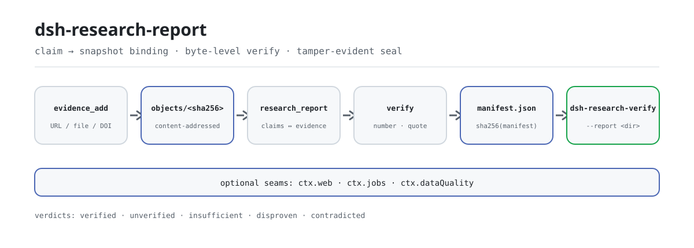

<div align="center">

<picture>
  <source media="(prefers-color-scheme: dark)" srcset="docs/assets/dsh-research-report-flow-dark.svg">
  
</picture>

# dsh-research-report

**ऐसी रिपोर्ट सौंपें जिसके हर निष्कर्ष को कोई भी अपनी मशीन पर ऑफ़लाइन दोबारा जाँच सके — एक बाइट बदलिए और सील हैश मेल खाना बंद कर देगा।**

DeepSeek Harness के लिए सत्यापन-योग्य शोध-रिपोर्ट इंजन: हर claim अपरिवर्तनीय एविडेंस स्नैपशॉट से बँधता है, संख्याएँ और उद्धरण बाइट-दर-बाइट जाँचे जाते हैं, और परिणाम एक संस्करणित रिपोर्ट डायरेक्टरी में सील होता है जिसकी सील `manifest.json` का SHA-256 है।

[इंस्टॉल](#तीन-चरणों-में-शुरुआत) · [कॉन्फ़िगरेशन](#कॉन्फ़िगरेशन) · [FAQ](#faq) · [简体中文](README.md) · [English](README.en.md) · [Español](README.es.md) · [Português](README.pt.md) · [हिन्दी](README.hi.md)

[](LICENSE)
[](#संगतता)
[](https://www.npmjs.com/package/dsh-research-report)
[](https://github.com/PerryLink/dsh-research-report/actions/workflows/ci.yml)
[](#संगतता)

[](https://github.com/PerryLink/dsh-research-report/stargazers)
[](https://www.npmjs.com/package/dsh-research-report)
[](https://dshfind.com/plugins/PerryLink/dsh-research-report?ref=badge)
[](https://securityscorecards.dev/viewer/?uri=github.com/PerryLink/dsh-research-report)
[](https://dsh.market/)
[](https://gitee.com/perrylink/dsh-research-report)

```sh
dsh plugin --profile <name> add dsh-research-report
```

</div>

<sub>सामुदायिक प्लगइन, DeepSeek से असंबद्ध। कैनोनिकल रिपॉज़िटरी: <https://github.com/PerryLink/dsh-research-report> (Gitee एक मिरर है)।</sub>

## यह क्या है

मॉडल को एक विषय और स्रोतों का समूह दीजिए, और `dsh-research-report` हर claim को अपरिवर्तनीय एविडेंस स्नैपशॉट से बाँधता है, संख्याओं और उद्धरणों को बाइट-दर-बाइट जाँचता है, फिर परिणाम को एक संस्करणित रिपोर्ट डायरेक्टरी में सील करता है जिसे कोई भी स्वतंत्र रूप से दोबारा जाँच सकता है। डायरेक्टरी में `report.md`, `manifest.json` और ऑडिट जर्नल होते हैं; सील `manifest.json` का SHA-256 है, और `dsh-research-verify` प्लगइन माउंट किए बिना उसे ऑफ़लाइन पुनर्गणना करता है। यह जानबूझकर कोई deep-research लूप नहीं रखता: रिट्रीवल `ctx.web` से, लंबे रन `ctx.jobs` से, और योजना व संश्लेषण मॉडल या अपस्ट्रीम प्लगइन के पास रहते हैं।

## तीन चरणों में शुरुआत

1. **इंस्टॉल** (कोई एक चैनल चुनें):

   ```sh
   # npm चैनल (प्रकाशित संस्करण)
   dsh plugin --profile web add dsh-research-report
   # git चैनल (नवीनतम main; git+https://github.com/PerryLink/dsh-research-report.git के बराबर)
   dsh plugin --profile web add github:PerryLink/dsh-research-report
   # tarball चैनल: इस रिपॉज़िटरी में pnpm pack के बाद
   dsh plugin --profile web add ./dsh-research-report-<version>.tgz
   ```

   दोनों ऑनलाइन चैनल bundle पंक्ति (देखें [`cordis.patch.yml`](cordis.patch.yml)) को प्रोफ़ाइल के `dsh.profile.bundles` स्टैक में डालते हैं; **प्रभाव के लिए रीस्टार्ट करें**।

2. **न्यूनतम कॉन्फ़िग** (डिफ़ॉल्ट चलने योग्य हैं; सापेक्ष रूट harness कार्य-डायरेक्टरी के सापेक्ष हल होते हैं):

   ```yaml
   - insert:
       - id: dsh-research-report
         name: dsh-research-report
         config:
           ledgerRoot: .research-ledger
           reportRoot: research-reports
   ```

3. **माउंट हुआ सत्यापित करें**:

   ```sh
   dsh --profile web --dump-config | grep dsh-research-report
   ```

   फिर सत्र में न्यूनतम चक्र चलाएँ और CLI से सील दोबारा जाँचें:

   ```text
   evidence_add({ origin: "docs/market.md", title: "Market snapshot" })   # → ev-1a2b3c4d5e6f
   research_report({ topic: "...", sections: [...], claims: [...], evidenceRefs: ["ev-1a2b…"] })
   ledger_query({ claimId: "c1" })                                        # बाइंडिंग + वर्डिक्ट
   ```

   ```sh
   dsh-research-verify --report research-reports/<topic>/<YYYYMMDD-HHmmss>
   ```

**अनइंस्टॉल**: `dsh plugin --profile web remove dsh-research-report` (या प्रोफ़ाइल patch से वह पंक्ति हटाएँ)।

<details>
<summary>DSH Desktop मार्केट से इंस्टॉल करें</summary>

सभी PerryLink प्लगइन DSH Desktop के अंतर्निहित मार्केट में सूचीबद्ध हैं: **मार्केट → स्रोत → स्रोत जोड़ें → पेस्ट करें** `https://perrylink-dsh-catalog.perrylink.workers.dev/catalog-source.json` **→ चुनें**। इंस्टॉल के लिए मार्केट का npm पहचान-सत्यापन और आपकी पुष्टि अब भी आवश्यक है।

</details>

## मुख्य क्षमताएँ

भरोसा तीन बातों पर टिका है: एविडेंस अपरिवर्तनीय है, जाँच दोबारा गणनीय है, और अंतराल कभी छिपाए नहीं जाते।

- **एविडेंस लेजर** — कंटेंट-एड्रेस्ड स्नैपशॉट स्टोर (`<ledgerRoot>/objects/<sha256>` + JSONL जर्नल)। वही कंटेंट ठीक एक बार संग्रहीत होता है; स्नैपशॉट अपरिवर्तनीय हैं; हर पढ़ाई हैश की पुनर्गणना करती है, इसलिए छेड़छाड़ या हटाना भरोसे के बजाय पकड़ा जाता है।
- **claim ↔ एविडेंस बाइंडिंग** — claim उन एविडेंस ids के साथ पंजीकृत होते हैं जिन पर निर्भर हैं; लेजर बाइंडिंग और हर सत्यापन वर्डिक्ट (नवीनतम मान्य) रखता है।
- **बाइट-स्तरीय सत्यापन** — claim का हर अंक और उद्धृत अंश बँधे स्नैपशॉट में शब्दशः मिलना चाहिए। बँधा एविडेंस न होना, या जाँचने योग्य लिटरल न होना, claim को `unverified` चिह्नित करता है; बँधा एविडेंस जो दावे के लिटरल को न पुष्ट कर सके न खंडन, उसे `insufficient` करता है; जिस लेबल का स्नैपशॉट मान भिन्न हो (और दावा किया मान अनुपस्थित हो) वह `disproven` करता है; छेड़े गए/गायब स्नैपशॉट `contradicted` करते हैं। कोई सेमांटिक्स नहीं, कोई embeddings नहीं — केवल ऑडिट-योग्य बाइट जाँच।
- **वैकल्पिक संख्यात्मक ब्रिज** — जब कोई claim वर्कस्पेस के संरचित डेटासेट (CSV/JSON) का हवाला देता है और `dsh-data-quality` माउंट है, तो उद्धरण उसके फ़्रोज़न `verifyCitations` कॉन्ट्रैक्ट से सहनशीलता के साथ जाँचे जाते हैं; डेटासेट बेमेल claim को गलत सिद्ध करता है।
- **DOI एविडेंस (शून्य नेटवर्क)** — DOI मूल नियतात्मक रूप से सत्यापित होते हैं (`10.xxxx/xxxx` संरचना, प्रीफ़िक्स श्वेतसूची, और DOI कैरेक्टर सेट); अमान्य DOI ज़ोरदार विफल होते हैं। वैकल्पिक जर्नल/वर्ष मेटाडेटा स्वीकार्य है, और `requireJournalMetadata` केवल सक्षम होने पर अकादमिक DOI एविडेंस को गेट करता है।
- **संस्करणित सीलबंद रिपोर्ट** — `<reportRoot>/<slug(topic)>/<YYYYMMDD-HHmmss>/report.md` + `manifest.json` + `verification.jsonl` + `disconfirmation.jsonl`; सील हैश manifest का SHA-256 है, जो स्वयं रिपोर्ट हैश, सभी एविडेंस हैश और हर ऑडिट जर्नल का हैश रखता है।
- **डिलीवरी-पूर्व पुनर्ऑडिट और सील इंटरसेप्शन** — सील से पहले हर बँधा claim ऑफ़लाइन दोबारा सत्यापित और `verification.jsonl` में दर्ज होता है; verdict drift, छेड़ा/गायब बँधा एविडेंस, या जर्नल सीरियलाइज़ेशन विफलता सील को रोकती है (ज़ोरदार विफल, कोई tunable नहीं)।
- **फ़ाल्सिफ़िकेशन लेजर** — हर contradicted या disproven claim `disconfirmation.jsonl` में दर्ज होता है (claim + एविडेंस संदर्भ + कारण) और रिपोर्ट के फ़ाल्सिफ़िकेशन-लॉग परिशिष्ट में सूचीबद्ध होता है।
- **नकारात्मक ज्ञान** — disproven claim अपने कंटेंट हैश से याद रखा जाता है (`disproofs.jsonl`); वही पाठ अपरिवर्तित एविडेंस के सामने दोबारा रिपोर्ट होने पर ज़बरदस्ती `disproven` पर लौटता है और एविडेंस बदलने पर ही पुनः सत्यापित होता है।
- **केवल-पढ़ने वाला verifier लूप** — सील के बाद नियतात्मक `verifySealedReport` फ़ॉलबैक (शून्य नेटवर्क, शून्य मॉडल) सील और ऑडिट हैश की पुनर्गणना कर, हर claim दोबारा जाँचकर मशीन-जाँच `verifier-note.md` में लिखता है; `ctx.jobs` माउंट होने पर केवल-पढ़ने वाला verifier job भी चलता है (मॉडल समीक्षा वृद्धि है, कभी प्रतिस्थापन नहीं)।
- **सत्र-एंकर्ड एविडेंस** — `evidence_add` वैकल्पिक `sessionRef` (`sessionId` + `eventRange`, ज़ोरदार सत्यापित) लेता है; एंकर संग्रहीत होकर परिशिष्ट B, manifest और `verification.jsonl` में दर्ज होता है। सत्र-एंकर्ड एविडेंस ईमानदारी से `unverified` सत्यापित होता है (`सत्र-एंकर्ड एविडेंस के लिए सत्र लॉग में मैनुअल जाँच आवश्यक है`)।
- **ईमानदार अंतराल** — unverified, insufficient, contradicted और disproven claims रिपोर्ट बॉडी में दृश्य चिह्न रखते हैं और परिशिष्ट A में सूचीबद्ध होते हैं। कुछ भी चुपचाप पास नहीं होता।
- **कोई deep-research लूप नहीं** — रिट्रीवल ऑर्केस्ट्रेशन जानबूझकर पुनः उपयोग होता है: खोज/फ़ेच के लिए `ctx.web`, लंबे रन के लिए `ctx.jobs`। योजना और संश्लेषण मॉडल (या अपस्ट्रीम प्लगइन) के पास रहते हैं।

### टूल सतह

- **`evidence_add({ origin, content?, title? })`** — एक एविडेंस स्नैपशॉट पंजीकृत करें। `content` के साथ पाठ शब्दशः संग्रहीत होता है; उसके बिना URL मूल `ctx.web` से फ़ेच होता है और वर्कस्पेस-सापेक्ष पथ डिस्क से पढ़ा जाता है (पढ़ाई कभी वर्कस्पेस से बाहर नहीं जाती)। एविडेंस id और SHA-256 हैश लौटाता है।
- **`research_report({ topic, title?, sections, claims, evidenceRefs, gather?, depth?, background? })`** — रिपोर्ट असेंबल और सील करें: सत्यापन (अपंजीकृत claim संदर्भ ज़ोरदार अस्वीकृत), हर claim की जाँच, दृश्य चिह्नों के साथ `report.md` रेंडर, `manifest.json` लेखन, और सील हैश की वापसी। `gather: true` `ctx.web` पर एक ही खोज दौर चलाता है और कैप्चर किए गए उम्मीदवार एविडेंस के साथ स्पष्ट अंतराल सूची लौटाता है — कभी स्वतः असेंबल नहीं करता। `background: true` `ctx.jobs` पर `{ kind: 'background', jobId }` लौटाता है।
- **`ledger_query({ claimId? | evidenceId? })`** — केवल-पढ़ने वाली बाइंडिंग/वर्डिक्ट क्वेरी; पढ़ाई पर एविडेंस का हैश दोबारा गिना जाता है, इसलिए छेड़ा या गायब स्नैपशॉट स्पष्ट रूप से रिपोर्ट होता है। बिना id के लेजर सारांश लौटाता है।
- **`ctx.researchReport.assemble(request)`** — सहोदर प्लगइन के लिए फ़्रोज़न सर्विस सतह (देखें `src/service.ts`; [`scripts/verify-frozen-contract.mjs`](scripts/verify-frozen-contract.mjs) द्वारा बाइट-दर-बाइट गेटेड)।

### उदाहरण

ये प्लगइन के वास्तविक प्रवेश-बिंदु हैं; एक बार इंस्टॉल करें, फिर एक चलाएँ।

**विस्तृत उदाहरण**

**कमांड**

~~~sh
research_report({
  topic: "示例行业概览",
  sections: [{ heading: "市场规模", paragraphs: [{ text: "2025 年全球示例行业市场规模为 1,280 亿元。", claimIds: ["c1"] }] }],
  claims: [{ id: "c1", text: "市场规模为 1,280 亿元", evidenceIds: ["ev-5dc0a84d0e48"] }],
  evidenceRefs: ["ev-5dc0a84d0e48", "ev-c6cf024e0916", "ev-61f8f4533cb7"]
})
~~~

**आउटपुट**

~~~text
report sealed: /tmp/rr-test-4U2mlF/reports/示例行业概览/20261019-124904
seal (sha256 of manifest.json): 5c85c97597096ced281ca191d7abaaf7434f18b397d35ac81c31aa364a3b12f9
claims: 1 verified / 0 unverified / 0 contradicted / 0 insufficient / 0 disproven (of 1); evidence bound: 3
~~~

*Observed from `README.md:112-118,150; test/index.spec.ts:166-177; src/tools/research-report.ts:170-175`*

**विफलता शाखा**

**इनपुट**

~~~text
{"topic":"probe","sections":[{"heading":"Growth","paragraphs":[{"text":"Growth was 42%.","claimIds":["c1"]}]}],"claims":[{"id":"c1","text":"Growth was 42%.","evidenceIds":[]}]}
~~~

**आउटपुट**

~~~text
edge-case (no throw): isError=false; kind=sealed; verdicts[0]={"claimId":"c1","status":"unverified","note":"claim binds no evidence snapshot"}; counts={"verified":0,"unverified":1,"contradicted":0,"insufficient":0,"disproven":0}; evidenceCount=0; report.md marker=Growth was 42%. [未核实]
~~~

*Observed from `plugins/dsh-research-report/src/verify.ts:173-175 (unverified verdict); plugins/dsh-research-report/src/assemble.ts:209-220 (visible mark); plugins/dsh-research-report/README.md:87 (honest gaps); exercised through plugins/dsh-research-report/test/harness.ts`*

**संक्षिप्त उदाहरण**: `research_report` · `ledger_query`

### dsh-research-verify CLI

स्वतंत्र बाइनरी (`lib/cli.js` के रूप में बंडल, शून्य `@deepseek-ai` आयात) प्लगइन माउंट किए बिना किसी भी सीलबंद रिपोर्ट डायरेक्टरी का ऑडिट करती है:

```sh
dsh-research-verify --report <dir> [--seal <sha256>] [--ledger <dir>] [--format json|sarif]
```

- `--report <dir>` — सीलबंद रिपोर्ट डायरेक्टरी (`manifest.json` + `report.md` + ऑडिट जर्नल)।
- `--seal <sha256>` — अपेक्षित सील हैश, जिससे पुनर्गणित manifest हैश की तुलना होती है। छोड़ने पर पुनर्गणित हैश बिना तुलना के रिपोर्ट होता है।
- `--ledger <dir>` — एविडेंस लेजर रूट (`objects/<sha256>` + `index.jsonl`), जो प्रति-claim बाइट-स्तरीय पुनर्जाँच सक्षम करता है। छोड़ने पर claim पुनर्जाँच ईमानदारी से छोड़ दी जाती है।
- `--format` — `json` (डिफ़ॉल्ट) या `sarif` (SARIF 2.1.0)।

यह सील हैश (`manifest.json` का SHA-256), `report.md` हैश और ऑडिट-जर्नल हैश की पुनर्गणना करता है, हर claim के लिए बाइट-स्तरीय + अखंडता जाँच दोबारा चलाता है, और कोई भी निष्पादित जाँच विफल होने पर ग़ैर-शून्य कोड से बाहर निकलता है। वही `verifySealedReport` / `buildVerificationReport` / `renderSarif` / `renderVerificationJson` फ़ंक्शन लाइब्रेरी उपयोग के लिए पैकेज से निर्यात होते हैं।

## कॉन्फ़िगरेशन

सभी समायोज्य Schemastery `Config` फ़ील्ड हैं; अमान्य मान प्रोफ़ाइल लोड पर ज़ोरदार विफल होते हैं। सापेक्ष रूट harness कार्य-डायरेक्टरी (वर्कस्पेस) के सापेक्ष हल होते हैं। `cordis.patch.yml` हर कुंजी को इनलाइन दस्तावेज़ित करता है।

सर्वाधिक प्रयुक्त कुंजियाँ:

| कुंजी | डिफ़ॉल्ट | अर्थ |
| --- | --- | --- |
| `enabled` | `true` | मास्टर स्विच; `false` कुछ भी माउंट नहीं करता। |
| `ledgerRoot` | `.research-ledger` | एविडेंस-लेजर डायरेक्टरी (ऑब्जेक्ट + JSONL जर्नल)। |
| `reportRoot` | `research-reports` | सीलबंद-रिपोर्ट रूट (विषय और टाइमस्टैम्प से संस्करणित)। |
| `workspaceRoot` | *(host सत्र कार्य-डायरेक्टरी)* | पथ-आधारित एविडेंस का रूट; डिफ़ॉल्ट सत्र कार्य-डायरेक्टरी, फिर harness cwd। |
| `maxEvidenceBytes` | `2097152` | एक एविडेंस स्नैपशॉट के UTF-8 बाइट्स की कड़ी सीमा। |
| `maxEvidencePerReport` | `200` | एक रिपोर्ट में बाँधे जा सकने वाले एविडेंस की कड़ी सीमा। |

<details>
<summary>पूर्ण कॉन्फ़िगरेशन तालिका (8 कुंजियाँ)</summary>

| कुंजी | डिफ़ॉल्ट | अर्थ |
| --- | --- | --- |
| `enabled` | `true` | मास्टर स्विच; `false` कुछ भी माउंट नहीं करता। |
| `ledgerRoot` | `.research-ledger` | एविडेंस-लेजर डायरेक्टरी (ऑब्जेक्ट + JSONL जर्नल)। |
| `reportRoot` | `research-reports` | सीलबंद-रिपोर्ट रूट (विषय और टाइमस्टैम्प से संस्करणित)। |
| `workspaceRoot` | *(host सत्र कार्य-डायरेक्टरी)* | पथ-आधारित एविडेंस का रूट; डिफ़ॉल्ट सत्र कार्य-डायरेक्टरी, फिर harness cwd। |
| `maxEvidenceBytes` | `2097152` | एक एविडेंस स्नैपशॉट के UTF-8 बाइट्स की कड़ी सीमा। |
| `maxEvidencePerReport` | `200` | एक रिपोर्ट में बाँधे जा सकने वाले एविडेंस की कड़ी सीमा। |
| `fetchTimeoutMs` | `20000` | कैप्चर के दौरान एक `ctx.web` fetch की समय-सीमा (ms)। |
| `requireJournalMetadata` | `false` | true होने पर DOI-प्रकार के एविडेंस में पंजीकरण के समय जर्नल नाम और प्रकाशन वर्ष होना चाहिए (अन्यथा ज़ोरदार विफल)। |

</details>

प्रोफ़ाइल patch में ओवरराइड उदाहरण:

```yaml
- insert:
    - id: dsh-research-report
      name: dsh-research-report
      config:
        reportRoot: research-reports/acme
        maxEvidencePerReport: 100
        requireJournalMetadata: true
```

## FAQ

<details>
<summary>लेजर और रिपोर्ट असल में कहाँ रहते हैं? हटा दें तो क्या होगा?</summary>

दोनों कॉन्फ़िगर किए गए रूट के अंदर हैं: `ledgerRoot` (डिफ़ॉल्ट `.research-ledger`) और `reportRoot` (डिफ़ॉल्ट `research-reports`), सापेक्ष होने पर harness कार्य-डायरेक्टरी के सापेक्ष हल होते हैं। स्नैपशॉट कंटेंट-एड्रेस्ड और अपरिवर्तनीय हैं, और वही कंटेंट केवल एक बार संग्रहीत होता है; कोई ऑब्जेक्ट हटाएँ या बदलें तो अगली पढ़ाई की हैश जाँच विफल होती है, उससे बँधे claims `contradicted` सत्यापित होते हैं, और `ledger_query` `integrity: missing`/`tampered` रिपोर्ट करता है — कुछ भी चुपचाप ठीक नहीं माना जाता।

</details>

<details>
<summary>fetch प्रोवाइडर के बिना क्या होता है? क्या चुपचाप कमज़ोर पड़ता है?</summary>

कभी चुपचाप नहीं। वितरित `dsh-base` केवल खोज माउंट करता है, इसलिए fetch प्रोवाइडर कॉन्फ़िगर होने तक URL कैप्चर ज़ोरदार विफल होता है (`WEB_UNAVAILABLE`/`WEB_PROVIDER_UNAVAILABLE`); खोज-आधारित `gather` बिना कैप्चर हुए स्रोतों को अंतराल सूची में रखता है और कभी एविडेंस नहीं गढ़ता, न स्वतः रिपोर्ट बनाता है।

</details>

<details>
<summary>क्या यह dsh-data-quality से टकराता है?</summary>

नहीं। `ctx.dataQuality` वैकल्पिक है और कॉल समय पर `ctx.get` से देखा जाता है — कभी inject नहीं होता। मौजूद होने पर यह अपने फ़्रोज़न `verifyCitations` कॉन्ट्रैक्ट से डेटासेट उद्धरणों का मिलान करता है; अनुपस्थित होने पर वह पथ ईमानदारी से छोड़ दिया जाता है। यह प्लगइन कोई waterfall listener पंजीकृत नहीं करता।

</details>

<details>
<summary>प्रदर्शन लागत कितनी है?</summary>

सत्यापन शुद्ध बाइट कार्य है: कोई नेटवर्क नहीं, कोई मॉडल कॉल नहीं, लागत claim के अंक/उद्धरण लिटरल की संख्या और बँधे स्नैपशॉट के आकार के साथ रैखिक है। सील-पूर्व पुनर्ऑडिट वही नियतात्मक कार्य दोबारा है। एकमात्र बाहरी प्रतीक्षा एविडेंस कैप्चर है, जो `fetchTimeoutMs` (डिफ़ॉल्ट 20000 ms) से सीमित है; लंबी रिपोर्ट `background: true` के साथ `ctx.jobs` पर चल सकती हैं।

</details>

<details>
<summary>मेरा पराफ़्रेज़ किया claim unverified क्यों सत्यापित होता है?</summary>

यह बाइट-स्तरीय डिज़ाइन है: अंतर्निहित जाँच अंक और उद्धरण लिटरल खोजती है, और पुनर्लेखन की अर्थ-समानता नहीं आँक सकती। देखें ज्ञात सीमाएँ की पहली प्रविष्टि — ऑडिट-योग्य चतुर से बेहतर।

</details>

## सुरक्षा सीमाएँ

- **रचना से छेड़छाड़-प्रमाण** — हर स्नैपशॉट पढ़ाई इंडेक्स के विरुद्ध SHA-256 की पुनर्गणना करती है; बेमेल होने पर बँधे claims `contradicted` सत्यापित होते हैं और `ledger_query` `integrity: tampered`/`missing` रिपोर्ट करता है।
- **वर्कस्पेस सीमाबद्धता** — स्थानीय एविडेंस पढ़ाई वर्कस्पेस रूट के सापेक्ष हल होती है और बाहर निकलने से मना करती है (तुलना से पहले दोनों पक्ष `path.resolve` होते हैं)।
- **ज़ोरदार विफल कॉन्फ़िगरेशन** — अमान्य सीमाएँ माउंट पर throw करती हैं; अपंजीकृत claim संदर्भ, अज्ञात एविडेंस id और id/कंटेंट टकराव असेंबल पर throw करते हैं।
- **कोई क्रेडेंशियल प्रबंधन नहीं, कोई छिपा नेटवर्क नहीं** — URL कैप्चर `ctx.web` से जाता है (प्रोवाइडर चयन, त्रुटि वर्गीकरण और कोई भी SSRF नीति डिप्लॉयमेंट के web प्रोवाइडर के पास रहती है)।
- **प्रतिवर्ती पंजीकरण** — हर योगदान `ctx.effect()` / `register()` से जाता है, इसलिए अनइंस्टॉल और हॉट रीलोड साफ़ रहते हैं।

## अनुमतियाँ और डेटा

`dsh-research-report` केवल सार्वजनिक seams उपभोग करता है: `ctx.tools`, `ctx.systemPrompt`, और वैकल्पिक रूप से `ctx.web` / `ctx.jobs` / `ctx.dataQuality` (कॉल समय पर `ctx.get` से देखे जाते हैं, कभी inject नहीं)। यह केवल कॉन्फ़िगर किए गए लेजर और रिपोर्ट रूट के अंदर लिखता है (दोनों डिफ़ॉल्ट रूप से वर्कस्पेस-स्थानीय डायरेक्टरी), वर्कस्पेस फ़ाइलें केवल वर्कस्पेस के अंदर पढ़ता है, और नेटवर्क तक केवल harness web seam से पहुँचता है — कभी सीधे `fetch` से नहीं। एविडेंस स्नैपशॉट अपरिवर्तनीय और कंटेंट-एड्रेस्ड हैं; claim पंजीकरण अपरिवर्तनीय हैं; वर्डिक्ट केवल जोड़े जाते हैं।

- **manifest में घोषित अनुमतियाँ**: `fs:workspace-write`, `network:ctx-web-only`, `session:read`, `session:write`, `native-code:none` (देखें `package.json` का `dshWorkshop` ब्लॉक)।
- **सत्र ईवेंट**: `research-report/evidence`, `research-report/verify` और `research-report/seal` एक अनुकूली मिरर हैं; वे सत्र लॉग में तभी जाते हैं जब host शब्दावली जानता हो, अन्यथा लेजर जर्नल ही टिकाऊ सत्य वहन करते हैं (देखें ज्ञात सीमाएँ)।

## ज्ञात सीमाएँ

- **बाइट-स्तरीय, सेमांटिक नहीं** — अंतर्निहित जाँच अंक/उद्धरण लिटरल को शब्दशः खोजती है; बिना जाँचने योग्य लिटरल वाले पराफ़्रेज़ किए claims `unverified` सत्यापित होते हैं, और जिस सच्चे claim का अंक अनुपस्थित हो पर लेबल किसी और मान के साथ मौजूद हो, वह `contradicted` पढ़ा जाता है। यह v1 का जानबूझकर चुना गया विकल्प है (ऑडिट-योग्य चतुर से बेहतर)।
- **सत्र ईवेंट अनुकूली हैं** — प्लगइन टाइप्ड `research-report/evidence`, `research-report/verify` और `research-report/seal` सत्र ईवेंट घोषित करता है, पर 0.1.5-alpha.1 का `Session.append` अब भी `ignorable` विकल्प और प्लगइन ईवेंट-पंजीकरण सतह नहीं देता, इसलिए append तभी सक्रिय होते हैं जब host build इन प्रकारों को जानता हो (अन्यथा persistence परत पुनर्स्थापन पर लॉग अस्वीकार कर देगी)। लेजर जर्नल सदा टिकाऊ सत्य-स्रोत हैं।
- **डिफ़ॉल्ट प्रोफ़ाइल fetch प्रोवाइडर माउंट नहीं करते** — वितरित `dsh-base` केवल खोज माउंट करता है, इसलिए fetch प्रोवाइडर कॉन्फ़िगर होने तक URL कैप्चर ज़ोरदार विफल होता है (`WEB_UNAVAILABLE`/`WEB_PROVIDER_UNAVAILABLE`); खोज-आधारित `gather` बिना कैप्चर हुए स्रोतों को अंतराल सूची में रखता है।
- **एकल-वर्कस्पेस दायरा** — लेजर और रिपोर्ट रूट माउंट पर harness कार्य-डायरेक्टरी के सापेक्ष हल होते हैं; बहु-वर्कस्पेस डिप्लॉयमेंट को प्रति प्रोफ़ाइल निरपेक्ष रूट कॉन्फ़िगर करने चाहिए।

## अन्य DSH प्लगइनों के साथ इंटरऑपरेबिलिटी

यह प्लगइन संरचनात्मक रूप से किसी अन्य प्लगइन के संसाधनों के लिए नहीं लड़ता:

- **एक ही सर्विस कुंजी, `ctx.researchReport`** — `src/service.ts` की Service Definition से प्रदान की जाती है; दूसरी सर्विस कुंजी पंजीकृत नहीं होती।
- **कोई waterfall listener नहीं** — प्लगइन कोई `ctx.on()` listener पंजीकृत नहीं करता, इसलिए किसी क्रम-संवेदी ईवेंट श्रृंखला में भाग नहीं लेता; यदि भविष्य में जोड़ा जाए तो allow/passthrough शाखा को `next()` कॉल करना ही होगा।
- **कोई HTTP रूट नहीं, कोई क्लाइंट सतह नहीं** — कोई `webServer` प्रीफ़िक्स नहीं और कोई क्लाइंट slot नहीं; यह शुद्ध host प्लगइन है (रिपॉज़िटरी में `client/` नहीं है)।
- **patch परत केवल अपनी पंक्ति डालती है** — bundle patch `dsh-research-report` डालता है और कभी किसी अंतर्निहित पंक्ति का `config` नहीं लिखता।
- **वैकल्पिक सहोदर माँग पर देखे जाते हैं** — `ctx.web` / `ctx.jobs` / `ctx.dataQuality` कॉल समय पर `ctx.get` से हल होते हैं; अनुपस्थित होने पर प्रभावित पथ स्पष्ट कारण के साथ ज़ोरदार विफल होता है, चुपचाप दूसरा रास्ता नहीं लेता।
- **फ़्रोज़न कॉन्ट्रैक्ट गेटेड हैं** — `ctx.researchReport.assemble` (`src/service.ts`) और `CitationCheck*` (`src/verify.ts`) सहोदर प्लगइन के साथ साझा बाइट-फ़्रोज़न ब्लॉक हैं, और `scripts/verify-frozen-contract.mjs` CI में विचलन की निगरानी करता है।

## संगतता

| सतह | स्थिति |
| --- | --- |
| Harness | DeepSeek Harness `dsh-v0.2.1-alpha.1` (2026-09-25 को सत्यापित)। npm dev/test लाइन `0.1.7-rc.2`; compat मैट्रिक्स सभी चार घोषित peer लाइनें पिन करता है। 0.1.5-alpha.1 (2026-09-09 को अनुकूलित) पर सत्र envelope ignorable फ़ील्ड केवल संग्रहीत-लॉग पढ़ने की संगतता के लिए रखता है; `Session.append` अब भी उसे स्टाम्प नहीं कर सकता, इसलिए ऑडिट-गेट व्यवहार अपरिवर्तित है। |
| Node | `^22.19.0 \|\| >=24.9.0`, केवल ESM (`"type": "module"`) |
| प्लेटफ़ॉर्म | जहाँ भी DSH चले (शुद्ध host; नेटवर्क केवल `ctx.web` से) |
| मॉडल | टेक्स्ट मॉडल पूर्णतः समर्थित; सत्यापन बाइट तुलना है, अतिरिक्त मॉडल क्षमता आवश्यक नहीं |

Peer निर्भरताएँ: `@deepseek-ai/cordis ^4.0.5-alpha.1`, `@deepseek-ai/schemastery ^3.18.5-alpha.1`, और `@deepseek-ai/dsh-session`, `@deepseek-ai/dsh-tools`, `@deepseek-ai/dsh-system-prompt`, `@deepseek-ai/dsh-web`, `@deepseek-ai/dsh-jobs` (श्रेणियाँ `package.json` में)। वैकल्पिक सहोदर (कभी अनिवार्य नहीं): कैप्चर के लिए `ctx.web`, पृष्ठभूमि असेंबली के लिए `ctx.jobs`, डेटासेट उद्धरण मिलान के लिए `ctx.dataQuality`।

## इकोसिस्टम और गुणवत्ता

- [Gitee मिरर](https://gitee.com/perrylink/dsh-research-report) (सिंक मिरर; GitHub कैनोनिकल है)
- [dshfind प्लगइन पेज](https://dshfind.com/plugins/PerryLink/dsh-research-report) (इंस्टॉल और रैंकिंग)
- [OpenSSF Scorecard रिपोर्ट](https://securityscorecards.dev/viewer/?uri=github.com/PerryLink/dsh-research-report) ([.github/workflows/scorecard.yml](.github/workflows/scorecard.yml) से संचालित)
- [dsh-plugin-doctor सत्यापन रिपोर्ट](https://github.com/PerryLink/dsh-plugin-doctor#verified-徽章)
- [DSH Market](https://dsh.market/) (सूचीबद्ध)
- **1024 स्टोर चैनल**: एक बार `npm i -g dsh1024`, फिर `dsh1024 plugin --profile web add dsh-research-report` ([deepseek1024.com](https://deepseek1024.com) इंस्टॉल रैंकिंग में गिना जाता है)
- [इकोसिस्टम ज्ञान-कोश](https://perrylink.github.io/dsh-plugin-guide/): मापा गया डेटा, मार्केटिंग नहीं: प्लगइन विकास गाइड · चयन डेटा · रखरखाव मानदंड

## डेवलपमेंट

```sh
pnpm install
pnpm run typecheck && pnpm run typecheck:ci
pnpm test
pnpm run build
pnpm run verify:self-contained && pnpm run verify:artifacts
pnpm run verify:frozen-contract
node scripts/check-readme-sync.mjs
pnpm run check:lockfile
pnpm pack
```

- `typecheck` इंस्टॉल किए गए 0.1.7-rc.2 peers से `@deepseek-ai/*` हल करता है; `typecheck:ci` `skipLibCheck` हटाकर प्रकाशित प्रकारों के विरुद्ध `verbatimModuleSyntax` सक्षम करता है। दोनों हरे रहने चाहिए।
- परीक्षण 0.1.7-rc.2 peers के वास्तविक `Context`/`Session`/`ToolRuntime`/`LocalJobRegistry`/`WebRuntime` उपयोग करते हैं; केवल नेटवर्क बैकएंड वास्तविक `ctx.web` रजिस्ट्रियों में पंजीकृत स्क्रिप्टेड प्रोवाइडर हैं।
- रिलीज़: `node scripts/release.mjs <x.y.z>` (bump, CHANGELOG स्टाम्प, दोबारा गेट, commit + tag; कभी push नहीं)।
- README चित्र [`scripts/gen-readme-assets.py`](scripts/gen-readme-assets.py) (Python + Pillow) से प्रोग्रामेटिक रूप से बनते हैं: हस्तलिखित SVG फ़्लो डायग्राम `docs/assets/dsh-research-report-flow-{light,dark}.svg` में, दोबारा चलाने योग्य और पाँचों भाषाओं में साझा।

डायरेक्टरी लेआउट:

| पथ | सामग्री |
| --- | --- |
| `src/index.ts` | function-plugin कॉन्ट्रैक्ट (`name`/`inject`/`Config`/`apply`, कोई default export नहीं) |
| `src/service.ts` | `ctx.researchReport` Service Definition + बाइट-फ़्रोज़न `assemble` कॉन्ट्रैक्ट ब्लॉक |
| `src/ledger.ts` | कंटेंट-एड्रेस्ड एविडेंस लेजर (ऑब्जेक्ट + JSONL जर्नल, पढ़ाई पर पुनर्हैश) |
| `src/verify.ts` | बाइट-स्तरीय जाँचकर्ता + फ़्रोज़न `CitationCheck*` ब्रिज प्रकार |
| `src/assemble.ts` | शुद्ध असेंबली: अनुरोध सत्यापन, `report.md` रेंडर, नियतात्मक `manifest.json`, सील |
| `src/gather.ts` | कैप्चर (`ctx.web` / वर्कस्पेस फ़ाइलें) और `gather` उम्मीदवार दौर |
| `src/tools/` | तीन उपभोक्ता: `evidence_add`, `research_report`, `ledger_query` |
| `test/` | वास्तविक host रनटाइम पर vitest; केवल नेटवर्क बैकएंड स्क्रिप्टेड प्रोवाइडर हैं |
| `fixtures/` | तीन स्थानीय दस्तावेज़, evidence → seal → tamper → contradicted फ़्लो कवर करते हैं |

Topics: `dsh`, `dsh-plugin`, `deepseek-harness`, `cordis`, `research`, `evidence-ledger`, `verifiable-report`, `audit`, `citation-verification`

## परिवार और आभार

यह परियोजना [PerryLink](https://github.com/PerryLink) के DeepSeek Harness प्लगइन परिवार का हिस्सा है (सभी Apache-2.0)। अगर यह उपयोगी हो, **एक स्टार अगले व्यक्ति को इसे खोजने में मदद करता है** — इसके पीछे कुछ भी बंद नहीं है।

- [@PerryLink](https://github.com/PerryLink) — मूल लेखक और अनुरक्षक: प्लगइन आर्किटेक्चर, एविडेंस लेजर, बाइट-स्तरीय सत्यापन, सीलबंद रिपोर्ट, पाँच-भाषा दस्तावेज़, CI और रिलीज़ ऑटोमेशन।

<details>
<summary>सभी प्लगइन खोलें</summary>

| प्लगइन | स्थिति |
|---|---|
| **[dsh-aqua-input-check](https://github.com/PerryLink/dsh-aqua-input-check)** |  |
| **[dsh-archive-check](https://github.com/PerryLink/dsh-archive-check)** |  |
| **[dsh-auto-review](https://github.com/PerryLink/dsh-auto-review)** |  |
| **[dsh-autotier](https://github.com/PerryLink/dsh-autotier)** | 🧊 फ़्रोज़न — रेपो README देखें |
| **[dsh-bid-ca-precheck](https://github.com/PerryLink/dsh-bid-ca-precheck)** |  |
| **[dsh-bid-qual-check](https://github.com/PerryLink/dsh-bid-qual-check)** |  |
| **[dsh-cert-mcp](https://github.com/PerryLink/dsh-cert-mcp)** | 🧊 फ़्रोज़न — रेपो README देखें |
| **[dsh-checkpoint-rewind](https://github.com/PerryLink/dsh-checkpoint-rewind)** |  |
| **[dsh-click](https://github.com/PerryLink/dsh-click)** |  |
| **[dsh-composer-history](https://github.com/PerryLink/dsh-composer-history)** |  |
| **[dsh-contract-stance](https://github.com/PerryLink/dsh-contract-stance)** |  |
| **[dsh-customs-doc-check](https://github.com/PerryLink/dsh-customs-doc-check)** |  |
| **[dsh-data-quality](https://github.com/PerryLink/dsh-data-quality)** |  |
| **[dsh-demurrage-ledger](https://github.com/PerryLink/dsh-demurrage-ledger)** |  |
| **[dsh-doublecheck](https://github.com/PerryLink/dsh-doublecheck)** |  |
| **[dsh-drill-script-check](https://github.com/PerryLink/dsh-drill-script-check)** |  |
| **[dsh-eia-guide-check](https://github.com/PerryLink/dsh-eia-guide-check)** |  |
| **[dsh-emergency-plan](https://github.com/PerryLink/dsh-emergency-plan)** |  |
| **[dsh-essay-rubric-check](https://github.com/PerryLink/dsh-essay-rubric-check)** |  |
| **[dsh-evidence-check](https://github.com/PerryLink/dsh-evidence-check)** |  |
| **[dsh-export-ctl-check](https://github.com/PerryLink/dsh-export-ctl-check)** |  |
| **[dsh-fast](https://github.com/PerryLink/dsh-fast)** |  |
| **[dsh-fmea-table-check](https://github.com/PerryLink/dsh-fmea-table-check)** |  |
| **[dsh-forecast-penalty](https://github.com/PerryLink/dsh-forecast-penalty)** |  |
| **[dsh-fund-research](https://github.com/PerryLink/dsh-fund-research)** |  |
| **[dsh-github](https://github.com/PerryLink/dsh-github)** |  |
| **[dsh-gongwen-flow-check](https://github.com/PerryLink/dsh-gongwen-flow-check)** |  |
| **[dsh-gongwen-word-check](https://github.com/PerryLink/dsh-gongwen-word-check)** |  |
| **[dsh-guard-plan-qc](https://github.com/PerryLink/dsh-guard-plan-qc)** |  |
| **[dsh-hazchem-check](https://github.com/PerryLink/dsh-hazchem-check)** |  |
| **[dsh-hazplan-check](https://github.com/PerryLink/dsh-hazplan-check)** |  |
| **[dsh-hidden-risk-map](https://github.com/PerryLink/dsh-hidden-risk-map)** |  |
| **[dsh-hs-classify](https://github.com/PerryLink/dsh-hs-classify)** |  |
| **[dsh-icd-rule-check](https://github.com/PerryLink/dsh-icd-rule-check)** |  |
| **[dsh-industry-research](https://github.com/PerryLink/dsh-industry-research)** |  |
| **[dsh-lawcite-adapter](https://github.com/PerryLink/dsh-lawcite-adapter)** |  |
| **[dsh-laya](https://github.com/PerryLink/dsh-laya)** |  |
| **[dsh-lc-doc-check](https://github.com/PerryLink/dsh-lc-doc-check)** |  |
| **[dsh-learning-gap-check](https://github.com/PerryLink/dsh-learning-gap-check)** |  |
| **[dsh-library](https://github.com/PerryLink/dsh-library)** |  |
| **[dsh-local-ai](https://github.com/PerryLink/dsh-local-ai)** |  |
| **[dsh-lsp-actions](https://github.com/PerryLink/dsh-lsp-actions)** |  |
| **[dsh-mask](https://github.com/PerryLink/dsh-mask)** |  |
| **[dsh-mcp-panel](https://github.com/PerryLink/dsh-mcp-panel)** |  |
| **[dsh-medrec-qc](https://github.com/PerryLink/dsh-medrec-qc)** |  |
| **[dsh-memento](https://github.com/PerryLink/dsh-memento)** |  |
| **[dsh-nsfc-form-check](https://github.com/PerryLink/dsh-nsfc-form-check)** |  |
| **[dsh-nurse-record-check](https://github.com/PerryLink/dsh-nurse-record-check)** |  |
| **[dsh-observe](https://github.com/PerryLink/dsh-observe)** |  |
| **[dsh-origin-rvc-check](https://github.com/PerryLink/dsh-origin-rvc-check)** |  |
| **[dsh-ota-review-check](https://github.com/PerryLink/dsh-ota-review-check)** |  |
| **[dsh-output-styles](https://github.com/PerryLink/dsh-output-styles)** |  |
| **[dsh-paper-doc-adapter](https://github.com/PerryLink/dsh-paper-doc-adapter)** |  |
| **[dsh-permission-rules](https://github.com/PerryLink/dsh-permission-rules)** |  |
| **[dsh-permit-report-check](https://github.com/PerryLink/dsh-permit-report-check)** |  |
| **[dsh-pipeline-check](https://github.com/PerryLink/dsh-pipeline-check)** |  |
| **[dsh-pleading-draft](https://github.com/PerryLink/dsh-pleading-draft)** |  |
| **[dsh-plugin-doctor](https://github.com/PerryLink/dsh-plugin-doctor)** | 🚫 रिटायर्ड (रेपो संग्रहीत) |
| **[dsh-plugin-guide](https://github.com/PerryLink/dsh-plugin-guide)** |  |
| **[dsh-plugin-kit](https://github.com/PerryLink/dsh-plugin-kit)** | 🚫 रिटायर्ड (रेपो संग्रहीत) |
| **[dsh-plugin-upgrade](https://github.com/PerryLink/dsh-plugin-upgrade)** | 🚫 रिटायर्ड (रेपो संग्रहीत) |
| **[dsh-policy-brief-draft](https://github.com/PerryLink/dsh-policy-brief-draft)** |  |
| **[dsh-power-loss-split](https://github.com/PerryLink/dsh-power-loss-split)** |  |
| **[dsh-power-ticket-check](https://github.com/PerryLink/dsh-power-ticket-check)** |  |
| **[dsh-ppap-check](https://github.com/PerryLink/dsh-ppap-check)** |  |
| **[dsh-protest-deadline](https://github.com/PerryLink/dsh-protest-deadline)** |  |
| **[dsh-railway-window](https://github.com/PerryLink/dsh-railway-window)** |  |
| **[dsh-repair-order-qc](https://github.com/PerryLink/dsh-repair-order-qc)** |  |
| **[dsh-research-report](https://github.com/PerryLink/dsh-research-report)** |  |
| **[dsh-review-reply-check](https://github.com/PerryLink/dsh-review-reply-check)** |  |
| **[dsh-rulefile-check](https://github.com/PerryLink/dsh-rulefile-check)** |  |
| **[dsh-safety-brief-check](https://github.com/PerryLink/dsh-safety-brief-check)** |  |
| **[dsh-score](https://github.com/PerryLink/dsh-score)** |  |
| **[dsh-session-sync](https://github.com/PerryLink/dsh-session-sync)** |  |
| **[dsh-site-log-check](https://github.com/PerryLink/dsh-site-log-check)** |  |
| **[dsh-skill-pack-security](https://github.com/PerryLink/dsh-skill-pack-security)** |  |
| **[dsh-soe-decision-check](https://github.com/PerryLink/dsh-soe-decision-check)** |  |
| **[dsh-soilwater-check](https://github.com/PerryLink/dsh-soilwater-check)** |  |
| **[dsh-sop-sync-check](https://github.com/PerryLink/dsh-sop-sync-check)** |  |
| **[dsh-spc-gbt-adapter](https://github.com/PerryLink/dsh-spc-gbt-adapter)** |  |
| **[dsh-talk](https://github.com/PerryLink/dsh-talk)** |  |
| **[dsh-tender-extract](https://github.com/PerryLink/dsh-tender-extract)** |  |
| **[dsh-tender-matrix](https://github.com/PerryLink/dsh-tender-matrix)** |  |
| **[dsh-test-drive](https://github.com/PerryLink/dsh-test-drive)** |  |
| **[dsh-ticktick](https://github.com/PerryLink/dsh-ticktick)** | 🚫 रिटायर्ड (रेपो संग्रहीत) |
| **[dsh-translate](https://github.com/PerryLink/dsh-translate)** |  |
| **[dsh-warranty-calc](https://github.com/PerryLink/dsh-warranty-calc)** |  |
| **[dsh-budget](https://github.com/PerryLink/dsh-budget)** | 🧊 फ़्रोज़न — रेपो README देखें |
| **[dsh-claude-move](https://github.com/PerryLink/dsh-claude-move)** | 🧊 फ़्रोज़न — रेपो README देखें |
| **[dsh-defend](https://github.com/PerryLink/dsh-defend)** | 🧊 फ़्रोज़न — रेपो README देखें |
| **[dsh-draw](https://github.com/PerryLink/dsh-draw)** | 🧊 फ़्रोज़न — रेपो README देखें |
| **[dsh-reach](https://github.com/PerryLink/dsh-reach)** | 🧊 फ़्रोज़न — रेपो README देखें |
| **[dsh-background-agents](https://github.com/PerryLink/dsh-background-agents)** | 🚫 रिटायर्ड (रेपो संग्रहीत) |
| **[dsh-session-pin](https://github.com/PerryLink/dsh-session-pin)** | 🚫 रिटायर्ड (रेपो संग्रहीत) |
| **[dsh-team-rooms](https://github.com/PerryLink/dsh-team-rooms)** | 🚫 रिटायर्ड (रेपो संग्रहीत) |

</details>

## लाइसेंस

[LICENSE](LICENSE) (Apache License 2.0) © 2026 dsh-research-report contributors

<p align="center"><sub>Apache-2.0 · सामुदायिक प्लगइन, DeepSeek से असंबद्ध।</sub></p>
