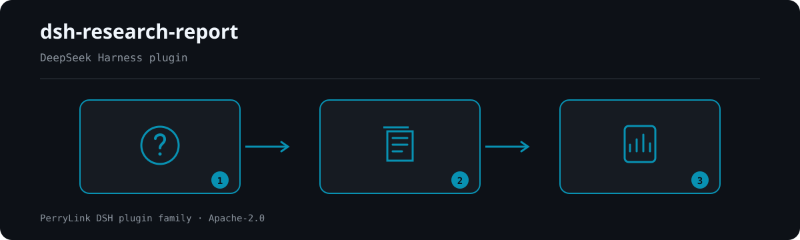

<div align="center">

# 📑 dsh-research-report
- **1024 store channel**: `npm i -g dsh1024` once, then `dsh1024 plugin --profile web add dsh-research-report` (counts toward the [deepseek1024.com](https://deepseek1024.com) install ranking).
[](https://gitee.com/perrylink/dsh-research-report)
[](https://dshfind.com/plugins/PerryLink/dsh-research-report?ref=badge)
[](https://api.securityscorecards.dev/projects/github.com/PerryLink/dsh-research-report)

**A verifiable research-report engine for DeepSeek Harness.**

*Every claim is bound to immutable evidence snapshots, verified byte-for-byte, and sealed into a versioned report whose manifest hash anyone can recompute.*

[](LICENSE)
[](https://github.com/topics/dsh-plugin)
[](https://github.com/PerryLink/dsh-plugin-doctor#verified-徽章)
[](https://dsh.market/)
[](#)
[](https://github.com/PerryLink/dsh-research-report/actions)
[](https://github.com/PerryLink/dsh-research-report/releases)
[](https://www.npmjs.com/package/dsh-research-report)
[](https://www.npmjs.com/package/dsh-research-report)

[English](README.md) · [简体中文](README-zh.md) · [Español](README-es.md) · [Português](README-pt.md) · [हिन्दी](README-hi.md)

```sh
dsh plugin --profile <name> add dsh-research-report
```


</div>

---

**📖 Ecosystem knowledge base** — measured data, not marketing: [plugin development guide · plugin-selection data · maintenance criteria](https://perrylink.github.io/dsh-plugin-guide/).

<!-- star-cta -->
## Install & uninstall

```sh
dsh plugin --profile demo add dsh-research-report       # install
dsh plugin --profile demo remove dsh-research-report    # uninstall
```

Verify the row mounts: `dsh --profile demo --dump-config | grep dsh-research-report`.

## ⭐ 如果它帮到了你

这个插件是 [DSH 插件家族](https://github.com/PerryLink)的一员（95 个，全部 Apache-2.0）。如果你在用，**给个 star** —— 它不会解锁任何功能，但会让下一个人在搜索里更容易找到它。

*English:* part of a 95 plugin family for DeepSeek Harness. If it is useful, **a star helps the next person find it** — nothing is gated behind it.


## What is dsh-research-report?

A verifiable research-report engine for DeepSeek Harness.

Every claim is bound to immutable evidence snapshots, verified byte-for-byte, and sealed into a versioned report whose manifest hash anyone can recompute.



*Workflow overview: question → sealed sources → report. The examples below use the real command surface.*


## Compatibility

- DeepSeek Harness `dsh-v0.2.1-alpha.1` (verified 2026-09-25). npm dev/test line `0.1.7-rc.2`; peers `>=0.1.6-0 <0.2.0 || >=0.1.7-0 <0.2.0`. The compat matrix pins all four declared peer lines. On this line `Session.append`'s third parameter is a `SurfaceIntent` for surface-eligible types only, so `research-report/*` events still do not land in the session log: the ledger journals are the durable source of truth and the audit mirror activates only once a host knows the vocabulary (the regression lock in `test/events-gate.spec.ts` pins that).
0.1.5-alpha.1 (adapted 2026-09-09): the session envelope keeps its ignorable field for stored-log read compatibility only - Session.append still cannot stamp it, so audit-gate behavior is unchanged. Verified 2026-09-11 against the published 0.1.5-rc.2 types (full local gate chain); the compat workflow pins both declared peer lines.
- Node `^22.19.0 || >=24.0.0`, ESM only (`"type": "module"`).
- Peer dependencies: `@deepseek-ai/cordis ^4.0.2`, `@deepseek-ai/schemastery ^3.18.2`, and `@deepseek-ai/dsh-session`, `@deepseek-ai/dsh-tools`, `@deepseek-ai/dsh-system-prompt`, `@deepseek-ai/dsh-web`, `@deepseek-ai/dsh-jobs` at `>=0.1.6-0 <0.2.0 || >=0.1.7-0 <0.2.0`.
- Optional siblings (never required): `ctx.web` providers for URL capture/gather, `ctx.jobs` for background assembly, `ctx.dataQuality` (dsh-data-quality) for dataset citation cross-checks.

## What you get

- **Evidence ledger** — a content-addressed snapshot store (`<ledgerRoot>/objects/<sha256>` + JSONL journals). The same content is stored exactly once; snapshots are immutable; every read recomputes the hash, so tampering or deletion is detected instead of trusted.
- **Claim ↔ evidence binding** — claims register with the evidence ids they rely on; the ledger keeps the binding and every verification verdict (latest wins).
- **Byte-level verification** — every number and quoted span in a claim must be locatable verbatim in the bound snapshots. No bound evidence, or no checkable literal, marks the claim `unverified`; bound evidence that cannot confirm or deny the claimed literals marks it `insufficient`; a label whose snapshot value differs (the claimed value absent) marks it `disproven`; tampered/missing snapshots mark it `contradicted`. No semantics, no embeddings — auditable byte checks.
- **Optional numeric bridge** — when a claim cites a structured workspace dataset (CSV/JSON) and `dsh-data-quality` is mounted, citations are cross-checked with tolerances through its frozen `verifyCitations` contract; a dataset mismatch disproves the claim.
- **DOI evidence (zero network)** — DOI origins are validated deterministically (`10.xxxx/xxxx` structure, a prefix whitelist, and a DOI character set); invalid DOIs fail loud. Optional journal/year metadata is accepted, and `requireJournalMetadata` gates academic DOI evidence only when enabled.
- **Versioned sealed reports** — `<reportRoot>/<slug(topic)>/<YYYYMMDD-HHmmss>/report.md` + `manifest.json` + `verification.jsonl` + `disconfirmation.jsonl`; the seal hash is the SHA-256 of the manifest, which itself carries the report hash, every evidence hash, and the hash of each audit journal.
- **Pre-delivery re-audit & seal interception** — before sealing, every bound claim is re-verified offline and journaled to `verification.jsonl`; verdict drift, tampered/missing bound evidence, or a journal serialization failure blocks the seal (fail loud, no tunable).
- **Falsification ledger** — every contradicted or disproven claim is recorded in `disconfirmation.jsonl` (claim + evidence references + reason) and listed in the report's `falsification log` appendix.
- **Negative knowledge** — a disproven claim is remembered by its content hash (`disproofs.jsonl`); the same text re-reported against unchanged evidence is forced back to `disproven` and only re-verifies once the evidence changes.
- **Read-only verifier loop** — after sealing, a deterministic `verifySealedReport` fallback (zero network, zero model) recomputes the seal and audit hashes and re-checks every claim, writing the machine check to `verifier-note.md`; when `ctx.jobs` is mounted a read-only verifier job is also spawned (the model review is an enhancement, never a replacement).
- **Standalone verifier CLI** — `dsh-research-verify --report <dir> [--seal <sha256>] [--ledger <dir>] [--format json|sarif]` recomputes the seal hash + per-claim re-checks from the sealed directory alone and prints a JSON envelope or a SARIF 2.1.0 document (see [Verifier CLI](#verifier-cli)).
- **Session-anchored evidence** — `evidence_add` accepts an optional `sessionRef` (`sessionId` + `eventRange`, validated loud); the anchor is stored, rendered in Appendix B, and registered in the manifest and `verification.jsonl`. Session-anchored evidence verifies honestly as `unverified` (`session-anchored evidence requires a manual check against the session log`).
- **Honest gaps** — unverified, insufficient, contradicted, and disproven claims keep a visible `[未核实]` / `[证据不足]` / `[与证据矛盾]` / `[已证伪]` marker in the report body and are listed in Appendix A. Nothing is silently passed.
- **No deep-research loop** — retrieval orchestration is deliberately reused: `ctx.web` for search/fetch, `ctx.jobs` for long runs. Planning and synthesis stay with the model (or an upstream plugin).

## Quick start

```sh
dsh plugin --profile web add github:PerryLink/dsh-research-report
```

### git channel

```sh
# From a scratch profile (pins the commit; runs the self-contained `prepare` build)
dsh plugin --profile demo add "github:YOUR_ORG/dsh-research-report#<sha>"
# The profile's pnpm-workspace.yaml gains an allowBuilds entry for dsh-research-report on first add.
```

### npm channel

```sh
dsh plugin --profile demo add dsh-research-report
```

Both channels install the bundle row (see `cordis.patch.yml`) into the profile's `dsh.profile.bundles` stack and take effect on restart.

Then, in a session:

```
evidence_add({ origin: "docs/market.md", title: "Market snapshot" })     # → ev-1a2b3c4d5e6f
research_report({ topic: "示例行业概览", sections: [...], claims: [...], evidenceRefs: ["ev-1a2b…"] })
ledger_query({ claimId: "c1" })                                          # bindings + verdict
```

### Examples

These are the plugin's real entry points; install once, then call one.

#### Detailed example

**Command**

~~~sh
research_report({
  topic: "示例行业概览",
  sections: [{ heading: "市场规模", paragraphs: [{ text: "2025 年全球示例行业市场规模为 1,280 亿元。", claimIds: ["c1"] }] }],
  claims: [{ id: "c1", text: "市场规模为 1,280 亿元", evidenceIds: ["ev-5dc0a84d0e48"] }],
  evidenceRefs: ["ev-5dc0a84d0e48", "ev-c6cf024e0916", "ev-61f8f4533cb7"]
})
~~~

**Output**

~~~text
report sealed: /tmp/rr-test-4U2mlF/reports/示例行业概览/20261019-124904
seal (sha256 of manifest.json): 5c85c97597096ced281ca191d7abaaf7434f18b397d35ac81c31aa364a3b12f9
claims: 1 verified / 0 unverified / 0 contradicted / 0 insufficient / 0 disproven (of 1); evidence bound: 3
~~~

*Observed from `README.md:112-118,150; test/index.spec.ts:166-177; src/tools/research-report.ts:170-175`*

#### Failure branch

**Input**

~~~text
{"topic":"probe","sections":[{"heading":"Growth","paragraphs":[{"text":"Growth was 42%.","claimIds":["c1"]}]}],"claims":[{"id":"c1","text":"Growth was 42%.","evidenceIds":[]}]}
~~~

**Output**

~~~text
edge-case (no throw): isError=false; kind=sealed; verdicts[0]={"claimId":"c1","status":"unverified","note":"claim binds no evidence snapshot"}; counts={"verified":0,"unverified":1,"contradicted":0,"insufficient":0,"disproven":0}; evidenceCount=0; report.md marker=Growth was 42%. [未核实]
~~~

*Observed from `plugins/dsh-research-report/src/verify.ts:173-175 (unverified verdict); plugins/dsh-research-report/src/assemble.ts:209-220 (visible mark); plugins/dsh-research-report/README.md:87 (honest gaps); exercised through plugins/dsh-research-report/test/harness.ts`*

#### Brief examples

- `research_report`
- `ledger_query`

## Configuration

All tunables are Schemastery `Config` fields; invalid values fail the profile load loudly. Relative roots resolve against the harness working directory (the workspace).

| Key | Default | Description |
| --- | --- | --- |
| `enabled` | `true` | Master switch; `false` mounts nothing. |
| `ledgerRoot` | `.research-ledger` | Evidence-ledger directory (objects + JSONL journals). |
| `reportRoot` | `research-reports` | Sealed-report root (versioned per topic and timestamp). |
| `workspaceRoot` | *(host session working directory)* | Root for workspace-path evidence; defaults to the session working directory, then the harness cwd. |
| `maxEvidenceBytes` | `2097152` | Hard cap on one evidence snapshot's UTF-8 bytes. |
| `maxEvidencePerReport` | `200` | Hard cap on evidence items bound into one report. |
| `fetchTimeoutMs` | `20000` | Deadline (ms) for one `ctx.web` fetch during capture. |
| `requireJournalMetadata` | `false` | When true, DOI-typed evidence must carry a journal name and publication year at registration (fails loud otherwise). |

## Tools & surfaces

- **`evidence_add({ origin, content?, title? })`** — register one evidence snapshot. With `content` the text is stored verbatim; without it a URL origin is fetched through `ctx.web` and a workspace-relative path is read from disk (reads never escape the workspace). Returns the evidence id and SHA-256 hash.
- **`research_report({ topic, title?, sections, claims, evidenceRefs, gather?, depth?, background? })`** — assemble and seal a report: validate (unregistered claim references are rejected loudly), verify every claim, render `report.md` with visible markers, write `manifest.json`, and return the seal hash. `gather: true` runs ONE search round over `ctx.web` and returns captured candidate evidence plus an explicit gap list — it never auto-assembles. `background: true` returns `{ kind: 'background', jobId }` over `ctx.jobs`.
- **`ledger_query({ claimId? | evidenceId? })`** — read-only binding/verdict queries; evidence is re-hashed on read so a tampered or missing snapshot is reported explicitly. With no id, returns a ledger summary.
- **`ctx.researchReport.assemble(request)`** — the frozen service surface for sibling plugins (see `src/service.ts`; gated byte-for-byte by `scripts/verify-frozen-contract.mjs`).

## Permissions & data

`dsh-research-report` consumes only public seams: `ctx.tools`, `ctx.systemPrompt`, and optionally `ctx.web` / `ctx.jobs` / `ctx.dataQuality` (looked up at call time, never injected). It writes only inside the configured ledger and report roots (both default to workspace-local directories), reads workspace files only inside the workspace, and reaches the network exclusively through the harness web seam — never a direct `fetch`. Evidence snapshots are immutable and content-addressed; claim registrations are immutable; verdicts are append-only.

## Security boundaries

- **Tamper-evidence by construction** — every snapshot read recomputes SHA-256 against the index; a mismatch verifies the bound claims `contradicted` and `ledger_query` reports `integrity: tampered`/`missing`.
- **Workspace confinement** — local evidence reads resolve against the workspace root and refuse escapes (both sides are `path.resolve`d before comparison).
- **Fail-loud configuration** — invalid bounds throw at mount; unregistered claim references, unknown evidence ids, and id/content conflicts throw at assemble.
- **No credential handling, no hidden network** — URL capture rides `ctx.web` (provider selection, error taxonomy, and any SSRF policy stay with the deployment's web providers).
- **Reversible registrations** — every contribution goes through `ctx.effect()` / `register()`, so uninstall and hot reload are clean.

## Known limitations

- **Byte-level, not semantic** — the built-in check locates number/quote literals verbatim; paraphrased claims without a checkable literal verify as `unverified`, and a true claim whose number is absent while its label appears with a different value reads `contradicted`. This is a deliberate v1 choice (auditable beats clever).
- **Session events are adaptive** — the plugin declares typed `research-report/evidence`, `research-report/verify`, and `research-report/seal` session events, but the 0.1.5-alpha.1 `Session.append` still exposes no `ignorable` option and no plugin event-registration surface, so appends activate only when the host build knows the types (otherwise the persistence layer would refuse the log on restore). The ledger journals are always the durable source of truth.
- **Default profiles mount no fetch provider** — the shipped `dsh-base` mounts search only, so URL capture fails loud (`WEB_UNAVAILABLE`/`WEB_PROVIDER_UNAVAILABLE`) until a fetch provider is configured; search-based `gather` lists uncaptured sources in the gap list.
- **Single-workspace scope** — ledger and report roots resolve against the harness working directory at mount; multi-workspace deployments should configure absolute roots per profile.

## Verifier CLI

The standalone `dsh-research-verify` binary (bundled as `lib/cli.js`, zero `@deepseek-ai` imports) audits any sealed report directory without mounting the plugin:

```sh
dsh-research-verify --report <dir> [--seal <sha256>] [--ledger <dir>] [--format json|sarif]
```

- `--report <dir>` — the sealed report directory (`manifest.json` + `report.md` + the audit journals).
- `--seal <sha256>` — the expected seal hash to compare the recomputed manifest hash against. Omitted = the recomputed hash is reported without comparison.
- `--ledger <dir>` — the evidence ledger root (`objects/<sha256>` + `index.jsonl`) enabling per-claim byte-level re-checks. Omitted = claim re-checks are skipped honestly.
- `--format` — `json` (default) or `sarif` (SARIF 2.1.0).

It recomputes the seal hash (SHA-256 of `manifest.json`), the `report.md` hash, and the audit-journal hashes, re-runs the byte-level + integrity check for every claim, and exits non-zero when any performed check fails. The same `verifySealedReport` / `buildVerificationReport` / `renderSarif` / `renderVerificationJson` functions are exported from the package for library use.

## Development

```sh
pnpm install
pnpm run typecheck && pnpm run typecheck:ci
pnpm test
pnpm run build
pnpm run verify:self-contained && pnpm run verify:artifacts
node scripts/check-readme-sync.mjs
node scripts/verify-frozen-contract.mjs
pnpm pack
```

- `typecheck` resolves `@deepseek-ai/*` through the installed 0.1.7-rc.2 peers; `typecheck:ci` clears `skipLibCheck` and enables `verbatimModuleSyntax` against the published types. Both must stay green.
- Tests use the real `Context`/`Session`/`ToolRuntime`/`LocalJobRegistry`/`WebRuntime` from the 0.1.7-rc.2 peers; only network backends are scripted providers registered through the real `ctx.web` registries.
- Release: `node scripts/release.mjs <x.y.z>` (bumps, stamps CHANGELOG, re-runs the gate, commits + tags; never pushes).

## Topics

`dsh`, `dsh-plugin`, `deepseek-harness`, `cordis`, `research`, `evidence-ledger`, `verifiable-report`, `audit`, `citation-verification`

## Contributors

- [PerryLink](https://github.com/PerryLink) — original author and maintainer: plugin architecture, evidence ledger, byte-level verification, sealed reports, five-language documentation, CI and release automation.

## PerryLink DSH Plugin Family

This project is part of the DeepSeek Harness plugin family from [PerryLink](https://github.com/PerryLink). The roster stays collapsed below so every README keeps a short first screen; expand it to see every row and its status.

<details>
<summary>Expand all plugins</summary>

| Plugin | Status |
|---|---|
| **[dsh-aqua-input-check](https://github.com/PerryLink/dsh-aqua-input-check)** |  |
| **[dsh-archive-check](https://github.com/PerryLink/dsh-archive-check)** |  |
| **[dsh-auto-review](https://github.com/PerryLink/dsh-auto-review)** |  |
| **[dsh-autotier](https://github.com/PerryLink/dsh-autotier)** |  |
| **[dsh-bid-ca-precheck](https://github.com/PerryLink/dsh-bid-ca-precheck)** |  |
| **[dsh-bid-qual-check](https://github.com/PerryLink/dsh-bid-qual-check)** |  |
| **[dsh-cert-mcp](https://github.com/PerryLink/dsh-cert-mcp)** |  |
| **[dsh-checkpoint-rewind](https://github.com/PerryLink/dsh-checkpoint-rewind)** |  |
| **[dsh-click](https://github.com/PerryLink/dsh-click)** |  |
| **[dsh-composer-history](https://github.com/PerryLink/dsh-composer-history)** |  |
| **[dsh-contract-stance](https://github.com/PerryLink/dsh-contract-stance)** |  |
| **[dsh-customs-doc-check](https://github.com/PerryLink/dsh-customs-doc-check)** |  |
| **[dsh-data-quality](https://github.com/PerryLink/dsh-data-quality)** |  |
| **[dsh-demurrage-ledger](https://github.com/PerryLink/dsh-demurrage-ledger)** |  |
| **[dsh-doublecheck](https://github.com/PerryLink/dsh-doublecheck)** |  |
| **[dsh-drill-script-check](https://github.com/PerryLink/dsh-drill-script-check)** |  |
| **[dsh-eia-guide-check](https://github.com/PerryLink/dsh-eia-guide-check)** |  |
| **[dsh-emergency-plan](https://github.com/PerryLink/dsh-emergency-plan)** |  |
| **[dsh-essay-rubric-check](https://github.com/PerryLink/dsh-essay-rubric-check)** |  |
| **[dsh-evidence-check](https://github.com/PerryLink/dsh-evidence-check)** |  |
| **[dsh-export-ctl-check](https://github.com/PerryLink/dsh-export-ctl-check)** |  |
| **[dsh-fast](https://github.com/PerryLink/dsh-fast)** |  |
| **[dsh-fmea-table-check](https://github.com/PerryLink/dsh-fmea-table-check)** |  |
| **[dsh-forecast-penalty](https://github.com/PerryLink/dsh-forecast-penalty)** |  |
| **[dsh-fund-research](https://github.com/PerryLink/dsh-fund-research)** |  |
| **[dsh-github](https://github.com/PerryLink/dsh-github)** |  |
| **[dsh-gongwen-flow-check](https://github.com/PerryLink/dsh-gongwen-flow-check)** |  |
| **[dsh-gongwen-word-check](https://github.com/PerryLink/dsh-gongwen-word-check)** |  |
| **[dsh-guard-plan-qc](https://github.com/PerryLink/dsh-guard-plan-qc)** |  |
| **[dsh-hazchem-check](https://github.com/PerryLink/dsh-hazchem-check)** |  |
| **[dsh-hazplan-check](https://github.com/PerryLink/dsh-hazplan-check)** |  |
| **[dsh-hidden-risk-map](https://github.com/PerryLink/dsh-hidden-risk-map)** |  |
| **[dsh-hs-classify](https://github.com/PerryLink/dsh-hs-classify)** |  |
| **[dsh-icd-rule-check](https://github.com/PerryLink/dsh-icd-rule-check)** |  |
| **[dsh-industry-research](https://github.com/PerryLink/dsh-industry-research)** |  |
| **[dsh-lawcite-adapter](https://github.com/PerryLink/dsh-lawcite-adapter)** |  |
| **[dsh-laya](https://github.com/PerryLink/dsh-laya)** |  |
| **[dsh-lc-doc-check](https://github.com/PerryLink/dsh-lc-doc-check)** |  |
| **[dsh-learning-gap-check](https://github.com/PerryLink/dsh-learning-gap-check)** |  |
| **[dsh-library](https://github.com/PerryLink/dsh-library)** |  |
| **[dsh-local-ai](https://github.com/PerryLink/dsh-local-ai)** |  |
| **[dsh-lsp-actions](https://github.com/PerryLink/dsh-lsp-actions)** |  |
| **[dsh-mask](https://github.com/PerryLink/dsh-mask)** |  |
| **[dsh-mcp-panel](https://github.com/PerryLink/dsh-mcp-panel)** |  |
| **[dsh-medrec-qc](https://github.com/PerryLink/dsh-medrec-qc)** |  |
| **[dsh-memento](https://github.com/PerryLink/dsh-memento)** |  |
| **[dsh-nsfc-form-check](https://github.com/PerryLink/dsh-nsfc-form-check)** |  |
| **[dsh-nurse-record-check](https://github.com/PerryLink/dsh-nurse-record-check)** |  |
| **[dsh-observe](https://github.com/PerryLink/dsh-observe)** |  |
| **[dsh-origin-rvc-check](https://github.com/PerryLink/dsh-origin-rvc-check)** |  |
| **[dsh-ota-review-check](https://github.com/PerryLink/dsh-ota-review-check)** |  |
| **[dsh-output-styles](https://github.com/PerryLink/dsh-output-styles)** |  |
| **[dsh-paper-doc-adapter](https://github.com/PerryLink/dsh-paper-doc-adapter)** |  |
| **[dsh-permission-rules](https://github.com/PerryLink/dsh-permission-rules)** |  |
| **[dsh-permit-report-check](https://github.com/PerryLink/dsh-permit-report-check)** |  |
| **[dsh-pipeline-check](https://github.com/PerryLink/dsh-pipeline-check)** |  |
| **[dsh-pleading-draft](https://github.com/PerryLink/dsh-pleading-draft)** |  |
| **[dsh-plugin-doctor](https://github.com/PerryLink/dsh-plugin-doctor)** |  |
| **[dsh-plugin-guide](https://github.com/PerryLink/dsh-plugin-guide)** |  |
| **[dsh-plugin-kit](https://github.com/PerryLink/dsh-plugin-kit)** |  |
| **[dsh-plugin-upgrade](https://github.com/PerryLink/dsh-plugin-upgrade)** |  |
| **[dsh-policy-brief-draft](https://github.com/PerryLink/dsh-policy-brief-draft)** |  |
| **[dsh-power-loss-split](https://github.com/PerryLink/dsh-power-loss-split)** |  |
| **[dsh-power-ticket-check](https://github.com/PerryLink/dsh-power-ticket-check)** |  |
| **[dsh-ppap-check](https://github.com/PerryLink/dsh-ppap-check)** |  |
| **[dsh-protest-deadline](https://github.com/PerryLink/dsh-protest-deadline)** |  |
| **[dsh-railway-window](https://github.com/PerryLink/dsh-railway-window)** |  |
| **[dsh-repair-order-qc](https://github.com/PerryLink/dsh-repair-order-qc)** |  |
| **[dsh-research-report](https://github.com/PerryLink/dsh-research-report)** |  |
| **[dsh-review-reply-check](https://github.com/PerryLink/dsh-review-reply-check)** |  |
| **[dsh-rulefile-check](https://github.com/PerryLink/dsh-rulefile-check)** |  |
| **[dsh-safety-brief-check](https://github.com/PerryLink/dsh-safety-brief-check)** |  |
| **[dsh-score](https://github.com/PerryLink/dsh-score)** |  |
| **[dsh-session-sync](https://github.com/PerryLink/dsh-session-sync)** |  |
| **[dsh-site-log-check](https://github.com/PerryLink/dsh-site-log-check)** |  |
| **[dsh-skill-pack-security](https://github.com/PerryLink/dsh-skill-pack-security)** |  |
| **[dsh-soe-decision-check](https://github.com/PerryLink/dsh-soe-decision-check)** |  |
| **[dsh-soilwater-check](https://github.com/PerryLink/dsh-soilwater-check)** |  |
| **[dsh-sop-sync-check](https://github.com/PerryLink/dsh-sop-sync-check)** |  |
| **[dsh-spc-gbt-adapter](https://github.com/PerryLink/dsh-spc-gbt-adapter)** |  |
| **[dsh-talk](https://github.com/PerryLink/dsh-talk)** |  |
| **[dsh-tender-extract](https://github.com/PerryLink/dsh-tender-extract)** |  |
| **[dsh-tender-matrix](https://github.com/PerryLink/dsh-tender-matrix)** |  |
| **[dsh-test-drive](https://github.com/PerryLink/dsh-test-drive)** |  |
| **[dsh-ticktick](https://github.com/PerryLink/dsh-ticktick)** |  |
| **[dsh-translate](https://github.com/PerryLink/dsh-translate)** |  |
| **[dsh-warranty-calc](https://github.com/PerryLink/dsh-warranty-calc)** |  |
| **[dsh-budget](https://github.com/PerryLink/dsh-budget)** | 🧊 FROZEN — see the repo README |
| **[dsh-claude-move](https://github.com/PerryLink/dsh-claude-move)** | 🧊 FROZEN — see the repo README |
| **[dsh-defend](https://github.com/PerryLink/dsh-defend)** | 🧊 FROZEN — see the repo README |
| **[dsh-draw](https://github.com/PerryLink/dsh-draw)** | 🧊 FROZEN — see the repo README |
| **[dsh-reach](https://github.com/PerryLink/dsh-reach)** | 🧊 FROZEN — see the repo README |
| **[dsh-background-agents](https://github.com/PerryLink/dsh-background-agents)** | 🚫 RETIRED — see the repo README |
| **[dsh-session-pin](https://github.com/PerryLink/dsh-session-pin)** | 🚫 RETIRED — see the repo README |
| **[dsh-team-rooms](https://github.com/PerryLink/dsh-team-rooms)** | 🚫 RETIRED — see the repo README |

</details>

## License

Apache-2.0 — see [LICENSE](LICENSE).
