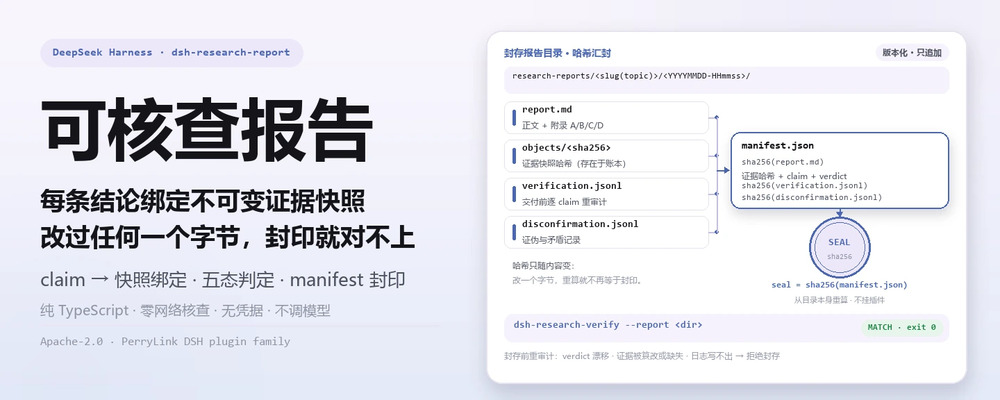
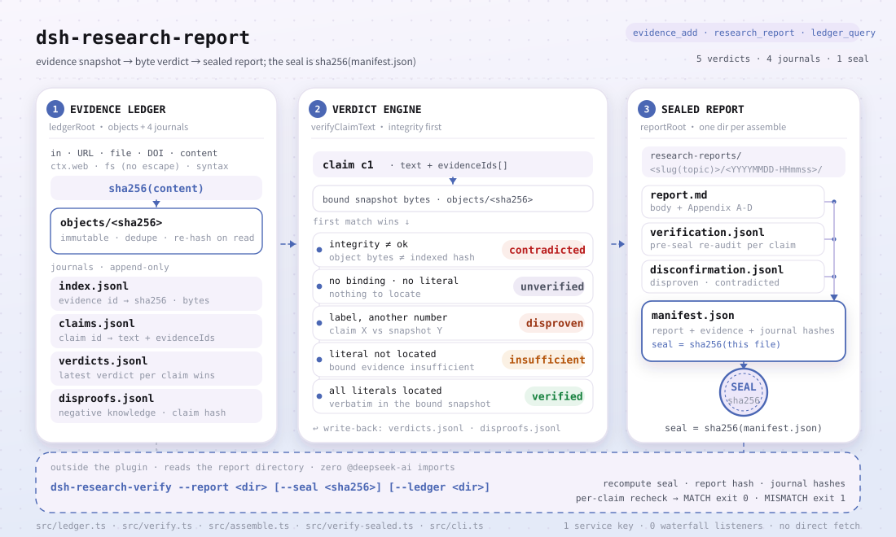

<div align="center">

<picture>
  <source media="(prefers-color-scheme: dark)" srcset="docs/assets/dsh-research-report-hero-zh-dark.webp">
  
</picture>

# dsh-research-report

**交出一份报告，每条结论都能被任何人在自己机器上离线复核——改过任何一个字节，密封哈希就会对不上。**

面向 DeepSeek Harness 的可核查研究报告引擎：claim 绑定不可变证据快照，数字与引文按字节核对，结果封存为版本化报告目录，封印就是 `manifest.json` 的 SHA-256。

[安装](#三步上手) · [配置](#配置) · [FAQ](#faq) · [简体中文](README.md) · [English](README.en.md) · [Español](README.es.md) · [Português](README.pt.md) · [हिन्दी](README.hi.md)

[](LICENSE)
[](#兼容性)
[](https://www.npmjs.com/package/dsh-research-report)
[](https://github.com/PerryLink/dsh-research-report/actions/workflows/ci.yml)
[](#兼容性)

[](https://github.com/PerryLink/dsh-research-report/stargazers)
[](https://www.npmjs.com/package/dsh-research-report)
[](https://dshfind.com/plugins/PerryLink/dsh-research-report?ref=badge)
[](https://securityscorecards.dev/viewer/?uri=github.com/PerryLink/dsh-research-report)
[](https://dsh.market/)
[](https://gitee.com/perrylink/dsh-research-report)

```sh
dsh plugin --profile <name> add dsh-research-report
```

</div>

<sub>社区插件，与 DeepSeek 官方无关。唯一仓库：<https://github.com/PerryLink/dsh-research-report>（Gitee 为镜像）。</sub>

## 它是什么

给模型一个主题和一组来源，`dsh-research-report` 把每条结论（claim）绑定到不可变的证据快照、逐字节核对数字与引文，再把结果封存成一份可独立复核的版本化报告。报告目录里有 `report.md`、`manifest.json` 和审计日志；封印哈希就是 `manifest.json` 的 SHA-256，拿到目录的人用 `dsh-research-verify` 就能离线重算，不需要挂载插件。它刻意不做深研循环：检索与抓取走 `ctx.web`，长任务走 `ctx.jobs`，规划与综合留给模型或上游插件。

<picture>
  <source media="(prefers-color-scheme: dark)" srcset="docs/assets/dsh-research-report-flow-v5-dark.svg">
  
</picture>

## 三步上手

1. **安装**（三选一）：

   ```sh
   # npm 通道（已发布版本）
   dsh plugin --profile web add dsh-research-report
   # git 通道（最新 main；等价于 git+https://github.com/PerryLink/dsh-research-report.git）
   dsh plugin --profile web add github:PerryLink/dsh-research-report
   # tarball 通道：本仓库 pnpm pack 后
   dsh plugin --profile web add ./dsh-research-report-<version>.tgz
   ```

   两条在线通道都会把 bundle 行（见 [`cordis.patch.yml`](cordis.patch.yml)）装入 profile 的 `dsh.profile.bundles` 层栈，**重启生效**。

2. **最小配置**（默认即可用；相对路径相对 harness 工作目录解析）：

   ```yaml
   - insert:
       - id: dsh-research-report
         name: dsh-research-report
         config:
           ledgerRoot: .research-ledger
           reportRoot: research-reports
   ```

3. **验证已生效**：

   ```sh
   dsh --profile web --dump-config | grep dsh-research-report
   ```

   然后在会话里跑一遍最小闭环，再用 CLI 复核封印：

   ```text
   evidence_add({ origin: "docs/market.md", title: "市场快照" })      # → ev-1a2b3c4d5e6f
   research_report({ topic: "...", sections: [...], claims: [...], evidenceRefs: ["ev-1a2b…"] })
   ledger_query({ claimId: "c1" })                                   # 绑定关系 + 核查结论
   ```

   ```sh
   dsh-research-verify --report research-reports/<topic>/<YYYYMMDD-HHmmss>
   ```

**卸载**：`dsh plugin --profile web remove dsh-research-report`（或从 profile patch 删掉该行）。

<details>
<summary>从 DSH Desktop 市场安装</summary>

所有 PerryLink 插件均可在 DSH Desktop 内置市场中浏览：**市场 → 来源 → 添加来源 → 粘贴** `https://perrylink-dsh-catalog.perrylink.workers.dev/catalog-source.json` **→ 选中**。安装仍需通过市场的 npm 身份校验与你的确认。

</details>

## 核心能力

`dsh-research-report` 的可信度来自三件事：证据不可变、核查可重算、缺口不隐藏。

- **证据账本**——内容寻址快照存储（`<ledgerRoot>/objects/<sha256>` + JSONL 日志）。同一内容只存一份；快照不可变；每次读取都重算哈希——篡改或删除会被发现，而不是被信任。
- **claim ↔ 证据绑定**——claim 登记时声明其依赖的证据 id；账本保存绑定关系与每一次核查结论（最新为准）。
- **字节级核查**——claim 文本中的每个数字与引文子串都必须能在其绑定快照中字面定位。无绑定证据或无核查字面量 → `unverified`；证据存在但不足以证实或证伪声称字面量 → `insufficient`；标签在快照中对应不同数值（且声称值不存在）→ `disproven`；快照被篡改/缺失 → `contradicted`。不做语义理解、不做向量相似——只做可审计的字节核对。
- **可选数字核查桥**——当 claim 引用 workspace 内结构化数据集（CSV/JSON）且 `dsh-data-quality` 已挂载时，经其冻结的 `verifyCitations` 契约做容差核对；数据集不一致即证伪该 claim。
- **DOI 证据（零网络）**——DOI 源做确定性语法校验（`10.xxxx/xxxx` 结构 + 前缀白名单 + DOI 字符集）；非法 DOI 响亮失败。可选期刊/年份元数据被接受；`requireJournalMetadata` 仅在启用时门禁学术 DOI 证据。
- **版本化封存报告**——`<reportRoot>/<slug(topic)>/<YYYYMMDD-HHmmss>/report.md` + `manifest.json` + `verification.jsonl` + `disconfirmation.jsonl`；封印哈希 = manifest 的 SHA-256，manifest 内含报告哈希、全部证据哈希与各审计日志哈希。
- **交付前重审计与封存拦截**——封存前对每条绑定证据的 claim 离线重跑一次核查并写入 `verification.jsonl`；verdict drift、绑定证据被篡改/缺失、或审计日志序列化失败都会拦截封存（响亮失败，无 tunable）。
- **证伪账本**——每条被证伪（disproven）或矛盾（contradicted）的 claim 记录进 `disconfirmation.jsonl`（claim + 证据引用 + 原因），并在报告的「证伪记录」附录列明。
- **负知识**——被证伪的 claim 按其内容哈希记入 `disproofs.jsonl`；同一文本在证据未变时被复报会被强制置回 `disproven`，证据变化后才允许重新核验。
- **只读 verifier 回环**——封存后先跑确定性兜底 `verifySealedReport`（零网络零模型）：重算封印与审计哈希、逐 claim 复核，把 machine-check 段落写入 `verifier-note.md`；挂载 `ctx.jobs` 时再派生只读 verifier job（模型复核为增强，绝不替代）。
- **会话锚定证据**——`evidence_add` 支持可选 `sessionRef`（`sessionId` + `eventRange`，格式校验响亮失败）；锚点入账并在附录 B、manifest、`verification.jsonl` 登记。会话锚定证据诚实判 `unverified`（`会话锚定证据需人工回查会话日志`）。
- **诚实缺口**——未核实/证据不足/有矛盾/已证伪的 claim 在正文中保留醒目标记 `[未核实]` / `[证据不足]` / `[与证据矛盾]` / `[已证伪]`，并在附录 A 列明。绝不静默通过。
- **不做深研循环**——检索编排刻意复用官方底座：搜索/抓取走 `ctx.web`，长任务走 `ctx.jobs`。规划与综合交给模型（或上游插件）。

### 工具面

- **`evidence_add({ origin, content?, title? })`**——登记一条证据。给 `content` 则按原文存储；不给时 URL 源经 `ctx.web` 抓取、workspace 相对路径从磁盘读取（读取绝不逃逸 workspace）。返回证据 id 与 SHA-256 哈希。
- **`research_report({ topic, title?, sections, claims, evidenceRefs, gather?, depth?, background? })`**——组装并封存报告：校验（claim 引用不全响亮拒绝）→ 逐条核查 → 渲染带醒目标记的 `report.md` → 写 `manifest.json` → 返回封印哈希。`gather: true` 先经 `ctx.web` 做一轮检索，返回已捕获候选证据与显式缺口清单——绝不自动成稿。`background: true` 经 `ctx.jobs` 返回 `{ kind: 'background', jobId }`。
- **`research_trail({ limit?, format? })`**——只读的 claim → 证据 → 结论轨迹：把已注册 claim 与证据、已存结论拼起来，把没有可解析证据的 claim 标为 **unbound**，列出悬空 evidence id，输出可交给审稿人的 Markdown（以及结构化行）。不新增存储、不改写结论。
- **`ledger_query({ claimId? | evidenceId? })`**——只读查询绑定关系与核查结论；证据读取时重算哈希，篡改/丢失会显式报告。不带 id 时返回账本摘要。
- **`ctx.researchReport.assemble(request)`**——面向兄弟插件的冻结服务表面（见 `src/service.ts`；由 [`scripts/verify-frozen-contract.mjs`](scripts/verify-frozen-contract.mjs) 逐字节门禁）。

### 示例

以下为插件真实入口；安装后调用一个即可。

**详细示例**

**命令**

~~~sh
research_report({
  topic: "示例行业概览",
  sections: [{ heading: "市场规模", paragraphs: [{ text: "2025 年全球示例行业市场规模为 1,280 亿元。", claimIds: ["c1"] }] }],
  claims: [{ id: "c1", text: "市场规模为 1,280 亿元", evidenceIds: ["ev-5dc0a84d0e48"] }],
  evidenceRefs: ["ev-5dc0a84d0e48", "ev-c6cf024e0916", "ev-61f8f4533cb7"]
})
~~~

**输出**

~~~text
report sealed: /tmp/rr-test-4U2mlF/reports/示例行业概览/20261019-124904
seal (sha256 of manifest.json): 5c85c97597096ced281ca191d7abaaf7434f18b397d35ac81c31aa364a3b12f9
claims: 1 verified / 0 unverified / 0 contradicted / 0 insufficient / 0 disproven (of 1); evidence bound: 3
~~~

*Observed from `README.md:112-118,150; test/index.spec.ts:166-177; src/tools/research-report.ts:170-175`*

**失败分支**

**输入**

~~~text
{"topic":"probe","sections":[{"heading":"Growth","paragraphs":[{"text":"Growth was 42%.","claimIds":["c1"]}]}],"claims":[{"id":"c1","text":"Growth was 42%.","evidenceIds":[]}]}
~~~

**输出**

~~~text
edge-case (no throw): isError=false; kind=sealed; verdicts[0]={"claimId":"c1","status":"unverified","note":"claim binds no evidence snapshot"}; counts={"verified":0,"unverified":1,"contradicted":0,"insufficient":0,"disproven":0}; evidenceCount=0; report.md marker=Growth was 42%. [未核实]
~~~

*Observed from `plugins/dsh-research-report/src/verify.ts:173-175 (unverified verdict); plugins/dsh-research-report/src/assemble.ts:209-220 (visible mark); plugins/dsh-research-report/README.md:87 (honest gaps); exercised through plugins/dsh-research-report/test/harness.ts`*

**简短示例**：`research_report` · `ledger_query` · `research_trail`

### dsh-research-verify CLI

独立二进制（打包为 `lib/cli.js`，零 `@deepseek-ai` 导入）无需挂载插件即可审计任意密封报告目录：

```sh
dsh-research-verify --report <dir> [--seal <sha256>] [--ledger <dir>] [--format json|sarif]
```

- `--report <dir>`：密封报告目录（`manifest.json` + `report.md` + 审计日志）。
- `--seal <sha256>`：期望的 seal 哈希，用于与重算的 manifest 哈希比对；缺省则只报告重算值、不比对。
- `--ledger <dir>`：证据账本根目录（`objects/<sha256>` + `index.jsonl`），用于逐 claim 字节级复检；缺省则如实跳过 claim 复检。
- `--format`：`json`（默认）或 `sarif`（SARIF 2.1.0）。

它重算 seal 哈希（`manifest.json` 的 SHA-256）、`report.md` 哈希与审计日志哈希，逐 claim 重跑字节级 + 完整性检查，任一已执行检查失败则以非零码退出。`verifySealedReport` / `buildVerificationReport` / `renderSarif` / `renderVerificationJson` 亦从包导出供库调用。

## 配置

全部可调项都是 Schemastery `Config` 字段；非法值在加载期响亮失败。相对路径根目录相对 harness 工作目录（workspace）解析。`cordis.patch.yml` 逐键内联注释。

最常用键：

| 键 | 默认值 | 含义 |
| --- | --- | --- |
| `enabled` | `true` | 总开关；`false` 时什么都不挂载。 |
| `ledgerRoot` | `.research-ledger` | 证据账本目录（对象 + JSONL 日志）。 |
| `reportRoot` | `research-reports` | 封存报告根目录（按主题 + 时间戳版本化）。 |
| `workspaceRoot` | *（宿主会话工作目录）* | 路径证据的工作区根；默认取会话工作目录，其次取 harness cwd。 |
| `maxEvidenceBytes` | `2097152` | 单条证据快照的 UTF-8 字节硬上限。 |
| `maxEvidencePerReport` | `200` | 单份报告可绑定证据条数硬上限。 |

<details>
<summary>完整配置表（8 个键）</summary>

| 键 | 默认值 | 含义 |
| --- | --- | --- |
| `enabled` | `true` | 总开关；`false` 时什么都不挂载。 |
| `ledgerRoot` | `.research-ledger` | 证据账本目录（对象 + JSONL 日志）。 |
| `reportRoot` | `research-reports` | 封存报告根目录（按主题 + 时间戳版本化）。 |
| `workspaceRoot` | *（宿主会话工作目录）* | 路径证据的工作区根；默认取会话工作目录，其次取 harness cwd。 |
| `maxEvidenceBytes` | `2097152` | 单条证据快照的 UTF-8 字节硬上限。 |
| `maxEvidencePerReport` | `200` | 单份报告可绑定证据条数硬上限。 |
| `fetchTimeoutMs` | `20000` | 抓取时单次 `ctx.web` fetch 的超时（毫秒）。 |
| `requireJournalMetadata` | `false` | 为 `true` 时，DOI 类证据登记必须带期刊名与出版年份（否则响亮失败）。 |

</details>

profile patch 覆盖示例：

```yaml
- insert:
    - id: dsh-research-report
      name: dsh-research-report
      config:
        reportRoot: research-reports/acme
        maxEvidencePerReport: 100
        requireJournalMetadata: true
```

## FAQ

<details>
<summary>账本和报告到底写在哪？删掉会怎样？</summary>

两者都在配置的根目录内：`ledgerRoot`（默认 `.research-ledger`）与 `reportRoot`（默认 `research-reports`），相对路径相对 harness 工作目录解析。快照按内容寻址且不可变，同一内容只存一份；删除或改写对象后，下一次读取重算哈希就会失败，绑定它的 claim 判 `contradicted`，`ledger_query` 报告 `integrity: missing`/`tampered`——不会悄悄当没事发生。

</details>

<details>
<summary>没有配置 fetch provider 时会怎样？会静默降级吗？</summary>

不会静默。官方 `dsh-base` 只挂搜索，配置 fetch provider 之前 URL 抓取会响亮失败（`WEB_UNAVAILABLE`/`WEB_PROVIDER_UNAVAILABLE`）；基于搜索的 `gather` 会把未捕获的来源列进缺口清单，绝不编造证据、绝不自动成稿。

</details>

<details>
<summary>和 dsh-data-quality 会冲突吗？</summary>

不冲突。`ctx.dataQuality` 是可选的，只在调用时经 `ctx.get` 判空使用，从不写入 `inject`；存在时按它冻结的 `verifyCitations` 契约做数据集引文核对，不存在时该分支如实跳过。本插件本身不注册任何 waterfall 监听器。

</details>

<details>
<summary>性能开销多大？</summary>

核查是纯字节操作：零网络、零模型调用，代价随 claim 中的数字/引文字面量与绑定快照大小线性增长。封存前的重审计同样是确定性的重复核对。唯一的外部等待是证据抓取，受 `fetchTimeoutMs`（默认 20000 ms）约束；长报告可走 `background: true` 交给 `ctx.jobs`。

</details>

<details>
<summary>为什么我的转述结论被判 unverified？</summary>

这是字节级设计的必然结果：内置核查只定位数字与引文字面量，不能判断改写前后的语义等价。见「已知限制」第一条——可审计优先于聪明。

</details>

## 安全边界

- **构造级防篡改**——每次快照读取都对照索引重算 SHA-256；不匹配时绑定 claim 核查为 `contradicted`，`ledger_query` 报告 `integrity: tampered`/`missing`。
- **workspace 限制**——本地证据读取相对 workspace 根解析并拒绝逃逸（比较前两侧都经 `path.resolve`）。
- **配置响亮失败**——非法边界在挂载期抛错；claim 引用不全、未知证据 id、id/内容冲突在组装期抛错。
- **不碰凭据、无隐藏网络**——URL 抓取走 `ctx.web`（provider 选择、错误分类、SSRF 策略都留在部署方的 web provider）。
- **注册可逆**——所有贡献经 `ctx.effect()` / `register()`，卸载与热重载干净。

## 权限与数据

`dsh-research-report` 只消费公开 seam：`ctx.tools`、`ctx.systemPrompt`，以及可选的 `ctx.web` / `ctx.jobs` / `ctx.dataQuality`（调用时经 `ctx.get` 判空使用，绝不写入 inject）。写入只发生在配置的账本与报告根目录内（默认都是 workspace 本地目录）；本地文件读取不越出 workspace；网络访问只经 harness web seam——绝不直接 `fetch`。证据快照不可变且内容寻址；claim 登记不可变；核查结论只追加。

- **manifest 声明的权限**：`fs:workspace-write`、`network:ctx-web-only`、`session:read`、`session:write`、`native-code:none`（见 `package.json` 的 `dshWorkshop` 段）。
- **会话事件**：`research-report/evidence`、`research-report/verify`、`research-report/seal` 是自适应镜像；宿主认识该词表时才落盘，否则账本日志单独承担持久真相（见「已知限制」）。

## 已知限制

- **字节级而非语义级**——内置核查只做数字/引文字面定位；没有可核查字面量的转述性 claim 判 `unverified`；声称值缺失而标签对应其他数值时判 `contradicted`。这是 v1 的刻意选择（可审计优先于聪明）。
- **会话事件自适应**——插件声明了类型化的 `research-report/evidence`、`research-report/verify`、`research-report/seal` 会话事件，但 0.1.5-alpha.1 的 `Session.append` 仍不提供 `ignorable` 选项、也没有插件事件注册面，所以只有宿主 build 认识这些类型时才真正落盘（否则持久化层会在恢复时拒绝该日志）。账本日志始终是权威的持久事实源。
- **默认 profile 不挂载 fetch provider**——官方 `dsh-base` 只挂搜索，所以配置 fetch provider 之前 URL 抓取会响亮失败（`WEB_UNAVAILABLE`/`WEB_PROVIDER_UNAVAILABLE`）；基于搜索的 `gather` 会把未捕获的来源列入缺口清单。
- **单 workspace 作用域**——账本与报告根目录在挂载时相对 harness 工作目录解析；多 workspace 部署应在各 profile 配置绝对路径。

## 与其他 DSH 插件的互操作性

本插件在结构上不争夺其他插件的资源：

- **唯一服务键 `ctx.researchReport`**——由 `src/service.ts` 的 Service Definition 提供，不注册第二个服务键。
- **不注册 waterfall 监听器**——本插件没有 `ctx.on()` 监听器，因而不参与任何顺序敏感事件链；若未来新增，放行分支必须调用 `next()`。
- **不注册 HTTP 路由与客户端面**——没有 `webServer` 前缀、没有客户端 slot；它是纯 host 插件（仓库无 `client/`）。
- **patch 层只 insert 自己**——bundle patch 只插入 `dsh-research-report` 一行，不覆写内置行的 `config`。
- **可选协同按需取用**——`ctx.web` / `ctx.jobs` / `ctx.dataQuality` 都在调用时经 `ctx.get` 判空；未挂载时对应路径响亮失败并说明原因，而不是静默走另一条路。
- **冻结契约有门禁**——`ctx.researchReport.assemble`（`src/service.ts`）与 `CitationCheck*`（`src/verify.ts`）是兄弟插件共用的逐字节冻结块，`scripts/verify-frozen-contract.mjs` 在 CI 里守住漂移。

## 兼容性

| 维度 | 状态 |
| --- | --- |
| Harness | DeepSeek Harness `dsh-v0.2.1-alpha.1`（2026-09-25 已核验）。npm dev/test 线 `0.1.7-rc.2`；compat 矩阵同时钉住四条已声明 peer 线。0.1.5-alpha.1（2026-09-09 已适配）的会话信封保留 ignorable 字段但仅用于存量日志读取兼容——`Session.append` 仍无法盖章，门控行为不变。 |
| Node | `^22.19.0 \|\| >=24.9.0`，仅 ESM（`"type": "module"`） |
| 平台 | 任何 DSH 可运行处（纯 host；网络只经 `ctx.web`） |
| 模型 | 文本模型完全支持；核查是字节比对，不需要额外模型能力 |

Peer 依赖：`@deepseek-ai/cordis ^4.0.5-alpha.1`、`@deepseek-ai/schemastery ^3.18.5-alpha.1`，以及 `@deepseek-ai/dsh-session`、`@deepseek-ai/dsh-tools`、`@deepseek-ai/dsh-system-prompt`、`@deepseek-ai/dsh-web`、`@deepseek-ai/dsh-jobs`（范围见 `package.json`）。可选兄弟（绝不强制）：`ctx.web` 抓取、`ctx.jobs` 后台组装、`ctx.dataQuality` 数据集引文交叉核对。

## 生态与质量

- [Gitee 镜像](https://gitee.com/perrylink/dsh-research-report)（同步镜像，以 GitHub 为准）
- [dshfind 插件页](https://dshfind.com/plugins/PerryLink/dsh-research-report)（安装量与排名）
- [OpenSSF Scorecard 报告](https://securityscorecards.dev/viewer/?uri=github.com/PerryLink/dsh-research-report)（由 [.github/workflows/scorecard.yml](.github/workflows/scorecard.yml) 驱动）
- [dsh-plugin-doctor 验证报告](https://github.com/PerryLink/dsh-plugin-doctor#verified-徽章)
- [DSH Market](https://dsh.market/)（已上架）
- **1024 商店渠道**：先 `npm i -g dsh1024`，再 `dsh1024 plugin --profile web add dsh-research-report`（计入 [deepseek1024.com](https://deepseek1024.com) 安装排行）
- [生态实测知识库](https://perrylink.github.io/dsh-plugin-guide/)：插件开发指南 · 选型实测数据 · 维护取舍判据

## 开发

```sh
pnpm install
pnpm run typecheck && pnpm run typecheck:ci
pnpm test
pnpm run build
pnpm run verify:self-contained && pnpm run verify:artifacts
pnpm run verify:frozen-contract
node scripts/check-readme-sync.mjs
pnpm run check:lockfile
pnpm pack
```

- `typecheck` 经已安装的 0.1.7-rc.2 peer 解析 `@deepseek-ai/*`；`typecheck:ci` 关闭 `skipLibCheck` 并开启 `verbatimModuleSyntax` 对照已发布类型。两者都必须保持绿。
- 测试使用 0.1.7-rc.2 peer 的真实 `Context`/`Session`/`ToolRuntime`/`LocalJobRegistry`/`WebRuntime`；只有网络后端是注册进真实 `ctx.web` 注册表的脚本化 provider。
- 发布：`node scripts/release.mjs <x.y.z>`（bump、盖 CHANGELOG、重跑门禁、提交 + 打 tag；绝不 push）。
- 配图由 [`scripts/gen-readme-assets.py`](scripts/gen-readme-assets.py) 程序化生成（Python + Pillow）：Pillow 画 `docs/assets/dsh-research-report-hero-{zh,en}-{light,dark}.webp`（1440×576），手写 SVG 画 `docs/assets/dsh-research-report-flow-v5-{light,dark}.svg`（1100×660），可重复执行、深浅两版与五语共用。

目录布局：

| 路径 | 内容 |
| --- | --- |
| `src/index.ts` | function-plugin 契约（`name`/`inject`/`Config`/`apply`，无 default export） |
| `src/service.ts` | `ctx.researchReport` Service Definition + 逐字节冻结的 `assemble` 契约块 |
| `src/ledger.ts` | 内容寻址证据账本（对象 + JSONL 日志、读取重算哈希） |
| `src/verify.ts` | 字节级核查器 + 冻结的 `CitationCheck*` 桥类型 |
| `src/assemble.ts` | 纯组装：请求校验、`report.md` 渲染、确定性 `manifest.json`、封印 |
| `src/gather.ts` | 抓取（`ctx.web` / workspace 文件）与 `gather` 候选轮 |
| `src/tools/` | 四个消费者：`evidence_add`、`research_report`、`ledger_query`、`research_trail` |
| `test/` | vitest，使用真实 host 运行时；仅网络后端是脚本化 provider |
| `fixtures/` | 三条本地文档，覆盖 evidence → seal → tamper → contradicted 全流程 |

Topics：`dsh`、`dsh-plugin`、`deepseek-harness`、`cordis`、`research`、`evidence-ledger`、`verifiable-report`、`audit`、`citation-verification`

## 家族与致谢

本项目是 [PerryLink](https://github.com/PerryLink) 维护的 DeepSeek Harness 插件家族成员（全部 Apache-2.0）。如果这个插件帮到了你，**给个 star**——它不解锁任何功能，但会让下一个人更容易找到它。

- [@PerryLink](https://github.com/PerryLink) —— 原作者与维护者：插件架构、证据账本、字节级核验、密封报告、五语文档、CI 与发布自动化。

<details>
<summary>展开全部插件</summary>

| 插件 | 状态 |
|---|---|
| **[dsh-aqua-input-check](https://github.com/PerryLink/dsh-aqua-input-check)** |  |
| **[dsh-archive-check](https://github.com/PerryLink/dsh-archive-check)** |  |
| **[dsh-auto-review](https://github.com/PerryLink/dsh-auto-review)** |  |
| **[dsh-autotier](https://github.com/PerryLink/dsh-autotier)** | 🧊 已冻结 — 见仓库 README |
| **[dsh-bid-ca-precheck](https://github.com/PerryLink/dsh-bid-ca-precheck)** |  |
| **[dsh-bid-qual-check](https://github.com/PerryLink/dsh-bid-qual-check)** |  |
| **[dsh-cert-mcp](https://github.com/PerryLink/dsh-cert-mcp)** | 🧊 已冻结 — 见仓库 README |
| **[dsh-checkpoint-rewind](https://github.com/PerryLink/dsh-checkpoint-rewind)** |  |
| **[dsh-click](https://github.com/PerryLink/dsh-click)** |  |
| **[dsh-composer-history](https://github.com/PerryLink/dsh-composer-history)** |  |
| **[dsh-contract-stance](https://github.com/PerryLink/dsh-contract-stance)** |  |
| **[dsh-customs-doc-check](https://github.com/PerryLink/dsh-customs-doc-check)** |  |
| **[dsh-data-quality](https://github.com/PerryLink/dsh-data-quality)** |  |
| **[dsh-demurrage-ledger](https://github.com/PerryLink/dsh-demurrage-ledger)** |  |
| **[dsh-doublecheck](https://github.com/PerryLink/dsh-doublecheck)** |  |
| **[dsh-drill-script-check](https://github.com/PerryLink/dsh-drill-script-check)** |  |
| **[dsh-eia-guide-check](https://github.com/PerryLink/dsh-eia-guide-check)** |  |
| **[dsh-emergency-plan](https://github.com/PerryLink/dsh-emergency-plan)** |  |
| **[dsh-essay-rubric-check](https://github.com/PerryLink/dsh-essay-rubric-check)** |  |
| **[dsh-evidence-check](https://github.com/PerryLink/dsh-evidence-check)** |  |
| **[dsh-export-ctl-check](https://github.com/PerryLink/dsh-export-ctl-check)** |  |
| **[dsh-fast](https://github.com/PerryLink/dsh-fast)** |  |
| **[dsh-fmea-table-check](https://github.com/PerryLink/dsh-fmea-table-check)** |  |
| **[dsh-forecast-penalty](https://github.com/PerryLink/dsh-forecast-penalty)** |  |
| **[dsh-fund-research](https://github.com/PerryLink/dsh-fund-research)** |  |
| **[dsh-github](https://github.com/PerryLink/dsh-github)** |  |
| **[dsh-gongwen-flow-check](https://github.com/PerryLink/dsh-gongwen-flow-check)** |  |
| **[dsh-gongwen-word-check](https://github.com/PerryLink/dsh-gongwen-word-check)** |  |
| **[dsh-guard-plan-qc](https://github.com/PerryLink/dsh-guard-plan-qc)** |  |
| **[dsh-hazchem-check](https://github.com/PerryLink/dsh-hazchem-check)** |  |
| **[dsh-hazplan-check](https://github.com/PerryLink/dsh-hazplan-check)** |  |
| **[dsh-hidden-risk-map](https://github.com/PerryLink/dsh-hidden-risk-map)** |  |
| **[dsh-hs-classify](https://github.com/PerryLink/dsh-hs-classify)** |  |
| **[dsh-icd-rule-check](https://github.com/PerryLink/dsh-icd-rule-check)** |  |
| **[dsh-industry-research](https://github.com/PerryLink/dsh-industry-research)** |  |
| **[dsh-lawcite-adapter](https://github.com/PerryLink/dsh-lawcite-adapter)** |  |
| **[dsh-laya](https://github.com/PerryLink/dsh-laya)** |  |
| **[dsh-lc-doc-check](https://github.com/PerryLink/dsh-lc-doc-check)** |  |
| **[dsh-learning-gap-check](https://github.com/PerryLink/dsh-learning-gap-check)** |  |
| **[dsh-library](https://github.com/PerryLink/dsh-library)** |  |
| **[dsh-local-ai](https://github.com/PerryLink/dsh-local-ai)** |  |
| **[dsh-lsp-actions](https://github.com/PerryLink/dsh-lsp-actions)** |  |
| **[dsh-mask](https://github.com/PerryLink/dsh-mask)** |  |
| **[dsh-mcp-panel](https://github.com/PerryLink/dsh-mcp-panel)** |  |
| **[dsh-medrec-qc](https://github.com/PerryLink/dsh-medrec-qc)** |  |
| **[dsh-memento](https://github.com/PerryLink/dsh-memento)** |  |
| **[dsh-nsfc-form-check](https://github.com/PerryLink/dsh-nsfc-form-check)** |  |
| **[dsh-nurse-record-check](https://github.com/PerryLink/dsh-nurse-record-check)** |  |
| **[dsh-observe](https://github.com/PerryLink/dsh-observe)** |  |
| **[dsh-origin-rvc-check](https://github.com/PerryLink/dsh-origin-rvc-check)** |  |
| **[dsh-ota-review-check](https://github.com/PerryLink/dsh-ota-review-check)** |  |
| **[dsh-output-styles](https://github.com/PerryLink/dsh-output-styles)** |  |
| **[dsh-paper-doc-adapter](https://github.com/PerryLink/dsh-paper-doc-adapter)** |  |
| **[dsh-permission-rules](https://github.com/PerryLink/dsh-permission-rules)** |  |
| **[dsh-permit-report-check](https://github.com/PerryLink/dsh-permit-report-check)** |  |
| **[dsh-pipeline-check](https://github.com/PerryLink/dsh-pipeline-check)** |  |
| **[dsh-pleading-draft](https://github.com/PerryLink/dsh-pleading-draft)** |  |
| **[dsh-plugin-doctor](https://github.com/PerryLink/dsh-plugin-doctor)** | 🚫 已退役（仓库已归档） |
| **[dsh-plugin-guide](https://github.com/PerryLink/dsh-plugin-guide)** |  |
| **[dsh-plugin-kit](https://github.com/PerryLink/dsh-plugin-kit)** | 🚫 已退役（仓库已归档） |
| **[dsh-plugin-upgrade](https://github.com/PerryLink/dsh-plugin-upgrade)** | 🚫 已退役（仓库已归档） |
| **[dsh-policy-brief-draft](https://github.com/PerryLink/dsh-policy-brief-draft)** |  |
| **[dsh-power-loss-split](https://github.com/PerryLink/dsh-power-loss-split)** |  |
| **[dsh-power-ticket-check](https://github.com/PerryLink/dsh-power-ticket-check)** |  |
| **[dsh-ppap-check](https://github.com/PerryLink/dsh-ppap-check)** |  |
| **[dsh-protest-deadline](https://github.com/PerryLink/dsh-protest-deadline)** |  |
| **[dsh-railway-window](https://github.com/PerryLink/dsh-railway-window)** |  |
| **[dsh-repair-order-qc](https://github.com/PerryLink/dsh-repair-order-qc)** |  |
| **[dsh-research-report](https://github.com/PerryLink/dsh-research-report)** |  |
| **[dsh-review-reply-check](https://github.com/PerryLink/dsh-review-reply-check)** |  |
| **[dsh-rulefile-check](https://github.com/PerryLink/dsh-rulefile-check)** |  |
| **[dsh-safety-brief-check](https://github.com/PerryLink/dsh-safety-brief-check)** |  |
| **[dsh-score](https://github.com/PerryLink/dsh-score)** |  |
| **[dsh-session-sync](https://github.com/PerryLink/dsh-session-sync)** |  |
| **[dsh-site-log-check](https://github.com/PerryLink/dsh-site-log-check)** |  |
| **[dsh-skill-pack-security](https://github.com/PerryLink/dsh-skill-pack-security)** |  |
| **[dsh-soe-decision-check](https://github.com/PerryLink/dsh-soe-decision-check)** |  |
| **[dsh-soilwater-check](https://github.com/PerryLink/dsh-soilwater-check)** |  |
| **[dsh-sop-sync-check](https://github.com/PerryLink/dsh-sop-sync-check)** |  |
| **[dsh-spc-gbt-adapter](https://github.com/PerryLink/dsh-spc-gbt-adapter)** |  |
| **[dsh-talk](https://github.com/PerryLink/dsh-talk)** |  |
| **[dsh-tender-extract](https://github.com/PerryLink/dsh-tender-extract)** |  |
| **[dsh-tender-matrix](https://github.com/PerryLink/dsh-tender-matrix)** |  |
| **[dsh-test-drive](https://github.com/PerryLink/dsh-test-drive)** |  |
| **[dsh-ticktick](https://github.com/PerryLink/dsh-ticktick)** | 🚫 已退役（仓库已归档） |
| **[dsh-translate](https://github.com/PerryLink/dsh-translate)** |  |
| **[dsh-warranty-calc](https://github.com/PerryLink/dsh-warranty-calc)** |  |
| **[dsh-budget](https://github.com/PerryLink/dsh-budget)** | 🧊 已冻结 — 见仓库 README |
| **[dsh-claude-move](https://github.com/PerryLink/dsh-claude-move)** | 🧊 已冻结 — 见仓库 README |
| **[dsh-defend](https://github.com/PerryLink/dsh-defend)** | 🧊 已冻结 — 见仓库 README |
| **[dsh-draw](https://github.com/PerryLink/dsh-draw)** | 🧊 已冻结 — 见仓库 README |
| **[dsh-reach](https://github.com/PerryLink/dsh-reach)** | 🧊 已冻结 — 见仓库 README |
| **[dsh-background-agents](https://github.com/PerryLink/dsh-background-agents)** | 🚫 已退役（仓库已归档） |
| **[dsh-session-pin](https://github.com/PerryLink/dsh-session-pin)** | 🚫 已退役（仓库已归档） |
| **[dsh-team-rooms](https://github.com/PerryLink/dsh-team-rooms)** | 🚫 已退役（仓库已归档） |

</details>

## License

[LICENSE](LICENSE)（Apache License 2.0）© 2026 dsh-research-report contributors

<p align="center"><sub>Apache-2.0 · 社区插件，与 DeepSeek 无关。</sub></p>
