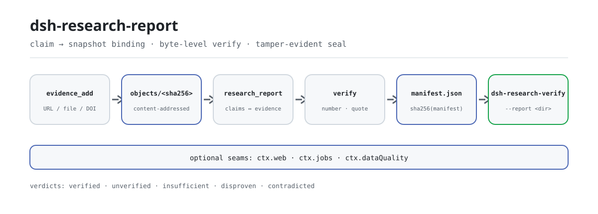

<div align="center">

<picture>
  <source media="(prefers-color-scheme: dark)" srcset="docs/assets/dsh-research-report-flow-dark.svg">
  
</picture>

# dsh-research-report

**Entregue um relatório cujas conclusões qualquer pessoa pode reverificar offline na própria máquina: mude um byte e o hash do selo deixa de bater.**

Motor de relatórios de pesquisa verificáveis para o DeepSeek Harness: cada claim é vinculado a snapshots de evidência imutáveis, números e citações são conferidos byte a byte, e o resultado é selado num diretório de relatório versionado cujo selo é o SHA-256 do `manifest.json`.

[Instalar](#instalação-em-três-passos) · [Configuração](#configuração) · [FAQ](#faq) · [简体中文](README.md) · [English](README.en.md) · [Español](README.es.md) · [Português](README.pt.md) · [हिन्दी](README.hi.md)

[](LICENSE)
[](#compatibilidade)
[](https://www.npmjs.com/package/dsh-research-report)
[](https://github.com/PerryLink/dsh-research-report/actions/workflows/ci.yml)
[](#compatibilidade)

[](https://github.com/PerryLink/dsh-research-report/stargazers)
[](https://www.npmjs.com/package/dsh-research-report)
[](https://dshfind.com/plugins/PerryLink/dsh-research-report?ref=badge)
[](https://securityscorecards.dev/viewer/?uri=github.com/PerryLink/dsh-research-report)
[](https://dsh.market/)
[](https://gitee.com/perrylink/dsh-research-report)

```sh
dsh plugin --profile <name> add dsh-research-report
```

</div>

<sub>Plugin da comunidade, sem afiliação com a DeepSeek. Repositório canônico: <https://github.com/PerryLink/dsh-research-report> (o Gitee é um espelho).</sub>

## O que é

Dê ao modelo um tema e um conjunto de fontes, e o `dsh-research-report` vincula cada claim a snapshots de evidência imutáveis, confere números e citações byte a byte e sela o resultado num diretório de relatório versionado que qualquer pessoa pode reverificar de forma independente. O diretório contém `report.md`, `manifest.json` e os diários de auditoria; o selo é o SHA-256 do `manifest.json`, e o `dsh-research-verify` o recalcula offline sem montar o plugin. Ele deliberadamente não embute um loop de deep-research: a recuperação roda sobre `ctx.web`, as execuções longas sobre `ctx.jobs`, e o planejamento e a síntese ficam com o modelo ou com um plugin upstream.

## Instalação em três passos

1. **Instalar** (escolha um canal):

   ```sh
   # canal npm (versões publicadas)
   dsh plugin --profile web add dsh-research-report
   # canal git (main mais recente; equivale a git+https://github.com/PerryLink/dsh-research-report.git)
   dsh plugin --profile web add github:PerryLink/dsh-research-report
   # canal tarball: pnpm pack neste repositório e depois
   dsh plugin --profile web add ./dsh-research-report-<version>.tgz
   ```

   Os dois canais online instalam a linha do bundle (ver [`cordis.patch.yml`](cordis.patch.yml)) na pilha `dsh.profile.bundles` do perfil; **reinicie para entrar em vigor**.

2. **Configuração mínima** (os padrões já funcionam; raízes relativas resolvem contra o diretório de trabalho do harness):

   ```yaml
   - insert:
       - id: dsh-research-report
         name: dsh-research-report
         config:
           ledgerRoot: .research-ledger
           reportRoot: research-reports
   ```

3. **Verificar se montou**:

   ```sh
   dsh --profile web --dump-config | grep dsh-research-report
   ```

   Depois execute o circuito mínimo numa sessão e confira o selo com a CLI:

   ```text
   evidence_add({ origin: "docs/market.md", title: "Market snapshot" })   # → ev-1a2b3c4d5e6f
   research_report({ topic: "...", sections: [...], claims: [...], evidenceRefs: ["ev-1a2b…"] })
   ledger_query({ claimId: "c1" })                                        # vínculos + veredicto
   ```

   ```sh
   dsh-research-verify --report research-reports/<topic>/<YYYYMMDD-HHmmss>
   ```

**Desinstalar**: `dsh plugin --profile web remove dsh-research-report` (ou remova a linha do patch do perfil).

<details>
<summary>Instalar a partir do mercado do DSH Desktop</summary>

Todos os plugins PerryLink estão no mercado embutido do DSH Desktop: **Mercado → Fontes → Adicionar fonte → colar** `https://perrylink-dsh-catalog.perrylink.workers.dev/catalog-source.json` **→ selecionar**. A instalação continua exigindo a verificação de identidade npm do mercado e a sua confirmação.

</details>

## Capacidades principais

Três coisas sustentam a confiança: a evidência é imutável, as verificações são recalculáveis e as lacunas nunca são escondidas.

- **Ledger de evidência** — armazém de snapshots endereçado por conteúdo (`<ledgerRoot>/objects/<sha256>` + diários JSONL). O mesmo conteúdo é guardado uma única vez; os snapshots são imutáveis; toda leitura recalcula o hash, de modo que adulteração ou remoção são detectadas em vez de confiadas.
- **Vínculo claim ↔ evidência** — os claims são registrados com os ids de evidência dos quais dependem; o ledger guarda o vínculo e cada veredicto de verificação (o mais recente vence).
- **Verificação em nível de byte** — cada número e trecho entre aspas de um claim precisa ser localizável literalmente nos snapshots vinculados. Sem evidência vinculada, ou sem literal verificável, o claim é marcado `unverified`; evidência vinculada que não confirma nem refuta os literais citados o marca `insufficient`; um rótulo cujo valor difere no snapshot (e o valor citado está ausente) o marca `disproven`; snapshots adulterados ou ausentes o marcam `contradicted`. Sem semântica, sem embeddings: apenas checagens de bytes auditáveis.
- **Ponte numérica opcional** — quando um claim cita um dataset estruturado do workspace (CSV/JSON) e o `dsh-data-quality` está montado, as citações são conferidas com tolerâncias pelo seu contrato congelado `verifyCitations`; uma divergência do dataset refuta o claim.
- **Evidência DOI (sem rede)** — origens DOI são validadas deterministicamente (estrutura `10.xxxx/xxxx`, lista de prefixos permitidos e conjunto de caracteres DOI); DOIs inválidos falham ruidosamente. Metadado opcional de revista/ano é aceito, e `requireJournalMetadata` só restringe evidência DOI acadêmica quando habilitado.
- **Relatórios selados versionados** — `<reportRoot>/<slug(topic)>/<YYYYMMDD-HHmmss>/report.md` + `manifest.json` + `verification.jsonl` + `disconfirmation.jsonl`; o hash do selo é o SHA-256 do manifesto, que por sua vez carrega o hash do relatório, os hashes de toda a evidência e o hash de cada diário de auditoria.
- **Reauditoria antes da entrega e interceptação do selo** — antes de selar, cada claim vinculado é reverificado offline e registrado em `verification.jsonl`; deriva de veredicto, evidência vinculada adulterada/ausente ou falha de serialização do diário bloqueiam o selo (falha ruidosa, sem tunable).
- **Ledger de falsificação** — cada claim contradito ou refutado é registrado em `disconfirmation.jsonl` (claim + referências de evidência + motivo) e listado no apêndice de registro de falsificação do relatório.
- **Conhecimento negativo** — um claim refutado é lembrado pelo hash de conteúdo (`disproofs.jsonl`); o mesmo texto re-reportado contra evidência inalterada é forçado de volta a `disproven` e só é reverificado quando a evidência muda.
- **Loop de verificação somente leitura** — após selar, o fallback determinístico `verifySealedReport` (sem rede, sem modelo) recalcula o selo e os hashes de auditoria e recheca cada claim, gravando a checagem de máquina em `verifier-note.md`; com `ctx.jobs` montado, um job de verificação somente leitura também é disparado (a revisão do modelo é um acréscimo, nunca um substituto).
- **Evidência ancorada na sessão** — `evidence_add` aceita um `sessionRef` opcional (`sessionId` + `eventRange`, validado ruidosamente); a âncora é guardada e registrada no Apêndice B, no manifesto e em `verification.jsonl`. Evidência ancorada na sessão verifica honestamente como `unverified` (`evidência ancorada na sessão exige uma checagem manual no log da sessão`).
- **Lacunas honestas** — claims não verificados, insuficientes, contraditos ou refutados mantêm uma marca visível no corpo do relatório e são listados no Apêndice A. Nada é aprovado em silêncio.
- **Sem loop de deep-research** — a orquestração de recuperação é deliberadamente reaproveitada: `ctx.web` para busca/coleta, `ctx.jobs` para execuções longas. Planejamento e síntese ficam com o modelo (ou com um plugin upstream).

### Superfície de ferramentas

- **`evidence_add({ origin, content?, title? })`** — registra um snapshot de evidência. Com `content` o texto é guardado tal e qual; sem ele, uma origem URL é coletada via `ctx.web` e um caminho relativo do workspace é lido do disco (as leituras nunca escapam do workspace). Retorna o id da evidência e o hash SHA-256.
- **`research_report({ topic, title?, sections, claims, evidenceRefs, gather?, depth?, background? })`** — monta e sela um relatório: valida (referências a claims não registrados são rejeitadas ruidosamente), verifica cada claim, renderiza `report.md` com marcas visíveis, grava `manifest.json` e retorna o hash do selo. `gather: true` roda UMA rodada de busca sobre `ctx.web` e retorna evidência candidata capturada mais uma lista explícita de lacunas; nunca monta automaticamente. `background: true` retorna `{ kind: 'background', jobId }` via `ctx.jobs`.
- **`ledger_query({ claimId? | evidenceId? })`** — consultas somente leitura de vínculos e veredictos; a evidência é re-hasheada na leitura, então um snapshot adulterado ou ausente é reportado explicitamente. Sem id, retorna um resumo do ledger.
- **`ctx.researchReport.assemble(request)`** — a superfície de serviço congelada para plugins irmãos (ver `src/service.ts`; protegida byte a byte por [`scripts/verify-frozen-contract.mjs`](scripts/verify-frozen-contract.mjs)).

### Exemplos

Estes são os pontos de entrada reais do plugin; instale uma vez e chame um.

**Exemplo detalhado**

**Comando**

~~~sh
research_report({
  topic: "示例行业概览",
  sections: [{ heading: "市场规模", paragraphs: [{ text: "2025 年全球示例行业市场规模为 1,280 亿元。", claimIds: ["c1"] }] }],
  claims: [{ id: "c1", text: "市场规模为 1,280 亿元", evidenceIds: ["ev-5dc0a84d0e48"] }],
  evidenceRefs: ["ev-5dc0a84d0e48", "ev-c6cf024e0916", "ev-61f8f4533cb7"]
})
~~~

**Saída**

~~~text
report sealed: /tmp/rr-test-4U2mlF/reports/示例行业概览/20261019-124904
seal (sha256 of manifest.json): 5c85c97597096ced281ca191d7abaaf7434f18b397d35ac81c31aa364a3b12f9
claims: 1 verified / 0 unverified / 0 contradicted / 0 insufficient / 0 disproven (of 1); evidence bound: 3
~~~

*Observed from `README.md:112-118,150; test/index.spec.ts:166-177; src/tools/research-report.ts:170-175`*

**Ramo de falha**

**Entrada**

~~~text
{"topic":"probe","sections":[{"heading":"Growth","paragraphs":[{"text":"Growth was 42%.","claimIds":["c1"]}]}],"claims":[{"id":"c1","text":"Growth was 42%.","evidenceIds":[]}]}
~~~

**Saída**

~~~text
edge-case (no throw): isError=false; kind=sealed; verdicts[0]={"claimId":"c1","status":"unverified","note":"claim binds no evidence snapshot"}; counts={"verified":0,"unverified":1,"contradicted":0,"insufficient":0,"disproven":0}; evidenceCount=0; report.md marker=Growth was 42%. [未核实]
~~~

*Observed from `plugins/dsh-research-report/src/verify.ts:173-175 (unverified verdict); plugins/dsh-research-report/src/assemble.ts:209-220 (visible mark); plugins/dsh-research-report/README.md:87 (honest gaps); exercised through plugins/dsh-research-report/test/harness.ts`*

**Exemplos breves**: `research_report` · `ledger_query`

### CLI dsh-research-verify

O binário independente (empacotado como `lib/cli.js`, zero importações de `@deepseek-ai`) audita qualquer diretório de relatório selado sem montar o plugin:

```sh
dsh-research-verify --report <dir> [--seal <sha256>] [--ledger <dir>] [--format json|sarif]
```

- `--report <dir>` — o diretório do relatório selado (`manifest.json` + `report.md` + os diários de auditoria).
- `--seal <sha256>` — o hash de selo esperado para comparar com o hash recalculado do manifesto. Omitido = o hash recalculado é informado sem comparação.
- `--ledger <dir>` — a raiz do ledger de evidência (`objects/<sha256>` + `index.jsonl`), habilitando as rechecagens byte a byte por claim. Omitido = as rechecagens são honestamente puladas.
- `--format` — `json` (padrão) ou `sarif` (SARIF 2.1.0).

Ele recalcula o hash do selo (SHA-256 do `manifest.json`), o hash do `report.md` e os hashes dos diários de auditoria, reexecuta a checagem byte a byte + de integridade para cada claim, e sai com código não zero quando qualquer checagem executada falha. As mesmas funções `verifySealedReport` / `buildVerificationReport` / `renderSarif` / `renderVerificationJson` são exportadas do pacote para uso como biblioteca.

## Configuração

Todos os ajustes são campos `Config` do Schemastery; valores inválidos falham ruidosamente no carregamento do perfil. Raízes relativas resolvem contra o diretório de trabalho do harness (o workspace). O `cordis.patch.yml` documenta cada chave inline.

Chaves mais usadas:

| Chave | Padrão | Significado |
| --- | --- | --- |
| `enabled` | `true` | Interruptor mestre; `false` não monta nada. |
| `ledgerRoot` | `.research-ledger` | Diretório do ledger de evidência (objetos + diários JSONL). |
| `reportRoot` | `research-reports` | Raiz dos relatórios selados (versionados por tema e timestamp). |
| `workspaceRoot` | *(diretório de trabalho da sessão do host)* | Raiz para evidência por caminho; padrão é o diretório da sessão, depois o cwd do harness. |
| `maxEvidenceBytes` | `2097152` | Limite rígido de bytes UTF-8 por snapshot de evidência. |
| `maxEvidencePerReport` | `200` | Limite rígido de evidências vinculadas a um relatório. |

<details>
<summary>Tabela completa de configuração (8 chaves)</summary>

| Chave | Padrão | Significado |
| --- | --- | --- |
| `enabled` | `true` | Interruptor mestre; `false` não monta nada. |
| `ledgerRoot` | `.research-ledger` | Diretório do ledger de evidência (objetos + diários JSONL). |
| `reportRoot` | `research-reports` | Raiz dos relatórios selados (versionados por tema e timestamp). |
| `workspaceRoot` | *(diretório de trabalho da sessão do host)* | Raiz para evidência por caminho; padrão é o diretório da sessão, depois o cwd do harness. |
| `maxEvidenceBytes` | `2097152` | Limite rígido de bytes UTF-8 por snapshot de evidência. |
| `maxEvidencePerReport` | `200` | Limite rígido de evidências vinculadas a um relatório. |
| `fetchTimeoutMs` | `20000` | Prazo (ms) de um `ctx.web` fetch durante a captura. |
| `requireJournalMetadata` | `false` | Quando true, evidência do tipo DOI precisa trazer nome de revista e ano de publicação no registro (caso contrário falha ruidosamente). |

</details>

Exemplo de override no patch do perfil:

```yaml
- insert:
    - id: dsh-research-report
      name: dsh-research-report
      config:
        reportRoot: research-reports/acme
        maxEvidencePerReport: 100
        requireJournalMetadata: true
```

## FAQ

<details>
<summary>Onde o ledger e os relatórios realmente ficam? O que acontece se eu apagar?</summary>

Ambos ficam sob as raízes configuradas: `ledgerRoot` (padrão `.research-ledger`) e `reportRoot` (padrão `research-reports`), resolvidas contra o diretório de trabalho do harness quando relativas. Os snapshots são endereçados por conteúdo e imutáveis, e o mesmo conteúdo é guardado uma única vez; apague ou reescreva um objeto e a checagem de hash da leitura seguinte falha, os claims vinculados verificam como `contradicted` e o `ledger_query` informa `integrity: missing`/`tampered` — nada é tratado como ok em silêncio.

</details>

<details>
<summary>O que acontece sem um provedor de fetch? Degrada em silêncio?</summary>

Nunca em silêncio. O `dsh-base` distribuído monta apenas busca, então a captura por URL falha ruidosamente (`WEB_UNAVAILABLE`/`WEB_PROVIDER_UNAVAILABLE`) até um provedor de fetch ser configurado; o `gather` baseado em busca lista as fontes não capturadas na lista de lacunas e nunca fabrica evidência nem monta relatório automaticamente.

</details>

<details>
<summary>Conflita com o dsh-data-quality?</summary>

Não. `ctx.dataQuality` é opcional e é consultado com `ctx.get` em tempo de chamada — nunca injetado. Quando presente, cruza citações de datasets pelo contrato congelado `verifyCitations`; quando ausente, esse caminho é honestamente ignorado. Este plugin não registra nenhum listener waterfall.

</details>

<details>
<summary>Qual é o custo de desempenho?</summary>

A verificação é puro trabalho de bytes: sem rede, sem chamadas de modelo, linear no número de literais numéricos e entre aspas de um claim e no tamanho dos snapshots vinculados. A reauditoria antes do selo é o mesmo trabalho determinístico repetido. A única espera externa é a captura de evidência, limitada por `fetchTimeoutMs` (20000 ms por padrão); relatórios longos podem rodar com `background: true` sobre `ctx.jobs`.

</details>

<details>
<summary>Por que meu claim parafraseado verifica como unverified?</summary>

É o desenho em nível de byte: a checagem embutida localiza literais numéricos e entre aspas e não consegue julgar equivalência semântica de uma reescrita. Ver a primeira entrada de Limitações conhecidas: auditável antes de esperto.

</details>

## Limites de segurança

- **Anti-adulteração por construção** — toda leitura de snapshot recalcula o SHA-256 contra o índice; uma divergência faz os claims vinculados verificarem como `contradicted` e o `ledger_query` reporta `integrity: tampered`/`missing`.
- **Confinamento ao workspace** — leituras locais de evidência resolvem contra a raiz do workspace e recusam escapes (ambos os lados passam por `path.resolve` antes da comparação).
- **Configuração que falha ruidosamente** — limites inválidos lançam na montagem; referências a claims não registrados, ids de evidência desconhecidos e conflitos de id/conteúdo lançam na montagem do relatório.
- **Sem manuseio de credenciais, sem rede oculta** — a captura por URL passa por `ctx.web` (seleção de provedor, taxonomia de erros e qualquer política SSRF ficam com os provedores web da implantação).
- **Registros reversíveis** — cada contribuição passa por `ctx.effect()` / `register()`, então desinstalação e recarga a quente ficam limpas.

## Permissões e dados

O `dsh-research-report` consome apenas seams públicos: `ctx.tools`, `ctx.systemPrompt` e, opcionalmente, `ctx.web` / `ctx.jobs` / `ctx.dataQuality` (consultados com `ctx.get` em tempo de chamada, nunca injetados). Ele só escreve dentro das raízes configuradas do ledger e dos relatórios (ambas, por padrão, diretórios locais do workspace), lê arquivos do workspace apenas dentro do workspace e alcança a rede exclusivamente pelo seam web do harness — nunca com `fetch` direto. Os snapshots de evidência são imutáveis e endereçados por conteúdo; os registros de claims são imutáveis; os veredictos são apenas anexados.

- **Permissões declaradas no manifesto**: `fs:workspace-write`, `network:ctx-web-only`, `session:read`, `session:write`, `native-code:none` (ver o bloco `dshWorkshop` em `package.json`).
- **Eventos de sessão**: `research-report/evidence`, `research-report/verify` e `research-report/seal` são um espelho adaptativo; só chegam ao log da sessão quando o host conhece o vocabulário, caso contrário os diários do ledger carregam a verdade durável (ver Limitações conhecidas).

## Limitações conhecidas

- **Em nível de byte, não semântico** — a checagem embutida localiza literais numéricos e entre aspas literalmente; claims parafraseados sem literal verificável verificam como `unverified`, e um claim verdadeiro cujo número está ausente enquanto seu rótulo aparece com outro valor é lido como `contradicted`. É uma escolha deliberada da v1 (auditável antes de esperto).
- **Os eventos de sessão são adaptativos** — o plugin declara eventos de sessão tipados `research-report/evidence`, `research-report/verify` e `research-report/seal`, mas o `Session.append` de 0.1.5-alpha.1 ainda não expõe a opção `ignorable` nem uma superfície de registro de eventos de plugin, então os appends só ativam quando o build do host conhece os tipos (caso contrário a camada de persistência recusaria o log na restauração). Os diários do ledger são sempre a fonte durável de verdade.
- **Perfis padrão não montam provedor de fetch** — o `dsh-base` distribuído monta apenas busca, então a captura por URL falha ruidosamente (`WEB_UNAVAILABLE`/`WEB_PROVIDER_UNAVAILABLE`) até configurar um provedor de fetch; o `gather` baseado em busca lista as fontes não capturadas na lista de lacunas.
- **Escopo de um único workspace** — as raízes do ledger e dos relatórios resolvem contra o diretório de trabalho do harness na montagem; implantações multi-workspace devem configurar raízes absolutas por perfil.

## Interoperabilidade com outros plugins DSH

Este plugin não disputa estruturalmente recursos de outro plugin:

- **Uma única chave de serviço, `ctx.researchReport`** — fornecida pela Service Definition em `src/service.ts`; nenhuma segunda chave de serviço é registrada.
- **Sem listeners waterfall** — o plugin não registra nenhum listener `ctx.on()`, então não participa de nenhuma cadeia de eventos sensível à ordem; se um for adicionado um dia, o ramo de allow/passthrough DEVE chamar `next()`.
- **Sem rotas HTTP nem superfície de cliente** — não há prefixo `webServer` nem slot de cliente; é um plugin puramente host (o repositório não tem `client/`).
- **A camada de patch só insere a própria linha** — o patch do bundle insere `dsh-research-report` e nunca sobrescreve o `config` de uma linha embutida.
- **Os irmãos opcionais são consultados sob demanda** — `ctx.web` / `ctx.jobs` / `ctx.dataQuality` são resolvidos com `ctx.get` em tempo de chamada; quando faltam, o caminho afetado falha ruidosamente com um motivo explícito em vez de silenciosamente tomar outro caminho.
- **Contratos congelados têm porta** — `ctx.researchReport.assemble` (`src/service.ts`) e `CitationCheck*` (`src/verify.ts`) são blocos congelados byte a byte compartilhados com plugins irmãos, e `scripts/verify-frozen-contract.mjs` vigia a deriva no CI.

## Compatibilidade

| Superfície | Estado |
| --- | --- |
| Harness | DeepSeek Harness `dsh-v0.2.1-alpha.1` (verificado em 2026-09-25). Linha npm dev/test `0.1.7-rc.2`; a matriz compat fixa as quatro linhas peer declaradas. Na 0.1.5-alpha.1 (adaptado em 2026-09-09) o envelope de sessão mantém o campo ignorable apenas para compatibilidade de leitura de logs armazenados; o `Session.append` ainda não consegue estampá-lo, então o comportamento da porta de auditoria não muda. |
| Node | `^22.19.0 \|\| >=24.9.0`, somente ESM (`"type": "module"`) |
| Plataformas | Onde o DSH rodar (host puro; a rede só é alcançada via `ctx.web`) |
| Modelo | Modelos de texto totalmente suportados; a verificação é comparação de bytes, sem capacidade extra de modelo |

Dependências peer: `@deepseek-ai/cordis ^4.0.5-alpha.1`, `@deepseek-ai/schemastery ^3.18.5-alpha.1`, e `@deepseek-ai/dsh-session`, `@deepseek-ai/dsh-tools`, `@deepseek-ai/dsh-system-prompt`, `@deepseek-ai/dsh-web`, `@deepseek-ai/dsh-jobs` (faixas em `package.json`). Irmãos opcionais (nunca obrigatórios): `ctx.web` para captura, `ctx.jobs` para montagem em segundo plano, `ctx.dataQuality` para cruzamento de citações de datasets.

## Ecossistema e qualidade

- [Espelho no Gitee](https://gitee.com/perrylink/dsh-research-report) (espelho sincronizado; o GitHub é o canônico)
- [Página do plugin no dshfind](https://dshfind.com/plugins/PerryLink/dsh-research-report) (instalações e ranking)
- [Relatório OpenSSF Scorecard](https://securityscorecards.dev/viewer/?uri=github.com/PerryLink/dsh-research-report) (movido por [.github/workflows/scorecard.yml](.github/workflows/scorecard.yml))
- [Relatório de verificação do dsh-plugin-doctor](https://github.com/PerryLink/dsh-plugin-doctor#verified-徽章)
- [DSH Market](https://dsh.market/) (listado)
- **Canal da loja 1024**: `npm i -g dsh1024` uma vez e depois `dsh1024 plugin --profile web add dsh-research-report` (conta para o ranking de instalações do [deepseek1024.com](https://deepseek1024.com))
- [Base de conhecimento do ecossistema](https://perrylink.github.io/dsh-plugin-guide/): dados medidos, não marketing: guia de desenvolvimento de plugins · dados de seleção · critérios de manutenção

## Desenvolvimento

```sh
pnpm install
pnpm run typecheck && pnpm run typecheck:ci
pnpm test
pnpm run build
pnpm run verify:self-contained && pnpm run verify:artifacts
pnpm run verify:frozen-contract
node scripts/check-readme-sync.mjs
pnpm run check:lockfile
pnpm pack
```

- `typecheck` resolve `@deepseek-ai/*` pelos peers 0.1.7-rc.2 instalados; `typecheck:ci` remove `skipLibCheck` e habilita `verbatimModuleSyntax` contra os tipos publicados. Ambos precisam ficar verdes.
- Os testes usam os `Context`/`Session`/`ToolRuntime`/`LocalJobRegistry`/`WebRuntime` reais dos peers 0.1.7-rc.2; apenas os backends de rede são provedores scriptados registrados nos registros reais de `ctx.web`.
- Release: `node scripts/release.mjs <x.y.z>` (bump, carimba CHANGELOG, reexecuta a porta, commit + tag; nunca faz push).
- As imagens do README são geradas programaticamente por [`scripts/gen-readme-assets.py`](scripts/gen-readme-assets.py) (Python + Pillow): diagramas de fluxo SVG escritos à mão em `docs/assets/dsh-research-report-flow-{light,dark}.svg`, seguros de reexecutar e compartilhados pelos cinco idiomas.

Estrutura de diretórios:

| Caminho | Conteúdo |
| --- | --- |
| `src/index.ts` | Contrato function-plugin (`name`/`inject`/`Config`/`apply`, sem default export) |
| `src/service.ts` | Service Definition de `ctx.researchReport` + o bloco de contrato `assemble` congelado byte a byte |
| `src/ledger.ts` | O ledger de evidência endereçado por conteúdo (objetos + diários JSONL, re-hash na leitura) |
| `src/verify.ts` | O verificador em nível de byte + os tipos de ponte `CitationCheck*` congelados |
| `src/assemble.ts` | Montagem pura: validação da requisição, render de `report.md`, `manifest.json` determinístico, selo |
| `src/gather.ts` | Captura (`ctx.web` / arquivos do workspace) e a rodada de candidatos `gather` |
| `src/tools/` | Os três consumidores: `evidence_add`, `research_report`, `ledger_query` |
| `test/` | vitest sobre o runtime real do host; apenas os backends de rede são provedores scriptados |
| `fixtures/` | Três documentos locais cobrindo o fluxo evidence → seal → tamper → contradicted |

Topics: `dsh`, `dsh-plugin`, `deepseek-harness`, `cordis`, `research`, `evidence-ledger`, `verifiable-report`, `audit`, `citation-verification`

## Família e agradecimentos

Este projeto faz parte da família de plugins DeepSeek Harness da [PerryLink](https://github.com/PerryLink) (todos Apache-2.0). Se ele for útil, **uma estrela ajuda a próxima pessoa a encontrá-lo** — nada é bloqueado por isso.

- [@PerryLink](https://github.com/PerryLink) — autor original e mantenedor: arquitetura do plugin, ledger de evidência, verificação em nível de byte, relatórios selados, documentação em cinco idiomas, CI e automação de releases.

<details>
<summary>Expandir todos os plugins</summary>

| Plugin | Status |
|---|---|
| **[dsh-aqua-input-check](https://github.com/PerryLink/dsh-aqua-input-check)** |  |
| **[dsh-archive-check](https://github.com/PerryLink/dsh-archive-check)** |  |
| **[dsh-auto-review](https://github.com/PerryLink/dsh-auto-review)** |  |
| **[dsh-autotier](https://github.com/PerryLink/dsh-autotier)** | 🧊 CONGELADO — ver o README do repo |
| **[dsh-bid-ca-precheck](https://github.com/PerryLink/dsh-bid-ca-precheck)** |  |
| **[dsh-bid-qual-check](https://github.com/PerryLink/dsh-bid-qual-check)** |  |
| **[dsh-cert-mcp](https://github.com/PerryLink/dsh-cert-mcp)** | 🧊 CONGELADO — ver o README do repo |
| **[dsh-checkpoint-rewind](https://github.com/PerryLink/dsh-checkpoint-rewind)** |  |
| **[dsh-click](https://github.com/PerryLink/dsh-click)** |  |
| **[dsh-composer-history](https://github.com/PerryLink/dsh-composer-history)** |  |
| **[dsh-contract-stance](https://github.com/PerryLink/dsh-contract-stance)** |  |
| **[dsh-customs-doc-check](https://github.com/PerryLink/dsh-customs-doc-check)** |  |
| **[dsh-data-quality](https://github.com/PerryLink/dsh-data-quality)** |  |
| **[dsh-demurrage-ledger](https://github.com/PerryLink/dsh-demurrage-ledger)** |  |
| **[dsh-doublecheck](https://github.com/PerryLink/dsh-doublecheck)** |  |
| **[dsh-drill-script-check](https://github.com/PerryLink/dsh-drill-script-check)** |  |
| **[dsh-eia-guide-check](https://github.com/PerryLink/dsh-eia-guide-check)** |  |
| **[dsh-emergency-plan](https://github.com/PerryLink/dsh-emergency-plan)** |  |
| **[dsh-essay-rubric-check](https://github.com/PerryLink/dsh-essay-rubric-check)** |  |
| **[dsh-evidence-check](https://github.com/PerryLink/dsh-evidence-check)** |  |
| **[dsh-export-ctl-check](https://github.com/PerryLink/dsh-export-ctl-check)** |  |
| **[dsh-fast](https://github.com/PerryLink/dsh-fast)** |  |
| **[dsh-fmea-table-check](https://github.com/PerryLink/dsh-fmea-table-check)** |  |
| **[dsh-forecast-penalty](https://github.com/PerryLink/dsh-forecast-penalty)** |  |
| **[dsh-fund-research](https://github.com/PerryLink/dsh-fund-research)** |  |
| **[dsh-github](https://github.com/PerryLink/dsh-github)** |  |
| **[dsh-gongwen-flow-check](https://github.com/PerryLink/dsh-gongwen-flow-check)** |  |
| **[dsh-gongwen-word-check](https://github.com/PerryLink/dsh-gongwen-word-check)** |  |
| **[dsh-guard-plan-qc](https://github.com/PerryLink/dsh-guard-plan-qc)** |  |
| **[dsh-hazchem-check](https://github.com/PerryLink/dsh-hazchem-check)** |  |
| **[dsh-hazplan-check](https://github.com/PerryLink/dsh-hazplan-check)** |  |
| **[dsh-hidden-risk-map](https://github.com/PerryLink/dsh-hidden-risk-map)** |  |
| **[dsh-hs-classify](https://github.com/PerryLink/dsh-hs-classify)** |  |
| **[dsh-icd-rule-check](https://github.com/PerryLink/dsh-icd-rule-check)** |  |
| **[dsh-industry-research](https://github.com/PerryLink/dsh-industry-research)** |  |
| **[dsh-lawcite-adapter](https://github.com/PerryLink/dsh-lawcite-adapter)** |  |
| **[dsh-laya](https://github.com/PerryLink/dsh-laya)** |  |
| **[dsh-lc-doc-check](https://github.com/PerryLink/dsh-lc-doc-check)** |  |
| **[dsh-learning-gap-check](https://github.com/PerryLink/dsh-learning-gap-check)** |  |
| **[dsh-library](https://github.com/PerryLink/dsh-library)** |  |
| **[dsh-local-ai](https://github.com/PerryLink/dsh-local-ai)** |  |
| **[dsh-lsp-actions](https://github.com/PerryLink/dsh-lsp-actions)** |  |
| **[dsh-mask](https://github.com/PerryLink/dsh-mask)** |  |
| **[dsh-mcp-panel](https://github.com/PerryLink/dsh-mcp-panel)** |  |
| **[dsh-medrec-qc](https://github.com/PerryLink/dsh-medrec-qc)** |  |
| **[dsh-memento](https://github.com/PerryLink/dsh-memento)** |  |
| **[dsh-nsfc-form-check](https://github.com/PerryLink/dsh-nsfc-form-check)** |  |
| **[dsh-nurse-record-check](https://github.com/PerryLink/dsh-nurse-record-check)** |  |
| **[dsh-observe](https://github.com/PerryLink/dsh-observe)** |  |
| **[dsh-origin-rvc-check](https://github.com/PerryLink/dsh-origin-rvc-check)** |  |
| **[dsh-ota-review-check](https://github.com/PerryLink/dsh-ota-review-check)** |  |
| **[dsh-output-styles](https://github.com/PerryLink/dsh-output-styles)** |  |
| **[dsh-paper-doc-adapter](https://github.com/PerryLink/dsh-paper-doc-adapter)** |  |
| **[dsh-permission-rules](https://github.com/PerryLink/dsh-permission-rules)** |  |
| **[dsh-permit-report-check](https://github.com/PerryLink/dsh-permit-report-check)** |  |
| **[dsh-pipeline-check](https://github.com/PerryLink/dsh-pipeline-check)** |  |
| **[dsh-pleading-draft](https://github.com/PerryLink/dsh-pleading-draft)** |  |
| **[dsh-plugin-doctor](https://github.com/PerryLink/dsh-plugin-doctor)** | 🚫 APOSENTADO (repo arquivado) |
| **[dsh-plugin-guide](https://github.com/PerryLink/dsh-plugin-guide)** |  |
| **[dsh-plugin-kit](https://github.com/PerryLink/dsh-plugin-kit)** | 🚫 APOSENTADO (repo arquivado) |
| **[dsh-plugin-upgrade](https://github.com/PerryLink/dsh-plugin-upgrade)** | 🚫 APOSENTADO (repo arquivado) |
| **[dsh-policy-brief-draft](https://github.com/PerryLink/dsh-policy-brief-draft)** |  |
| **[dsh-power-loss-split](https://github.com/PerryLink/dsh-power-loss-split)** |  |
| **[dsh-power-ticket-check](https://github.com/PerryLink/dsh-power-ticket-check)** |  |
| **[dsh-ppap-check](https://github.com/PerryLink/dsh-ppap-check)** |  |
| **[dsh-protest-deadline](https://github.com/PerryLink/dsh-protest-deadline)** |  |
| **[dsh-railway-window](https://github.com/PerryLink/dsh-railway-window)** |  |
| **[dsh-repair-order-qc](https://github.com/PerryLink/dsh-repair-order-qc)** |  |
| **[dsh-research-report](https://github.com/PerryLink/dsh-research-report)** |  |
| **[dsh-review-reply-check](https://github.com/PerryLink/dsh-review-reply-check)** |  |
| **[dsh-rulefile-check](https://github.com/PerryLink/dsh-rulefile-check)** |  |
| **[dsh-safety-brief-check](https://github.com/PerryLink/dsh-safety-brief-check)** |  |
| **[dsh-score](https://github.com/PerryLink/dsh-score)** |  |
| **[dsh-session-sync](https://github.com/PerryLink/dsh-session-sync)** |  |
| **[dsh-site-log-check](https://github.com/PerryLink/dsh-site-log-check)** |  |
| **[dsh-skill-pack-security](https://github.com/PerryLink/dsh-skill-pack-security)** |  |
| **[dsh-soe-decision-check](https://github.com/PerryLink/dsh-soe-decision-check)** |  |
| **[dsh-soilwater-check](https://github.com/PerryLink/dsh-soilwater-check)** |  |
| **[dsh-sop-sync-check](https://github.com/PerryLink/dsh-sop-sync-check)** |  |
| **[dsh-spc-gbt-adapter](https://github.com/PerryLink/dsh-spc-gbt-adapter)** |  |
| **[dsh-talk](https://github.com/PerryLink/dsh-talk)** |  |
| **[dsh-tender-extract](https://github.com/PerryLink/dsh-tender-extract)** |  |
| **[dsh-tender-matrix](https://github.com/PerryLink/dsh-tender-matrix)** |  |
| **[dsh-test-drive](https://github.com/PerryLink/dsh-test-drive)** |  |
| **[dsh-ticktick](https://github.com/PerryLink/dsh-ticktick)** | 🚫 APOSENTADO (repo arquivado) |
| **[dsh-translate](https://github.com/PerryLink/dsh-translate)** |  |
| **[dsh-warranty-calc](https://github.com/PerryLink/dsh-warranty-calc)** |  |
| **[dsh-budget](https://github.com/PerryLink/dsh-budget)** | 🧊 CONGELADO — ver o README do repo |
| **[dsh-claude-move](https://github.com/PerryLink/dsh-claude-move)** | 🧊 CONGELADO — ver o README do repo |
| **[dsh-defend](https://github.com/PerryLink/dsh-defend)** | 🧊 CONGELADO — ver o README do repo |
| **[dsh-draw](https://github.com/PerryLink/dsh-draw)** | 🧊 CONGELADO — ver o README do repo |
| **[dsh-reach](https://github.com/PerryLink/dsh-reach)** | 🧊 CONGELADO — ver o README do repo |
| **[dsh-background-agents](https://github.com/PerryLink/dsh-background-agents)** | 🚫 APOSENTADO (repo arquivado) |
| **[dsh-session-pin](https://github.com/PerryLink/dsh-session-pin)** | 🚫 APOSENTADO (repo arquivado) |
| **[dsh-team-rooms](https://github.com/PerryLink/dsh-team-rooms)** | 🚫 APOSENTADO (repo arquivado) |

</details>

## Licença

[LICENSE](LICENSE) (Apache License 2.0) © 2026 dsh-research-report contributors

<p align="center"><sub>Apache-2.0 · Plugin da comunidade, sem afiliação com a DeepSeek.</sub></p>
